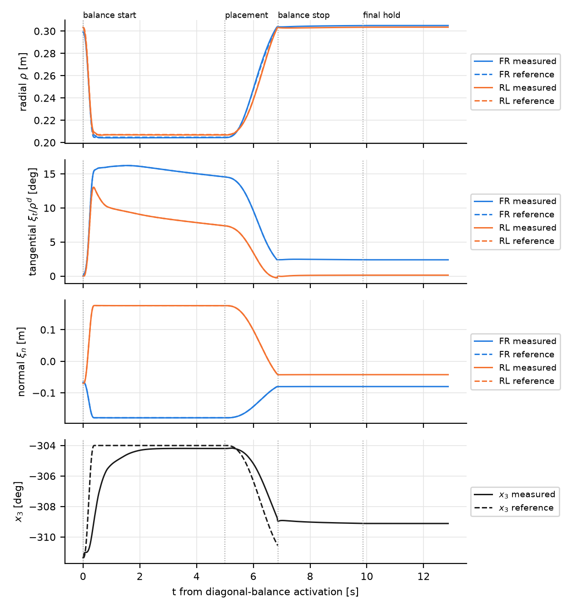
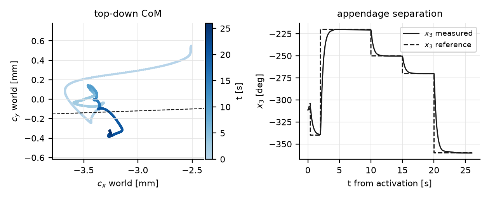
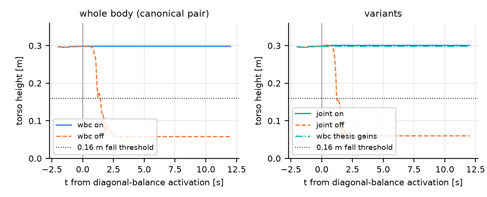
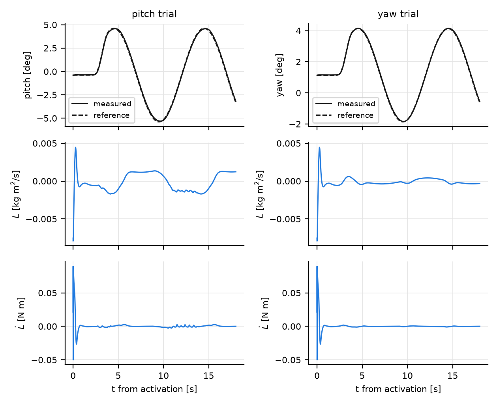
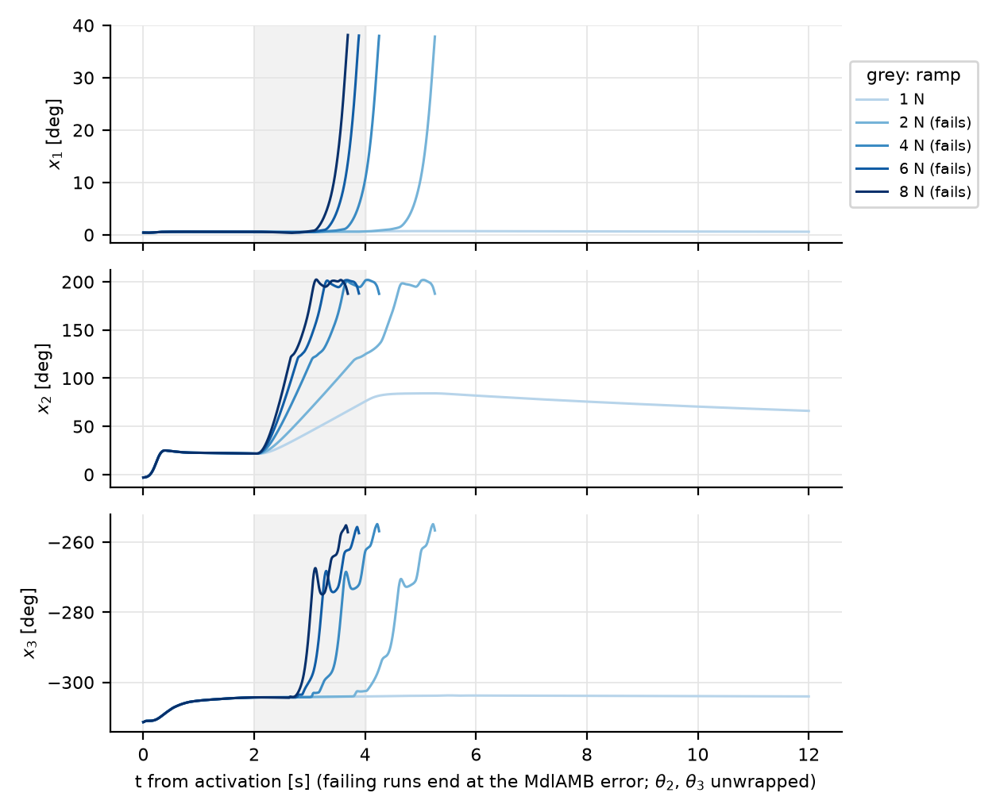
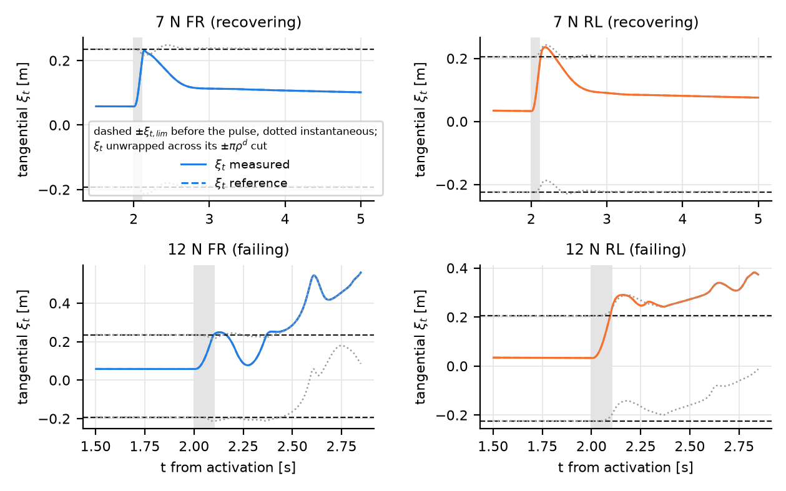
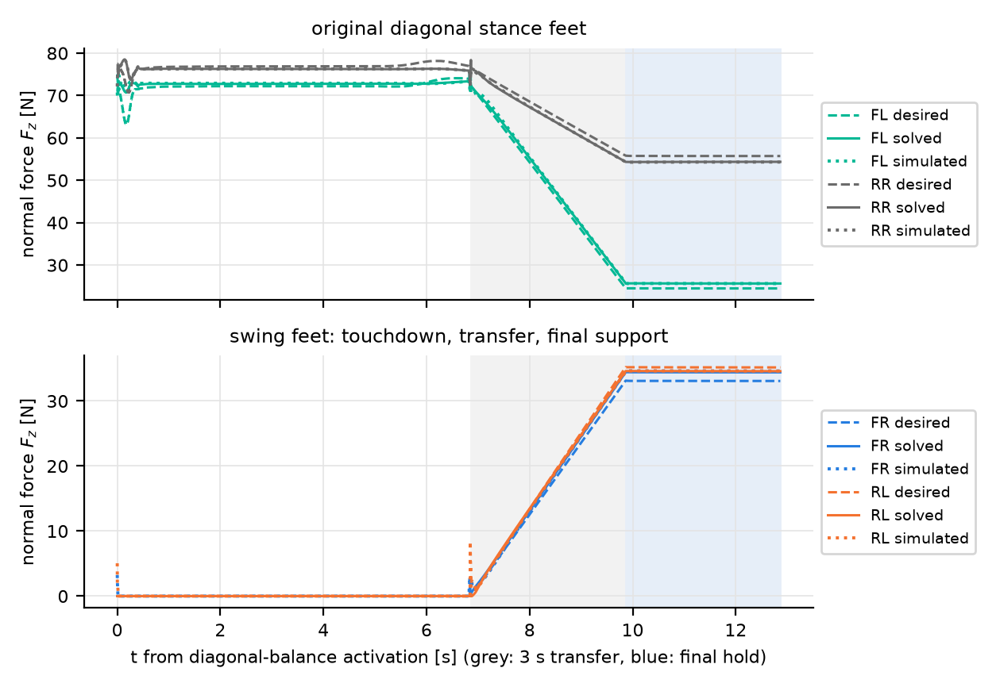

# Angular-momentum balancing as a whole-body task on the Go2 (thesis Chapter 6)

*Report on the whole-body realization of MdlAMB in quadcontrol and on the thesis Sec. 6.6 experiments, simulation only. Results: `reports/amb_wbc/results.json`, written 2026-11-26 13:06 by `figs/amb_wbc/run_experiments.py` (1 simulator runs, 8 s wall time). Thesis: Ozden (2026), Chapter 6.*

## 1. What this is and the outcome

MdlAMB balances the Go2 on its FL–RR diagonal by swinging the two free legs, FR and RL, under the reduced-order angular-momentum (AMB) law of the thesis. This work adds the thesis Chapter 6 realization of that law. The AMB output becomes a tangential acceleration of each swing foot in a hip-centred principal frame. A prioritized whole-body controller (WBC) realizes it together with body-orientation and body-position tasks, and a whole-body impulse-control QP (WBIC) resolves the floating-base dynamics against stance forces planned by the existing convex MPC. The earlier joint-space realization stays, selected by `[amb] wbc = false`. One script runs every Sec. 6.6 experiment headless in MuJoCo. The robot differs from the thesis model in ways that matter (rolling 22 mm sphere feet, real Go2 torque limits, a different entry posture, tuned AMB gains and a stiffer body-orientation gain), so the comparison is qualitative. The mechanism, the ablation, x<sub>3</sub> and orientation tracking and the load transfer reproduce the thesis' statements. The operating range does not: a persistent force is held only up to 1 N (thesis: 8 N), and the push boundary along the direction inferred from the thesis' figures is 9–10 N (thesis: 11–12 N; 11–12 N here along the opposite direction).

**Symbols.** L: whole-robot angular momentum about the FL–RR support line through the ground contact points [kg m²/s]. t<sub>h</sub>: horizontal unit normal of that line (here pointing to the robot's left). c<sub>x</sub>: horizontal offset of the centre of mass (CoM) from the line along t<sub>h</sub>. x<sub>1</sub> = θ<sub>1</sub>: template tip angle about the line; x<sub>2</sub> = θ<sub>2</sub> + θ<sub>3</sub> and x<sub>3</sub> = θ<sub>2</sub> − θ<sub>3</sub>: symmetric swing and separation of the two swing legs (θ<sub>2</sub>, θ<sub>3</sub> their template angles). ξ<sub>n</sub>, ρ, ξ<sub>t</sub>: normal, radial and tangential coordinates of a swing foot relative to its hip in the principal frame. Times are from MdlAMB activation, the hand-off from MdlDiagonalStance.

*Table 1. Sec. 6.6 experiments: gate, result, headline numbers here and in the thesis.*

| Experiment (thesis) | Gate | Result | Here | Thesis |
|---|---|---|---|---|
| Principal-frame tracking (6.6.2) | normal and radial errors bounded | pass | RMSE normal 0.16 mm, radial 0.50 mm (both legs); largest error 2.1 mm | RMSE normal 7.59 mm, radial 18.95 mm |
| x<sub>3</sub> tracking (6.6.3) | steady error below 5 deg on every step, no fall | pass | steady error at most 0.66 deg on the last 4 steps, 2.40 deg on the 1.6 s first step; no fall in 26 s | follows each step with a small offset (Fig. 6.4) |
| AMB ablation (6.6.4) | AMB on no fall ≥ 10 s, AMB off falls | pass | on: no fall in 12 s; off: falls at 1.436 s | on: no fall in 8.447 s; off: falls at 1.299 s |
| Orientation (6.6.5.1) | both sinusoids tracked, L bounded, no fall | pass | amplitude ratio 0.997 (pitch) / 1.000 (yaw), lag 0.053 / 0.036 s | ratio about 0.90 / 0.79 (peaks of Fig. 6.11) |
| Persistent force (6.6.5.2) | bounded for 2/4/6/8 N, or the boundary reported | pass via the 'boundary reported' clause; thesis result not reproduced | bounded at 1 N; falls at 2, 4, 6, 8 N | bounded at 2, 4, 6, 8 N |
| Push recovery (6.6.5.3) | boundary bracketed, WBC ≥ joint space, failure plotted vs workspace bounds | pass | +t<sub>h</sub>: WBC recovers up to 9 N, falls from 10 N; joint space up to 5 N, from 6 N. −t<sub>h</sub>: WBC up to 11 N, from 12 N | recovers up to 11 N, falls from 12 N (one direction) |
| Workspace limit (6.6.6) | failed push plotted against the tangential bounds | pass | 7 N recovers, 12 N fails by exhausted tangential travel, normal/radial errors 104–239 mm; recovering pushes from 6 N also pass the abduction stop | recovering case inside ±ξ<sub>t,lim</sub>, failing case crosses it with normal/radial collapse |
| Load transfer (6.6.7) | four-foot support, no fall, desired-vs-solved RMSE below 10 N | pass | four-foot support, no fall; worst per-foot desired−solved RMSE 1.39 N | worst per-foot RMSE 5.89 N |

**Code regression checks** (run by hand, not stored in results.json): ctest passes 20 of 20 tests, the pre-existing ones unchanged. With `amb.wbc = false` the headless 10 s balance log is identical, sample for sample (4674 samples), to the one recorded before any of this work: the joint-space path is untouched.

## 2. What was built

Thesis (6.10) runs once per 1 ms tick in `MdlAMB::computeTick`: (q, dq/dt, contact pair) → support line and template plane → reduced state (x, dx/dt, L, dL/dt) → template accelerations d²θ/dt² → swing-foot feedforward a<sub>f</sub> → swing-foot task command → WBIC (generalized acceleration, contact forces F<sub>c</sub>, torques τ). The first three arrows are MdlAMB code shared with the joint-space path: `project()` builds the support line from the FL and RR ground contact points, the template angles and the CoM offset; `robotMomentum()` gives L, with dL/dt = M g c<sub>x</sub> about the line and an external-torque observer; `ambLaw()` is the Chapter 4 law. From d²θ<sub>2</sub>/dt², d²θ<sub>3</sub>/dt² the two realizations part. In WBC mode `MdlAMB::_wbcTick` builds, per swing leg, the principal frame (6.13)–(6.16), the feedforward a<sub>f</sub> = ρ (d²θ/dt²) e<sub>t</sub> with its norm limit (6.18), the tangential pass-through ξ<sub>t</sub><sup>d</sup> = ξ<sub>t</sub> (6.23) and the desired foot position and velocity (6.20)–(6.25). It hands four tasks, in priority order body orientation, body position, FR foot, RL foot, to `QuadrupedWBC`. The stance-force objective F<sub>c</sub><sup>d</sup> comes from `MdlConvexMPC`, re-solved every 10th tick on the latched pose and clamped to 0.10 tangential over normal. `QuadrupedWBC` computes the task hierarchy (6.4)–(6.6), the WBIC QP (6.7)–(6.8) in qpOASES and the torque (6.9) on `QuadrupedDynamics`, an 18-DoF floating-base model whose contact Jacobian is that of a rolling sphere. Joint commands follow (6.28): stance legs track the WBC joint references under a 30/3 joint PD plus the WBIC torque; swing joints get the WBIC torque alone, plus cancellation of the simulator's joint damping and dry friction.

**Phases.** The Supervisor goes S_STAND → (key B) S_DIAG, where MdlDiagonalStance moves the load onto FL and RR, → S_AMB. MdlAMB lifts FR and RL over 0.4 s (quintic: normal and radial references to a lift target, x<sub>3</sub> reference to −304 deg) and balances. Key D requests a stop (WBC mode only, state S_AMB_STOPPING): the swing feet are placed over 2.5 s with AMB still acting; each foot becomes a WBC contact once its kinematic contact point is within 5 mm of the ground and no longer sinking faster than 1 cm/s; the desired normal forces then blend linearly over 3 s from the frozen two-foot plan to the four-foot MPC plan; after a 3 s four-foot hold MdlAMB reports SETTLED. FL and RR are then still on the centreline, so MdlDiagonalStance (state S_AMB_RETURN) steps all four feet, one at a time, back to the footprint the stand had before B, and the robot sits. Key R does the same and stays standing. In joint-space mode D and R sit at once, as before.

*Table 2. Thesis items and where they live.*

| Thesis | Implementation | Where |
|---|---|---|
| (6.1)–(6.2) floating-base dynamics, rigid contacts | M, h, foot, contact-point and hip Jacobians with their bias terms, CoM | `QuadrupedDynamics.hh/.cc` |
| (6.3)–(6.9) task feedback, hierarchy, WBIC QP, torque | dynamically consistent hierarchy and kinematic stage; QP over base-acceleration and force corrections with friction pyramid and normal-force bounds | `QuadrupedWBC.hh/.cc` |
| (6.10)–(6.12) signal path, support line, template plane | `computeTick`: project, L, ambLaw, d²θ/dt², then `_wbcTick` | `MdlAMB.cc` |
| (6.13)–(6.19) principal frame, arc coordinate, feedforward and norm limit | static helpers `principalFrame`, `tangentialArc`, `tangentialFeedforward` | `MdlAMB.hh/.cc` |
| (6.20)–(6.27) desired axes, pass-through, swing task | `swingReference`; task assembly in `_wbcTick` | `MdlAMB.cc` |
| (6.28) joint commands | per-leg MIT command, friction cancellation on the swing joints | `MdlAMB.cc` |
| F<sub>c</sub><sup>d</sup>, Sec. 6.4.3 force ratio | MPC grabbed as MdlTrot does; tangential clamp | `MdlConvexMPC` (unchanged), `MdlAMB.cc` |
| Sec. 6.5 feasibility diagnostics | logs `MdlAMB_wbc` (layout at `_logWbc`), `MdlAMB_tau`, closing messages (saturation, tick time) | `MdlAMB.hh/.cc` |
| Sec. 6.6 inputs | `x3_schedule`, `pitch_amp_deg`, `yaw_amp_deg`, `place_duration`; `push_ramp` | `amb.toml`, `simulation.toml`, `MdlSimDriver.cc` |
| Sec. 6.6.7 stop sequence | `stopBalancing()`, contact promotion, transfer blend; S_AMB_STOPPING | `MdlAMB.cc`, `Supervisor.cc` |
| Tests | model against MuJoCo; WBC invariants; full-rig balance, ablation, x<sub>3</sub> step, orientation, stop and transfer | `test_quadruped_dynamics`, `test_wbc`, `test_amb_wbc_sim` |
| Sec. 6.6 experiments | single entry point: runs, metrics, figures, this report | `figs/amb_wbc/run_experiments.py` |

## 3. Results

**Common setup.** Each run is one headless, non-real-time `bin/sim.sh` call with the key script S at 0 s and B at 2.5 s; MdlDiagonalStance hands over to MdlAMB at 7.104 s of simulation time in every run. Disturbances start 2 s after the hand-off. Logs are at 500 Hz. Torso state, CoM, L and c<sub>x</sub> are simulator truth (logged qpos and qvel through the MuJoCo model); reduced and principal-frame quantities are the controller's own log. Fall criteria, as Sec. 6.6.1: ablation torso height below 0.16 m; all other trials torso height below 0.16 m or |roll|/|pitch| above 45 deg. Pushes and persistent forces act at the base body's CoM along +t<sub>h</sub> = world (x, y) = (-0.0398, 0.9992), the sign for which thesis Fig. 6.18 shows L and dL/dt positive during the pulse. The support line runs 1.13 deg from body x.

### 3.1 Principal-frame tracking (Sec. 6.6.2, Fig. 6.3)

Applied: the stop sequence of Sec. 3.8 (balance 5 s, then D). During balance the normal and radial coordinates of both swing feet hold their references, and the tangential reference equals the measurement by construction (6.23), so the tangential panel shows the motion AMB commands. At the stop the normal reference returns to its hand-off value and the radial one rises to the ground. From the end of the lift to each foot's promotion the RMSE is 0.20 / 0.10 mm normal and 0.59 / 0.39 mm radial (FR / RL), largest error 2.1 mm; with the 0.4 s lift included, 0.23 / 0.33 mm and 0.68 / 0.58 mm. Thesis: 7.59 mm normal, 18.95 mm radial. Why smaller: the swing task here feeds the lift and placement ramps' reference rate and acceleration ((6.3)), which the thesis' held references do not need; before the acceleration term was added, RL's normal error peaked at 56.8 mm just after the lift.



*Fig. 6.3 counterpart: principal-frame coordinates of FR (blue) and RL (orange) and x<sub>3</sub> through balance, placement, promotion of both feet ('balance stop'), load transfer and final hold. Dashed: references, hidden once a foot is a contact.*

### 3.2 x<sub>3</sub> tracking (Sec. 6.6.3, Fig. 6.4–6.5)

Applied: the full thesis schedule as raw steps, -340 deg at 0.4 s, -220 deg at 2.0 s, -250 deg at 10.0 s, -270 deg at 15.0 s, -360 deg at 20.0 s. The lift itself ramps x<sub>3</sub> to −304 deg, so the thesis' first value is given at the end of the lift. x<sub>3</sub> follows every step; the steady error (mean over each step's last 1 s) is +2.40, -0.66, -0.33, -0.15, -0.22 deg. The first step lasts only 1.6 s and is still settling. No fall in 26 s; the CoM stays within 0.65 mm of the support line, the offset it starts with at the hand-off. The torso stays near its WBC references: largest deviation 0.32 mm in height, 0.47 deg roll, 0.03 deg pitch, 0.03 deg yaw. The roll deviation peaks at 21.2 s; the swing abduction ends 30.5 deg (+0.81 deg/s) from its stop. Thesis: an offset of about 1–2 deg and sub-degree, millimetre torso deviations. The offset is smaller here; the template masses and gains differ, and the cause was not investigated.



*Fig. 6.4 counterpart: top-down CoM path (colour: time) against the hand-off support line, and x<sub>3</sub> against the scheduled reference. Torso deviations: `figs/fig6_05_x3_torso.png`.*

### 3.3 AMB ablation (Sec. 6.6.4, Table 6.4, Fig. 6.7–6.8)

Applied: the same run with `amb.enabled = false`, which keeps the WBC, its hierarchy and the lift and removes the AMB feedforward and the tangential pass-through. AMB on stays up for the whole 12 s window; AMB off crosses 0.16 m at 1.436 s (thesis 1.299 s). The joint-space pair behaves the same way (on balances, off falls at 1.216 s). The AMB-on peaks of |L|, |c<sub>x</sub>| and angular speed are the values at the hand-off instant, the posture MdlDiagonalStance leaves; after the lift they are an order of magnitude smaller (0.0007 kg m²/s and 0.08 mm, from the wbc_on log). The thesis' peaks include its trot-to-balance transition, so the AMB-on rows are not comparable in size. The Table 6.2 AMB gains and template masses also balance over the 12 s window, with larger excursions (peak |L| 0.0174 against 0.0080 kg m²/s; a one-off 60 s run held, max |θ<sub>1</sub>| 0.66 deg against 0.30 deg). The tuned values stay: the joint-space path shares them.

**Is the balance a settled state?** The law feeds back L, its derivatives and x<sub>3</sub>; nothing in it restores x<sub>2</sub>, the symmetric swing. The measured lever is the trunk's orientation stiffness (probably: with the roll about the support line held, the CoM offset depends on x<sub>2</sub>, and regulating L then fixes it). With Table 6.2's body-orientation gains (100, 10) the roll yields and x<sub>2</sub> runs away slowly: 27, 57, 100 deg at 5, 20, 35 s, then the swing legs reach their stops and the robot falls at 44.4 s. With the default (400, 40) x<sub>2</sub> settles: 18.5, 12.2, 11.0 deg at the same times, no fall in 60 s, max |θ<sub>1</sub>| 0.30 deg, abduction margin at the end 53.4 deg (+0.00 deg/s); a one-off run held 120 s. From kp 200 up it settles; kd alone changes nothing. This is why the default departs from Table 6.2 (departure 6). At 12 s the default is still settling (x<sub>2</sub> rate -0.38 deg/s); the joint-space path does not move (-0.00 deg/s).

*Table 3. Table 6.4 metrics, AMB off and on, here (whole-body path) and in the thesis.*

| Metric | Off, here | Off, thesis | On, here | On, thesis |
|---|---|---|---|---|
| Fall detected | yes | yes | no | no |
| Time to fall [s] | 1.436 | 1.299 | – | – |
| Minimum torso height [m] | 0.0641 | 0.1595 | 0.2981 | 0.3026 |
| Peak \|roll\| [deg] | 179.80 | 29.66 | 0.12 | 1.89 |
| Peak \|pitch\| [deg] | 9.09 | 14.41 | 0.39 | 0.98 |
| Peak angular speed [rad/s] | 7.700 | 5.404 | 0.025 | 0.151 |
| Peak \|L\| [kg m²/s] | 4.6071 | 3.8300 | 0.0080 | 0.0352 |
| Peak \|c<sub>x</sub>\| [mm] | 216.64 | 176.90 | 0.65 | 2.45 |
| Observed duration [s] | 2.436 | 2.447 | 12.000 | 8.447 |



*Fig. 6.7 counterpart: torso height, whole-body pair (left) and the joint-space pair and Table 6.2 AMB gains (right); dotted: 0.16 m fall threshold. Top-down CoM: `figs/fig6_08_ablation_com.png`.*

### 3.4 Orientation commands (Sec. 6.6.5.1, Fig. 6.11–6.12)

Applied: 5 deg pitch and 3 deg yaw sinusoids at 0.1 Hz in separate runs, after a 2 s delay and a 2 s envelope, on the orientation task and on the MPC reference. The measured angle follows with amplitude ratio 0.997 and 1.000, lag 0.053 s and 0.036 s, tracking RMS 0.13 and 0.06 deg. During the sinusoids max |L| is 0.0017 and 0.0005 kg m²/s; no fall. Thesis: peaks 5.1 → 4.6 deg (pitch) and 2.9 → 2.3 deg (yaw), L within ±0.02 kg m²/s. Why better here: the MPC reference carries the sinusoid, and the orientation gain is four times the thesis' (with (100, 10) the ratios were 0.991 and 0.994, and 0.881 for pitch without the MPC reference). Abduction margin at the end 48.7 deg (-1.76 deg/s) and 47.1 deg (-1.99 deg/s); x<sub>2</sub> follows the sinusoid.



*Fig. 6.11 counterpart: pitch and yaw against their references, L and dL/dt (the early spike is the lift). Top-down CoM: `figs/fig6_12_orientation_com.png`.*

### 3.5 Persistent force (Sec. 6.6.5.2, Fig. 6.14–6.15)

Applied: 2, 4, 6, 8 N along +t<sub>h</sub>, a 2 s linear ramp from 2 s, held to 12 s; then 1 N steps below the first failure. Only 1 N stays bounded; 2, 4, 6, 8 N fall at 5.22, 4.21, 3.85, 3.65 s. Thesis: all four bounded. At 1 N the CoM settles at c<sub>x</sub> = -1.964 mm, the static requirement −F h/(M g) = -1.965 mm (h: height of the base CoM, where the force acts). The WBC holds the trunk pose, so this offset has to come from the swing legs, and they supply it by abduction: x<sub>2</sub> is at 67 deg over the last second, still moving at -2.21 deg/s, and the abduction margin at 12 s is 25.8 deg (+1.09 deg/s). In every failing run the swing abductions run into their ±60 deg stops (smallest joint-limit distance -0.017 rad: past the soft limit), then the trunk tips. Why: with the stance feet on the body centreline the support line is 1.1 deg from body x, so the swing feet's tangential channel is almost pure hip abduction, which moves the CoM little. With the trunk fixed, both abductions at −60 deg move c<sub>x</sub> by −4.30 mm (FR −0.19 mm, RL −4.11 mm) and at +60 deg by +6.85 mm (review check on an earlier run's posture), while 2 N needs 3.93 mm, 8 N needs 15.72 mm. For feet under the hips the thesis' diagonal would be about 36 deg from body x, which brings hip flexion in (a hypothesis, not re-derived). The stiffer orientation gain does not change this boundary. Along −t<sub>h</sub>, 2 N is bounded and 3 N fails (one-off runs).



*Fig. 6.14 counterpart: x<sub>1</sub>, x<sub>2</sub>, x<sub>3</sub> under the ramped forces (grey: ramp); failing runs end at MdlAMB's error, angles unwrapped across the θ branch cut (Sec. 5). Top-down CoM: `figs/fig6_15_force_com.png`.*

### 3.6 Push recovery (Sec. 6.6.5.3, Table 6.5, Fig. 6.16–6.18)

Applied: 0.1 s pulses along +t<sub>h</sub> at 2 s, from 1 N in 1 N steps to two past the first failure, on the whole-body and on the joint-space path; success is judged after the pulse; the same sweep along −t<sub>h</sub> is a side result. The WBC recovers up to 9 N and falls from 10 N; the joint-space path recovers up to 5 N and falls from 6 N. Along −t<sub>h</sub>: WBC 11 / 12 N, the thesis' boundary, joint space 9 / 10 N. No push above a first failure recovered. In the recovering cases near the boundary, max |L| is 0.18–0.24 kg m²/s (thesis 0.219–0.273) and the mean dL/dt during the pulse 1.8–2.4 N m (thesis about 3 N m). Why lower along +t<sub>h</sub>: probably the asymmetry of the abduction-only tangential channel (+6.85 / −4.30 mm above); +t<sub>h</sub> calls on the weaker side. The boundary is sensitive to the posture at the pulse: a 0.5 deg difference in abduction moved it by 1 N in an earlier build, and with the hand-off 0.5 s earlier (the autorun) 10 N recovers. Read it as ±1 N.

*Table 4. Table 6.5 quantities after the pulse (WBC, +t<sub>h</sub>) with the thesis rows, and success on the other sweeps; –: not sampled. Plots: `figs/table6_05_push_sweep.png` (both paths), `fig6_16_push_com_recovering.png`, `fig6_17_push_com_failing.png` (CoM paths), `fig6_18_push_dynamics.png` (v<sub>⊥</sub>, L, dL/dt of the recovering cases).*

| F [N] | max \|c<sub>x</sub>\| [mm] | max \|L\| [kg m²/s] | z<sub>min</sub> [m] | Success | Success −t<sub>h</sub> | Success joint | Thesis max \|c<sub>x</sub>\| [mm] | Thesis max \|L\| | Thesis z<sub>min</sub> [m] | Thesis success |
|---|---|---|---|---|---|---|---|---|---|---|
| 5 | 5.72 | 0.130 | 0.2980 | yes | yes | yes | – | – | – | – |
| 6 | 6.63 | 0.157 | 0.2981 | yes | yes | no | – | – | – | – |
| 7 | 7.25 | 0.183 | 0.2981 | yes | yes | no | – | – | – | – |
| 8 | 7.74 | 0.210 | 0.2981 | yes | yes | no | – | – | – | – |
| 9 | 8.17 | 0.237 | 0.2980 | yes | yes | – | 9.57 | 0.219 | 0.3066 | yes |
| 10 | 222.23 | 6.526 | 0.0718 | no | yes | – | 9.20 | 0.244 | 0.3066 | yes |
| 11 | 62.67 | 0.613 | 0.1305 | no | yes | – | 9.22 | 0.273 | 0.3017 | yes |
| 12 | 215.04 | 5.084 | 0.1393 | no | no | – | 201.82 | 4.754 | 0.1312 | no |
| 13 | – | – | – | – | no | – | 362.69 | 6.924 | 0.0874 | no |
| 14 | – | – | – | – | no | – | – | – | – | – |

### 3.7 Workspace limit (Sec. 6.6.6, Fig. 6.19–6.20)

Applied: the recovering push 2 N below the boundary (7 N) and the failing push 2 N above it (12 N), as the thesis pairs 9 and 14 N around its 11–12 N. The tangential bounds ±ξ<sub>t,lim</sub> come from MuJoCo forward kinematics of the logged posture with only that leg's abduction moved to its limits: FR [-0.192, 0.235] m, RL [-0.224, 0.205] m before the pulse (the thesis draws about ±0.5 m). The 12 N failure follows the thesis' mechanism, now with the logs the thesis lacked (its Sec. 6.7, limitation 4). In order: AMB feedforward norm-limited at 2.016 s (during the pulse), abduction within 0.01 rad of its stop at 2.092 s, ξ<sub>t</sub> past its bound at 2.096 s (RL) and 2.102 s (FR), torque saturation at 2.136 s, normal and radial errors growing to 104–239 mm, fall at 2.8 s, then MdlAMB's θ<sub>1</sub> guard at 2.849 s. The QP never failed. Unlike the thesis' recovering case, the recovering pushes here also use up the tangential travel: every WBC push from 6 to 9 N passes the ±60 deg stop (peak 62.4–66.2 deg; the simulator's joint limit is soft) and still recovers, and 7 N passes RL's ξ<sub>t</sub> bound at 2.126 s. Along +t<sub>h</sub> the 50 m/s² feedforward norm limit first acts at 10 N, the first failing push; but along −t<sub>h</sub> pushes of 8–11 N recover with it active, and raising it to 100 m/s² does not save 10 or 11 N (one-off diagnostic). The limit marks where failures start; it does not set the boundary.



*Fig. 6.19 counterpart: ξ<sub>t</sub> of FR and RL for the 7 N and 12 N pushes; dashed ±ξ<sub>t,lim</sub> before the pulse, dotted the instantaneous bound. Normal and radial channels: `figs/fig6_20_workspace_normal_radial.png`; abduction, feedforward status, QP status and torque: `figs/fig6_19b_workspace_diagnostics.png`.*

### 3.8 Load transfer (Sec. 6.6.7, Table 6.6, Fig. 6.21–6.22)

Applied: balance for 5 s, then D. Placement starts at 5.002 s, both feet are promoted ('balance stop') at 6.864 s, the final hold starts at 9.866 s and SETTLED comes at 12.864 s. The robot ends in four-foot support without falling; final simulated normal forces FL / FR / RL / RR 25.6 / 34.6 / 34.6 / 54.3 N, sum 149.2 N, weight 149.2 N. The worst per-foot desired−solved RMSE is 1.39 N (thesis 5.89 N), the worst desired−simulated RMSE 1.53 N. Final body-position RMSE: 0.43 mm in the controller's frame and 0.43 mm in simulator truth (thesis 7.13 mm, under its simulated-state override). Why the force errors are smaller: the thesis' desired forces are a pre-set ramp to equal shares, which its mean solved forces leave by 1.0–5.7 N; here the desired forces are the MPC's plan for the actual CoM and footholds, which the WBIC changes little. That is also why the final split here is unequal.

*Table 5. Table 6.6 normal forces [N]: means and RMSE here (desired, solved, simulated) and in the thesis (desired, solved).*

| Phase | Foot | Desired | Solved | Simulated | RMSE des−sol | RMSE des−sim | Thesis desired | Thesis solved | Thesis RMSE |
|---|---|---|---|---|---|---|---|---|---|
| transfer | FL | 48.45 | 49.41 | 49.63 | 1.00 | 1.27 | 55.24 | 58.42 | 3.38 |
| transfer | FR | 16.56 | 17.31 | 17.25 | 0.81 | 0.84 | 18.41 | 19.61 | 1.40 |
| transfer | RL | 17.65 | 17.48 | 17.41 | 0.29 | 0.42 | 18.41 | 16.22 | 2.57 |
| transfer | RR | 66.10 | 64.87 | 64.87 | 1.27 | 1.25 | 55.24 | 49.58 | 5.89 |
| final hold | FL | 24.50 | 25.66 | 25.65 | 1.17 | 1.15 | 36.83 | 37.83 | 1.00 |
| final hold | FR | 33.08 | 34.42 | 34.62 | 1.34 | 1.53 | 36.83 | 39.36 | 2.54 |
| final hold | RL | 35.17 | 34.59 | 34.61 | 0.58 | 0.56 | 36.83 | 32.37 | 4.46 |
| final hold | RR | 55.74 | 54.35 | 54.29 | 1.39 | 1.44 | 36.83 | 34.07 | 2.76 |



*Fig. 6.21 counterpart: desired (dashed), solved (solid) and simulated (dotted) normal forces; grey: 3 s transfer, blue: final hold. Body position and roll: `figs/fig6_22_body.png`.*

## 4. Departures from the thesis

1. **Feet.** The Go2 model's 22 mm sphere feet roll; contacts, the support line and L are taken at the ground contact points. The thesis treats point feet. Numbers are compared qualitatively.
2. **Entry.** MdlDiagonalStance puts FL and RR on the body centreline (support line 1.13 deg from body x) and MdlAMB lifts FR and RL over 0.4 s; the thesis hands over from a trot. Disturbances start 2 s after the hand-off (the thesis' 5.5 s warm-up less its ≈3.5 s balance start).
3. **State.** Base position and velocity come from the planted stance feet. Attitude and body rate come from MdlOrientationEstimator, which in the default configuration (`[orientationestimator] use_ground_truth = true`) hands out the simulator's own, so every run here is free of sensor noise, like the thesis' simulated-state override. With `use_ground_truth = false` (Mahony filter on the noisy simulated IMU) one-off runs balanced for 23 s and completed the stop, with 0.44 deg rms of swing-abduction jitter; the joint-space path fell 7.4 s after the hand-off.
4. **Period and torque.** 1 ms control period (thesis 2 ms); the real Go2 torque limits 23.7 / 23.7 / 45.43 N m (thesis 65 N m).
5. **AMB gains and template masses.** Tuned (950, 360, 41) and momentum-matched masses (14.954, 0.2296, 0.0594 kg) instead of Table 6.2's (−3430, −1470, −210) and (10.5, 2.26, 2.26 kg). The thesis values were run and balance too, with larger excursions (Sec. 3.3); the tuned ones stay because the joint-space path shares them. The code's law takes the gains as magnitudes.
6. **Body-orientation gains.** (400, 40) instead of Table 6.2's (100, 10): with the thesis values the balance diverges slowly and falls 44.4 s after the hand-off; with the default it settles (Sec. 3.3). The other WBC gains are Table 6.2's. Every experiment here runs with (400, 40).
7. **Not implemented.** Pair switching (FL–RR only); the stance-foot horizontal anti-slip action of Sec. 6.4.3 (stance legs follow the WBC joint references under the 30/3 joint PD instead); the Chapter 5 vertical-acceleration bound (Table 6.2: 'when enabled').
8. **Swing joints.** The simulator model's joint damping and dry friction (0.2 N m s/rad, 0.2 N m) are cancelled in the swing commands, and the swing kd is 0.001 instead of 0 because the simulator replaces kd ≤ 0 with 5 N m s/rad.
9. **Swing task during ramps.** In the lift and placement the task uses the ramped ξ<sub>n</sub><sup>d</sup>, ρ<sup>d</sup> with their rates and the reference acceleration of (6.3), and ρ<sup>d</sup> in (6.20); the thesis holds these references. Without the acceleration term RL's normal error after the lift was 56.8 mm.
10. **AMB-off ablation.** Same WBC, hierarchy and lift; the AMB feedforward and the tangential pass-through (6.23) are removed and the swing task holds the tangential channel at the lift target's angle. The thesis says only that the run removes the tangential balance acceleration.
11. **Disturbance direction.** +t<sub>h</sub>, the sign of thesis Fig. 6.18 (L, dL/dt positive in the pulse) and Fig. 6.15 (CoM leaning to −t<sub>h</sub> under the ramp); the thesis says only 'support-normal'. The −t<sub>h</sub> push sweep is a side result.
12. **x<sub>3</sub> schedule.** The lift ramps x<sub>3</sub> to −304 deg, so the thesis' first value (−340 deg) is a schedule entry at 0.4 s; schedule times count from MdlAMB activation.
13. **Orientation input.** Quintic envelope (the thesis does not give its shape); the reference rate feeds the orientation task and the MPC reference; no feedforward acceleration (measured to make no difference).
14. **Stop sequence.** The radial placement reference ramps to the radius that puts the contact point 10 mm into the ground along the current radial axis, not back to the hand-off radius, because x<sub>2</sub> does not return to its hand-off value (the literal target left FR 19.5 mm above the ground in an earlier build). Promotion is kinematic (within 5 mm of the ground, sinking at most 1 cm/s; the thesis gives no criterion). The MPC adds the former swing feet at the second touchdown, so the first-promoted foot is a WBC contact with zero desired force for some tens of ms (25 ms in the transfer run). The final split is the four-foot MPC plan, not equal shares.
15. **Return to the stand.** Not in the thesis, whose trot host needs none. After SETTLED, MdlDiagonalStance steps each foot to the spot it had under the body before B. The swing feet land wherever the balance left them, so each body shift is planned from the feet as found: to the nearest point 5 cm inside the triangle of the other three feet, the foot needing the shortest shift first. In the transfer run the return ends 21.1 s after the hand-off with every foot within 13 mm of its stand spot and roll and pitch below 3.4 deg. Fewer than three feet carry load for 16 ms in all, at the last touchdown; the least-loaded supporting foot carries about 10 N during the steps, as on the way in.
16. **Metrics.** Table 6.6's 'total' RMSE is not defined in the thesis; pooled and summed-force RMSE are in results.json. ξ<sub>t,lim</sub> is computed by forward kinematics with only the abduction moved to its limits, at the held radius.

## 5. Open issues and limits

1. **MPC solve time against the 1 ms period (needs a decision).** Two-foot MPC re-solves (every 10th tick) take about 0.75 ms on average and up to 1.0–1.4 ms, the same cost MdlTrot pays; this is accepted. With four contacts (load transfer and final hold, 6 s per stop) they take 2.0–2.2 ms on average with peaks of 6.2–6.6 ms in the first ≈0.15 s after the contact switch (test-rig instrumentation). From the runs' closing lines: computeTick mean 136–201 µs over all ticks; max 0.91–1.49 ms in balanced two-foot runs, 2.59 ms in the transfer run, up to 4.34 ms in runs that fall. Timing varies between identical runs, and headless non-real-time runs hide overruns; on hardware the four-foot solve would miss deadlines.
2. **Dependence on cancelling joint friction.** Balance needs the swing joints' simulated damping and dry friction cancelled: uncancelled, the swing legs creep into the hip-roll stop and the robot falls 4.6 s after the hand-off (one-off run). An error of ±0.2 N m in the cancelled friction also made it fall in an earlier build. Real joint friction is unknown and will differ.
3. **Operating range.** Persistent force bounded only up to 1 N and the push boundary 9–10 N along +t<sub>h</sub> (Sec. 3.5–3.7). The measured cause is the little CoM authority of an abduction-only tangential channel in the centreline stance. Reaching the thesis' range needs a structural change (a wider diagonal from MdlDiagonalStance, or trunk tasks that yield about the support line), not a gain.
4. **x<sub>2</sub> has no restoring action of its own.** It settles only through the trunk's orientation stiffness (Sec. 3.3), slowly (about 20 s), and a 'no fall' or 'bounded' verdict over a window is not by itself a settled state. Abduction margin at the end of each window (rate; +: moving away from the stop): ablation, AMB on, 12 s 51.8 deg (+0.20 deg/s); the same, 60 s 53.4 deg (+0.00 deg/s); x3 schedule 30.5 deg (+0.81 deg/s); pitch 48.7 deg (-1.76 deg/s); yaw 47.1 deg (-1.99 deg/s); 1 N force 25.8 deg (+1.09 deg/s); 8 N push 36.8 deg (+1.37 deg/s); ablation, joint space 46.2 deg (+0.00 deg/s). The joint-space path shows no such motion; why was not investigated. An x<sub>2</sub> term in the law would be an addition to the thesis (decision).
5. **Branch cut in the reduced state.** θ<sub>2</sub>, θ<sub>3</sub> (and ξ<sub>t</sub>) jump by 2π when a swing leg passes straight up. In the logged runs this happens only after divergence, 0.61–0.61 s before the fall. Not fixed; it would matter if a recovery ever passed through that posture.
6. **Rig-only light contact.** In `test_amb_wbc_sim` the promoted FR's contact point reads up to 3.2 mm above the ground while the QP asks it for up to 2.1 N more than the simulator gives; the full stack does not show this. A per-foot minimum normal force in QuadrupedWBC would probably prevent it (decision).
7. **Hardware-dependent thresholds.** The touchdown criterion (5 mm, 1 cm/s) was set from MuJoCo soft-contact readings and needs checking on the robot.
8. **Test coverage.** `test_amb_wbc_sim` has no push block, and the stop sequence's failure paths (a foot that never lands fails the tick; a stop during the lift waits for its end) were checked only in one-off full-stack runs.
9. **Joint-space stop.** D still sits at once and the swing feet drop; a sit after a balance ending near the abduction stops failed in an earlier stage. The stop sequence fixes this in WBC mode only.
10. **Scope.** Simulation only, one diagonal, one direction per sweep (plus the −t<sub>h</sub> side result). Runs repeat but not bit for bit: in a repeat of the whole set every gate and boundary was the same and the metrics agreed to about three digits (the hand-off can land 1 ms apart); computeTick timing varied.

## 6. Reproduction

From the repository root; one simulator at a time (it binds a fixed port; the script refuses to start while another `simulation` process runs).

```bash
cd /home/ege/legged/iros/project
# all Sec. 6.6 experiments, headless, then results.json, figures and this report
/home/ege/legged/iros/.venv/bin/python figs/amb_wbc/run_experiments.py
# a subset, merged into the existing results.json (names: ablation transfer x3
# orientation force push workspace); --out DIR writes runs/, results.json, figs/ under DIR
/home/ege/legged/iros/.venv/bin/python figs/amb_wbc/run_experiments.py --only push workspace
# this report alone, from the existing results.json and figures (no simulation)
/home/ege/legged/iros/.venv/bin/python figs/amb_wbc/build_report.py

# build, install (needed before running from bin/), tests
cmake --build build -j 12 && cmake --install build
cd build && ctest --output-on-failure
# one headless balance with the autorun (stand, diagonal stance, balance, stop, sit)
cd ../bin && ./sim.sh -c "simulation.headless = true" -c "simulation.realtime = false" \
                      -c "supervisor.autorun_amb_duration = 10" < /dev/null
```

**Interactive.** `cd bin && ./sim.sh`, then keys in the terminal or the simulator window: S (stand; wait for it to settle), B (diagonal stance, which hands over to balancing by itself 4.6 s later), P in the simulator window (push: `simulation.push_force` for `push_duration`, ramped over `push_ramp`), D (WBC: place the feet, transfer the load, step back to the stand's footprint, sit; R: the same, but stay standing; joint space: sit), Q (quit). Useful overrides: `-c "amb.wbc = false"` (joint-space path), `-c "amb.enabled = false"` (ablation), `-c "amb.x3_schedule = [[0.4, -340.0], [2.0, -220.0]]"`, `-c "amb.pitch_amp_deg = 5"`, `-c "simulation.push_ramp = 2"`.

**Outputs.** Logs: `runs/amb_wbc/<experiment>/<run>.mat` and `.log` (500 Hz Supervisor logs and the simulator's stdout; layouts of `MdlAMB_state` and `MdlAMB_wbc` at `_log` and `_logWbc` in `include/quadruped/MdlAMB.hh`). Results: `reports/amb_wbc/results.json` (metrics, thesis values where stored, gates). Figures: `reports/amb_wbc/figs/*.png`, named after the thesis figure or table they reproduce. Report: `reports/amb_wbc/REPORT.md` and `REPORT.pdf`, both from `figs/amb_wbc/build_report.py`.
