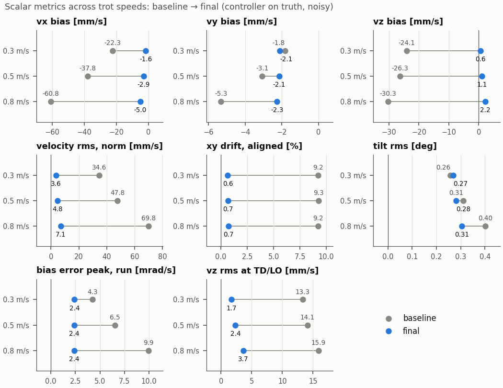
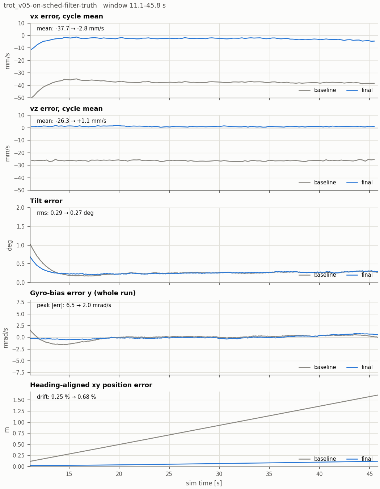
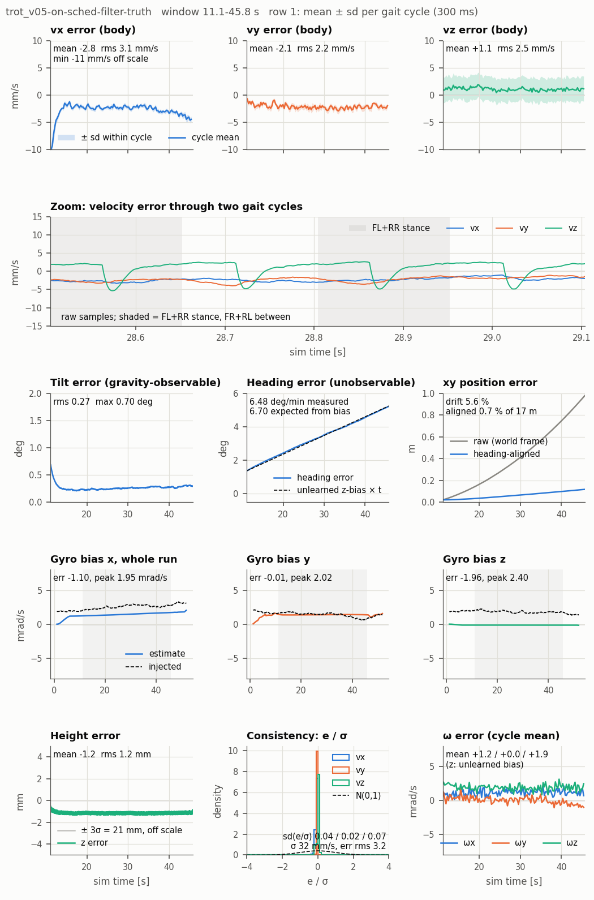
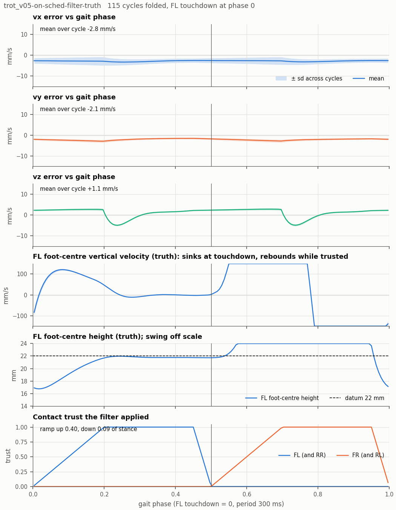
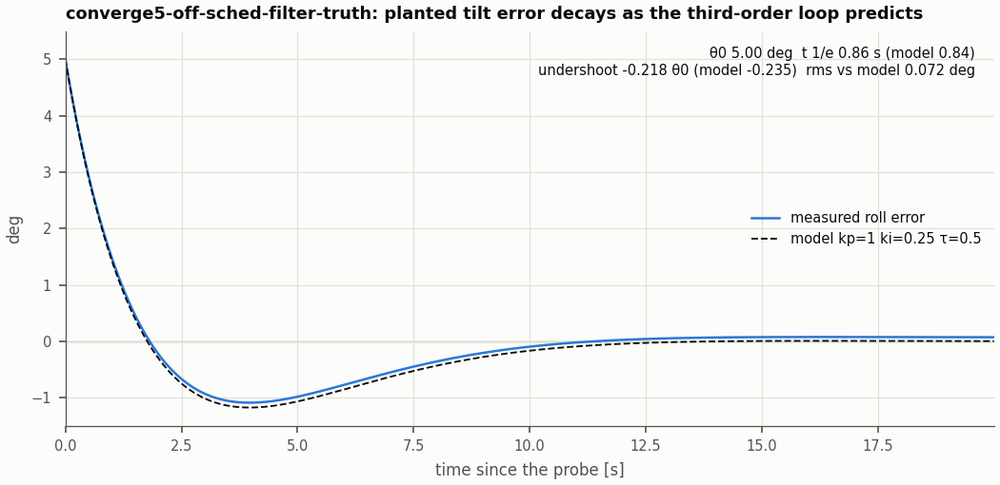
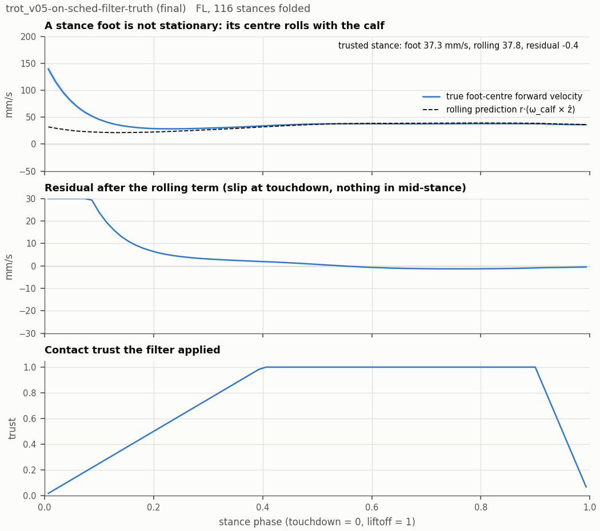
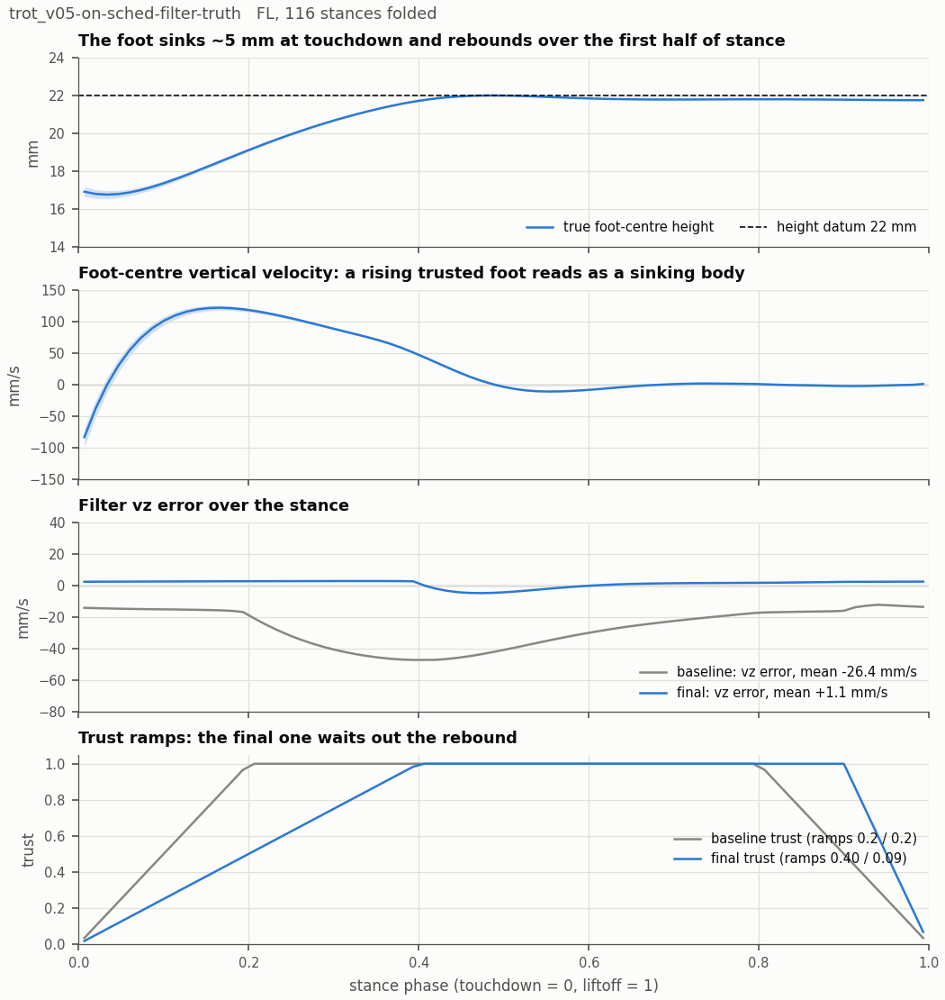
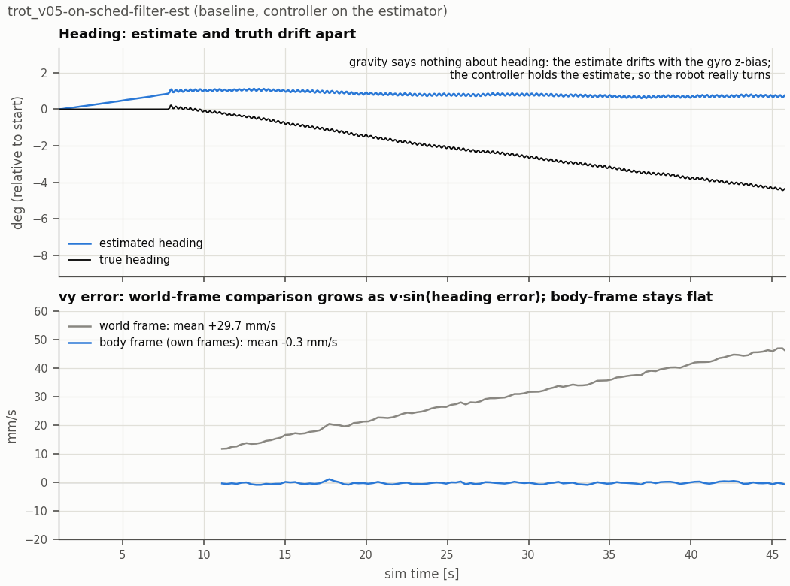

# State estimator: audit, benchmark and fixes (2026-11-08)

Branch `amb`, uncommitted. Benchmark: `figs/.venv/bin/python figs/estimation/estbench.py all`
(31 headless runs, ≈7 min). Report generated 2026-11-08T20:35.

## 1. Summary

The estimator (`MdlOrientationEstimator`, Mahony; `MdlPosVelEstimator`, MIT-Cheetah 18-state KF) was
instrumented, benchmarked against simulator truth, audited choice by choice (60 critique rows, 26
adversarial verifications), and fixed where a defect was measured. All numbers below are from the
in-module, same-tick comparison with simulator truth; velocities are body-frame, each in its own frame.

What was actually wrong, in order of size (0.5 m/s trot, controller on truth):

| defect | mechanism | baseline → final |
|---|---|---|
| forward velocity bias | the FK foot point is the 22 mm sphere centre; in stance it rolls with the calf (ω_calf ≈ 1.5 rad/s → +33 mm/s) while the KF assumed a stationary point | vx bias -37.8 → -2.9 mm/s; aligned xy drift 9.25 → 0.68 % |
| vertical velocity bias | the compliant foot sinks ~5 mm after touchdown and rebounds at up to +110 mm/s until ~45 % of stance, while the symmetric 20 % trust ramp (a gate at H = 100) already trusted it | vz bias -26.3 → 1.1 mm/s; vz rms at transitions 14.1 → 2.4 mm/s |
| gyro-bias kicks | fore-aft acceleration at trot start/stop tilts the low-passed gravity reference by a/g without changing |a|, so the magnitude band never engaged and ki = 0.25 integrated 6–10 mrad/s | peak bias error y 6.20 → 0.50 mrad/s (zero noise); tilt max over run 1.60 → 1.36 ° |
| tilt while turning | centripetal ω×v read as 0.5° of roll | tilt rms turning 0.70 → 0.27 ° |
| sim accelerometer | the explicit `qacc` is not the acceleration MuJoCo's implicit-damping Euler step integrates: −0.015 m/s² mean error, 0.09° steady pitch | tilt rms zero-noise trot 0.16 → 0.09 ° |
| "vy diverging" | not an estimator fault: the heading is unobservable, the controller holds the *estimated* heading, so the robot really turns and a world-frame velocity comparison grows with the yaw error | body-frame vy bias was -3.1 mm/s all along; heading drift 7.07 °/min = integral of the unlearned z-bias (7.06 °/min) |

Against the four requested outcomes (see §4 for the full table): velocity errors are bounded and within
±3 mm/s (x, y) and ±1 mm/s (z) at 0.5 m/s with and without noise; angular-velocity error is the gyro noise
plus < 1 mrad/s of bias error on x/y (z carries the unobservable bias); the gyro bias learns standing with
no kick at transitions; roll/pitch error is bounded (0.09° rms zero-noise, 0.28° noisy of which 0.165° is the
unestimated accelerometer bias) with no drift; heading drifts at exactly the unlearned z-bias rate.


*Scalar metrics across trot speeds, baseline (grey) to final (blue); controller on truth, simnoise on.*


*Trot 0.5 m/s, noisy: the same quantities before (grey) and after (blue) the fixes. Velocity errors are per-gait-cycle means in the body frame.*


## 2. Before / after, key scenarios

### 2.1 Trot 0.5 m/s, simnoise on, controller on truth (`trot_v05-on-sched-filter-truth`)
| metric | baseline | final |
|---|---|---|
| tilt rms [°] | 0.31 | 0.28 |
| tilt max, whole run [°] | 1.60 | 1.36 |
| heading drift [°/min] | 6.51 | 6.48 |
| expected from unlearned z-bias [°/min] | 6.74 | 6.71 |
| gyro-bias error, steady x/y/z [mrad/s] | 0.15 / 0.37 / -1.89 | -0.97 / 0.50 / -1.91 |
| gyro-bias error, peak over run x/y/z [mrad/s] | 1.61 / 6.54 / 2.42 | 1.57 / 1.35 / 2.40 |
| ω error mean x/y/z [mrad/s] | 0.12 / 0.05 / 1.94 | 1.16 / 0.04 / 1.94 |
| velocity bias x/y/z, body frame [mm/s] | -37.8 / -3.1 / -26.3 | -2.9 / -2.1 / 1.1 |
| velocity rms x/y/z [mm/s] | 37.9 / 3.2 / 28.9 | 3.4 / 2.2 / 2.5 |
| velocity rms at touchdown/liftoff x/y/z [mm/s] | 39.4 / 3.4 / 14.1 | 3.1 / 2.0 / 2.4 |
| velocity rms mid-stance x/y/z [mm/s] | 37.5 / 3.1 / 31.5 | 3.5 / 2.3 / 2.5 |
| xy drift, raw [% of path] | 10.76 | 5.64 |
| xy drift, heading-aligned [% of path] | 9.25 | 0.68 |
| z rms [mm] | 1.8 | 1.2 |
| z mean [mm] | -1.8 | -1.2 |
| NEES v raw | 2.61 | 0.02 |
| NEES v centred | 0.17 | 0.01 |
| NIS v | 0.035 | 0.003 |
| true vx − command, closed loop [mm/s] | -17.5 | -16.6 |
| fall | no | no |

### 2.2 Trot 0.5 m/s, zero noise (`trot_v05-off-sched-filter-truth`)
| metric | baseline | final |
|---|---|---|
| tilt rms [°] | 0.16 | 0.09 |
| tilt max, whole run [°] | 1.51 | 1.44 |
| heading drift [°/min] | -0.00 | 0.00 |
| expected from unlearned z-bias [°/min] | -0.00 | 0.00 |
| gyro-bias error, steady x/y/z [mrad/s] | -0.00 / -0.00 / 0.00 | 0.00 / -0.21 / 0.00 |
| gyro-bias error, peak over run x/y/z [mrad/s] | 0.33 / 6.20 / 0.01 | 0.02 / 0.50 / 0.00 |
| ω error mean x/y/z [mrad/s] | 0.00 / 0.21 / -0.00 | -0.00 / 0.25 / -0.00 |
| velocity bias x/y/z, body frame [mm/s] | -37.6 / 0.0 / -27.7 | -2.7 / 0.0 / -0.3 |
| velocity rms x/y/z [mm/s] | 37.7 / 0.2 / 30.1 | 3.2 / 0.1 / 2.4 |
| velocity rms at touchdown/liftoff x/y/z [mm/s] | 39.2 / 0.2 / 15.6 | 2.9 / 0.1 / 1.1 |
| velocity rms mid-stance x/y/z [mm/s] | 37.3 / 0.1 / 32.8 | 3.3 / 0.1 / 2.6 |
| xy drift, raw [% of path] | 9.24 | 0.68 |
| xy drift, heading-aligned [% of path] | 9.24 | 0.68 |
| z rms [mm] | 1.9 | 1.3 |
| z mean [mm] | -1.9 | -1.3 |
| NEES v raw | 2.67 | 0.02 |
| NEES v centred | 0.17 | 0.01 |
| NIS v | 0.036 | 0.004 |
| true vx − command, closed loop [mm/s] | -16.8 | -17.3 |
| fall | no | no |

### 2.3 Closed loop: controller on the estimator, 0.5 m/s, noisy (`trot_v05-on-sched-filter-est`)
| metric | baseline | final |
|---|---|---|
| tilt rms [°] | 0.32 | 0.28 |
| tilt max, whole run [°] | 1.81 | 1.42 |
| heading drift [°/min] | 6.51 | 6.48 |
| expected from unlearned z-bias [°/min] | 6.74 | 6.71 |
| gyro-bias error, steady x/y/z [mrad/s] | 0.16 / 0.36 / -1.91 | -0.97 / 0.50 / -1.91 |
| gyro-bias error, peak over run x/y/z [mrad/s] | 1.61 / 7.09 / 2.41 | 1.58 / 1.35 / 2.40 |
| ω error mean x/y/z [mrad/s] | 0.12 / 0.08 / 1.94 | 1.16 / 0.04 / 1.94 |
| velocity bias x/y/z, body frame [mm/s] | -41.4 / -0.3 / -23.7 | -2.9 / -2.2 / 0.9 |
| velocity rms x/y/z [mm/s] | 41.5 / 0.6 / 26.5 | 3.4 / 2.3 / 2.5 |
| velocity rms at touchdown/liftoff x/y/z [mm/s] | 42.7 / 0.7 / 14.0 | 3.1 / 2.0 / 2.2 |
| velocity rms mid-stance x/y/z [mm/s] | 41.1 / 0.6 / 28.8 | 3.5 / 2.3 / 2.5 |
| xy drift, raw [% of path] | 10.76 | 5.63 |
| xy drift, heading-aligned [% of path] | 9.29 | 0.67 |
| z rms [mm] | 1.7 | 1.2 |
| z mean [mm] | -1.7 | -1.2 |
| NEES v raw | 2.77 | 0.02 |
| NEES v centred | 0.17 | 0.01 |
| NIS v | 0.028 | 0.003 |
| true vx − command, closed loop [mm/s] | 26.7 | -13.9 |
| fall | no | no |

### 2.4 Turning trot 0.3 m/s, 0.3 rad/s (`trot_yaw-on-sched-filter-truth`)
| metric | baseline | final |
|---|---|---|
| tilt rms [°] | 0.70 | 0.27 |
| tilt max, whole run [°] | 1.14 | 0.86 |
| gyro-bias error, steady x/y/z [mrad/s] | -0.35 / -2.97 / -1.94 | -1.34 / 0.23 / -1.91 |
| gyro-bias error, peak over run x/y/z [mrad/s] | 4.21 / 7.57 / 2.47 | 1.93 / 1.35 / 2.40 |
| ω error mean x/y/z [mrad/s] | 1.18 / 3.19 / 1.99 | 1.41 / 0.19 / 1.94 |
| velocity bias x/y/z, body frame [mm/s] | -21.6 / -10.9 / -21.5 | -2.9 / -0.0 / 0.8 |
| velocity rms x/y/z [mm/s] | 21.7 / 11.1 / 23.7 | 3.0 / 0.9 / 2.0 |

### 2.5 Standing 60 s, noisy (`stand60-on-sched-filter-truth`)
| metric | baseline | final |
|---|---|---|
| tilt rms [°] | 0.18 | 0.18 |
| tilt slope [°/min] | -0.052 | -0.045 |
| heading drift [°/min] | 7.08 | 7.07 |
| expected from unlearned z-bias [°/min] | 7.07 | 7.06 |
| gyro-bias error, steady x/y/z [mrad/s] | -0.23 / -0.22 / -1.84 | -0.23 / -0.22 / -1.84 |
| ω error mean x/y/z [mrad/s] | 0.37 / -0.01 / 2.03 | 0.32 / 0.02 / 2.04 |
| velocity bias x/y/z, body frame [mm/s] | 0.1 / -0.2 / 0.8 | 0.1 / -0.2 / 0.8 |
| z rms [mm] | 1.5 | 1.5 |


*Per-run story of the final estimator at 0.5 m/s (noisy, controller on truth): cycle-mean velocity error, a two-cycle zoom, tilt and heading error, gyro bias estimate vs injected, height error and the normalised-error histogram.*


*The same run folded on the gait cycle (FL touchdown at phase 0): where in the cycle the error lives, what the foot does, and the trust the filter applied.*


### 2.6 Convergence probe (5° roll error planted while standing, zero noise)
Measured against the linearised third-order loop e' = −kp(e−r) − b, b' = ki(e−r), r' = −r/τ − b (the gravity
reference is transported with the bias-corrected rate, which makes the loop third-order; the textbook
second-order model predicts a 13.5 % undershoot, the real loop 23.5 %):

| | measured | model |
|---|---|---|
| t 1/e [s] | 0.86 | 0.84 |
| t 10 % [s] | 1.48 | 1.44 |
| undershoot [θ0] | -0.218 | -0.235 |
| rms vs model [°] | 0.072 | |


*Planted 5° roll error against the third-order loop model.*


### 2.7 Stage-by-stage progression (`trot_v05-on-sched-filter-truth`)
| stage | tilt rms ° | tilt max run ° | bias peak y mrad/s | bias steady x mrad/s | vx mm/s | vy | vz | vz rms transitions | aligned drift % | z mean mm | NEES c | fall |
|---|---|---|---|---|---|---|---|---|---|---|---|---|
| baseline | 0.31 | 1.60 | 6.54 | 0.15 | -37.8 | -3.1 | -26.3 | 14.1 | 9.25 | -1.8 | 0.17 | no |
| bench2 | 0.31 | 1.60 | 6.54 | 0.15 | -37.8 | -3.1 | -26.3 | 15.3 | 9.25 | -1.8 | 0.17 | no |
| fix7 | 0.25 | 1.60 | 6.44 | 0.15 | -37.5 | -3.0 | -26.3 | 16.4 | 9.20 | -1.8 | 0.15 | no |
| fix1 | 0.25 | 1.60 | 6.44 | 0.15 | -4.6 | -0.5 | -26.1 | 16.0 | 2.18 | -1.8 | 0.15 | no |
| fix2b | 0.29 | 1.36 | 1.38 | -0.97 | -4.4 | -2.2 | -26.0 | 15.9 | 2.16 | -1.8 | 0.15 | no |
| fix3 | 0.29 | 1.36 | 1.38 | -0.97 | -2.9 | -2.5 | 1.1 | 2.5 | 0.68 | -1.1 | 0.01 | no |
| fix456 | 0.28 | 1.36 | 1.35 | -0.97 | -2.9 | -2.1 | 1.1 | 2.5 | 0.68 | -1.2 | 0.01 | no |
| final | 0.28 | 1.36 | 1.35 | -0.97 | -2.9 | -2.1 | 1.1 | 2.4 | 0.68 | -1.2 | 0.01 | no |

- `baseline`: unfixed estimator, Phase-0 instrumentation
- `bench2`: benchmark metric fixes only (no estimator change)
- `fix7`: sim accelerometer = Δv/dt (MdlSimDriver)
- `fix1`: rolling-foot velocity rows + foot states rolled along
- `fix2b`: soft gyro-bias gate (ki/20 while moving)
- `fix3`: asymmetric trust ramp 0.4/0.1, high_suspect_number 1000
- `fix456`: centripetal compensation, truth-tier velocity, oracle hysteresis, comments, sim initial pose
- `final`: full matrix on the final code

Zero-noise run (`trot_v05-off-sched-filter-truth`):
| stage | tilt rms ° | tilt max run ° | bias peak y mrad/s | bias steady x mrad/s | vx mm/s | vy | vz | vz rms transitions | aligned drift % | z mean mm | NEES c | fall |
|---|---|---|---|---|---|---|---|---|---|---|---|---|
| baseline | 0.16 | 1.51 | 6.20 | -0.00 | -37.6 | 0.0 | -27.7 | 15.6 | 9.24 | -1.9 | 0.17 | no |
| bench2 | 0.16 | 1.51 | 6.20 | -0.00 | -37.6 | 0.0 | -27.7 | 16.7 | 9.24 | -1.9 | 0.17 | no |
| fix7 | 0.14 | 1.57 | 6.10 | -0.00 | -37.4 | 0.0 | -27.4 | 17.6 | 9.19 | -1.9 | 0.15 | no |
| fix1 | 0.14 | 1.57 | 6.10 | -0.00 | -4.5 | 0.0 | -27.3 | 17.5 | 2.19 | -1.9 | 0.15 | no |
| fix2b | 0.09 | 1.44 | 0.50 | 0.00 | -4.4 | 0.0 | -27.7 | 17.8 | 2.18 | -1.9 | 0.15 | no |
| fix3 | 0.09 | 1.44 | 0.50 | 0.00 | -2.7 | 0.0 | -0.2 | 1.2 | 0.68 | -1.3 | 0.01 | no |
| fix456 | 0.09 | 1.44 | 0.50 | 0.00 | -2.7 | 0.0 | -0.3 | 1.1 | 0.68 | -1.3 | 0.01 | no |
| final | 0.09 | 1.44 | 0.50 | 0.00 | -2.7 | 0.0 | -0.3 | 1.1 | 0.68 | -1.3 | 0.01 | no |

## 3. Changes

Estimator and simulator (each accepted only after rebuild, `ctest` 17/17 and a benchmark rerun with no regression):

1. **Rolling feet** (`QuadrupedKinematics::calfAngularVelocity`, `MdlPosVelEstimator::step`): the velocity rows use
   v_body = r(ω_calf,world × ẑ) − dp_f with r = `foot_ground_height`; the foot states are advanced by the same
   rolling velocity so the never-inflated position rows stay consistent. Residual −2.9 mm/s is the 2 mm offset
   between the kinematic foot point and the simulator's sphere centre plus touchdown slip.
2. **Trust ramp** (`trust_window = 0.4`, new `trust_window_liftoff = 0.1`): the touchdown ramp now covers the
   plunge/rebound, the liftoff ramp no longer discards clean late stance. **`high_suspect_number = 1000`**: the
   swing legs' full-weight position rows dragged the body (−5 mm/s at 100; 33 % drift at 3 in the sweep).
3. **Gyro-bias gate** (`bias_gate_rate = 0.1`): ki runs at full value only after 2τ of body rate below 0.1 rad/s
   and at ki/20 otherwise. Removes the transition kicks; the cost is that the simnoise bias random walk
   (1e-4 rad/s/√s, ten times a VN-100's) is followed with an ≈80 s time constant during a trot, ≈1 mrad/s here.
   `bias_gate_rate = 0` restores the old behaviour.
4. **Centripetal compensation** (`MdlOrientationEstimator::setBodyVelocityHint`, fed by `MdlPosVelEstimator`):
   ω × v̂_body is removed from the specific force before it serves as the gravity reference.
5. **Simulator accelerometer** (`MdlSimDriver::_readIMUData`): base acceleration = Δv/dt of the free joint.
6. **Shadow mode** (`use_ground_truth` in both estimators): the filter always runs and is what the logs record;
   consumers get truth. The posvel shadow hands over the true *body* velocity through the published attitude.
7. Diagnostics: `MdlOrientationEstimator_error`[11], `MdlPosVelEstimator_innov`[6], body-frame velocity error,
   `supervisor.script`, `simnoise.tilt_probe_deg/_time`, `use_contact_oracle` (20/10 N hysteresis),
   `MdlSimDriver` initial orientation parsing fixed, config comments rewritten to describe the implemented loop.
8. Unit tests added: rolling_foot_velocity, calf_angular_velocity, asymmetric_trust_ramp, shadow (×2),
   tilt_probe_convergence (third-order model), bias_gate_during_motion, bias_gate_reopens_after_quiet,
   centripetal_compensation.


*Why the forward velocity read 8 % low: the stance foot centre rolls with the calf at r·ω_calf; the prediction matches the true foot-centre velocity to 0.4 mm/s in trusted stance.*


*Why vz was biased: the compliant foot sinks ~5 mm and rebounds during the first 40 % of stance; the old 20 % ramp trusted the rebound, the new 40 % ramp waits it out.*


*Why vy looked divergent: heading is unobservable, the controller holds the estimate, the robot really turns, and a world-frame velocity comparison grows as v·sin(heading error) while the body-frame error stays flat.*


**Post-benchmark change (2026-11-08, after the matrix):** `trust_window` was raised from 0.4 to **0.5**. The matrix
above was measured at 0.4 with the benchmark's 5 cm swing height. An in-place trot with a 10 cm swing (Ege's test)
lands twice as fast, sinks the foot 5-10 mm and rebounds past 40 % of stance; the trusted rising foot read as a
sinking body again (vz bias −19.5 mm/s with the attitude from truth, **−74 mm/s** fully closed loop, body bobbing at
43 mm/s rms), while the 5 cm gait stayed at +0.3. With 0.5 the 10 cm cases give +0.1 mm/s (in place) and +3.2 mm/s
(0.5 m/s), the 0.6 ramp overshoots to +5.5. Cost: only the last 40 % of each stance is fully trusted. The matrix was
not rerun at 0.5 (figures in `test-estimator/`); a ramp fixed as a fraction of stance cannot know how hard the foot
landed, so a compliance-aware gate (scale trust by the estimated foot-centre height below the datum) remains the
structural fix to consider.

Deliberately not changed:

- **R_v = 0.1** (σ 316 mm/s per leg). It is a smoothing knob, not a noise model: the filter is 50× underconfident
  standing and its centred NEES is ≈0 in trot. Lowering it buys consistency at the price of letting the compliance
  transients through, and nothing in the stack consumes P:

| run | R_v | σ_v [mm/s] | v bias x/y/z [mm/s] | v rms x/z [mm/s] | vz rms at transitions | NEES v centred | NIS v | in 3σ | fall |
|---|---|---|---|---|---|---|---|---|---|
| stand60-on-sched-filter-truth | 0.1 (shipped) | 22.1 | 0.1 / -0.2 / 0.8 | 0.4 / 0.8 | n/a | 0.00 | 0.000 | 1.00 | no |
| stand60-on-sched-filter-truth-Rv1e-3 | 1e-3 | 6.7 | 0.0 / -0.1 / 0.1 | 0.5 / 0.1 | n/a | 0.01 | 0.018 | 1.00 | no |
| trot_v05-off-sched-filter-truth | 0.1 (shipped) | 31.9 | -2.7 / 0.0 / -0.3 | 3.2 / 2.4 | 1.1 | 0.01 | 0.004 | 1.00 | no |
| trot_v05-off-sched-filter-truth-Rv1e-2 | 1e-2 | 19.9 | -2.5 / 0.0 / -0.6 | 2.7 / 6.7 | 2.9 | 0.12 | 0.034 | 1.00 | no |
| trot_v05-off-sched-filter-truth-Rv1e-3 | 1e-3 | 13.9 | -2.5 / 0.0 / -0.7 | 2.7 / 10.5 | 3.7 | 1.17 | 0.120 | 0.95 | no |
| trot_v05-off-sched-filter-truth-Rv1e-4 | 1e-4 | 9.8 | -2.8 / 0.0 / -3.8 | 3.0 / 15.2 | 4.1 | 6.23 | 0.233 | 0.91 | no |
| trot_v05-on-sched-filter-est | 0.1 (shipped) | 31.9 | -2.9 / -2.2 / 0.9 | 3.4 / 2.5 | 2.2 | 0.01 | 0.003 | 1.00 | no |
| trot_v05-on-sched-filter-est-Rv1e-3 | 1e-3 | 13.8 | -2.6 / -0.8 / 0.1 | 2.8 / 9.9 | 5.0 | 0.96 | 0.142 | 0.95 | no |
| trot_v05-on-sched-filter-truth | 0.1 (shipped) | 31.9 | -2.9 / -2.1 / 1.1 | 3.4 / 2.5 | 2.4 | 0.01 | 0.003 | 1.00 | no |
| trot_v05-on-sched-filter-truth-Rv1e-2 | 1e-2 | 19.9 | -2.6 / -1.1 / 0.2 | 2.8 / 6.4 | 3.4 | 0.11 | 0.026 | 1.00 | no |
| trot_v05-on-sched-filter-truth-Rv1e-3 | 1e-3 | 13.8 | -2.6 / -0.8 / -0.4 | 2.8 / 10.3 | 3.9 | 1.09 | 0.149 | 0.95 | no |
| trot_v05-on-sched-filter-truth-Rv1e-4 | 1e-4 | 9.8 | -2.9 / -0.6 / -3.5 | 3.1 / 14.8 | 4.3 | 5.84 | 0.294 | 0.91 | no |

- **Yaw**: unobservable from gravity; the drift equals the unlearned z-bias. The sim magnetometer is unused on
  purpose (none on the Go2).
- **Accelerometer bias** (0.165° static tilt from the 0.02 m/s² simnoise bias): observable only through the KF;
  not worth a coupled EKF at this level.
- **IMU lever arm** (hardware only: the Go2 IMU sits 4.9 cm from the base origin; ≈5 mm/s rms velocity ripple
  and ≈2 mm/s bias predicted): compensate before hardware runs; the sim IMU sits at the base, so it cannot be
  benchmarked here.
- **kp = 1 / ki = 0.25**: kept for MdlAMB's bias learning; the attitude follows 39 % of a 0.5 s specific-force
  pulse (1.5° at 1 m/s²). The loop goes unstable for ki > kp(kp + 1/τ) = 3.
- The old sweep of the trust parameters (why lowering H failed):

| cell (noisy 0.5 m/s, controller on truth) | vz bias [mm/s] | xy drift raw [%] | blind fraction |
|---|---|---|---|
| H100-w0.2 (old default) | -26.3 | 10.76 | 0.400 |
| H10-w0.2 | -27.1 | 19.00 | 0.374 |
| H10-w0.3 | -20.0 | 20.13 | 0.547 |
| H100-w0.3 | -16.6 | 11.12 | 0.601 |
| H3-w0.2 | -27.3 | 32.74 | 0.325 |
| H3-w0.3 | -22.0 | 34.04 | 0.480 |

## 4. Acceptance

| outcome | metric | threshold | baseline | final | verdict |
|---|---|---|---|---|---|
| 1 velocity | |bias| x/y/z at 0.5 m/s, zero noise [mm/s] | x,y < 3; z < 3 | -37.6 / 0.0 / -27.7 | -2.7 / 0.0 / -0.3 | pass |
| 1 velocity | |bias| x/y/z at 0.5 m/s, noisy [mm/s] | x,y < 5; z < 10 | -37.8 / -3.1 / -26.3 | -2.9 / -2.1 / 1.1 | pass |
| 1 velocity | closed-loop |bias| x/y/z, 0.5 m/s noisy [mm/s] | x,y < 5; z < 10 | -41.4 / -0.3 / -23.7 | -2.9 / -2.2 / 0.9 | pass |
| 1 velocity | xy drift, heading-aligned, zero noise [%] | < 1 | 9.24 | 0.68 | pass |
| 1 velocity | xy drift, heading-aligned, noisy [%] | < 4 | 9.25 | 0.68 | pass |
| 2 angular velocity | ω error mean x/y, noisy trot [mrad/s] (z = unobservable bias) | |x|,|y| < 1.5 | 0.12 / 0.05 / 1.94 | 1.16 / 0.04 / 1.94 | pass |
| 2 angular velocity | ω error mean x/y, 12 s stand then trot [mrad/s] | |x|,|y| < 1.5 | — | 0.88 / -0.33 / 1.88 | pass |
| 3 gyro bias | peak |bias error| y over run incl. start/stop, zero noise [mrad/s] | < 1 | 6.20 | 0.50 | pass |
| 3 gyro bias | peak |bias error| y over run, noisy [mrad/s] (1.35 = learning transient of the 4 s stand) | < 2 | 6.54 | 1.35 | pass |
| 3 gyro bias | steady bias error x/y, standing 60 s noisy [mrad/s] | |·| < 1 | -0.23 / -0.22 / -1.84 | -0.23 / -0.22 / -1.84 | pass |
| 3 gyro bias | steady bias error x/y, noisy trot [mrad/s] (random walk tracked at ki/20) | |·| < 1.5 | 0.15 / 0.37 / -1.89 | -0.97 / 0.50 / -1.91 | pass |
| 4 roll/pitch | tilt rms, zero noise trot [°] | < 0.15 | 0.16 | 0.09 | pass |
| 4 roll/pitch | tilt rms, noisy trot [°] (0.165° of it is the unestimated accel bias) | < 0.35 | 0.31 | 0.28 | pass |
| 4 roll/pitch | tilt max over run incl. transitions, noisy [°] | < 1.5 | 1.60 | 1.36 | pass |
| 4 roll/pitch | tilt rms while turning at 0.3 rad/s [°] | < 0.35 | 0.70 | 0.27 | pass |
| 4 roll/pitch | tilt slope, 60 s stand [°/min] (no drift) | |·| < 0.1 | -0.05 | -0.05 | pass |
| 4 yaw | heading drift vs integral of unlearned z-bias [°/min] | within 10 % | 7.08 vs 7.07 | 7.07 vs 7.06 | pass |
| convergence | 5° probe: t 1/e measured vs third-order model [s] | within 10 % | — | 0.86 vs 0.84 | pass |
| convergence | 5° probe: undershoot measured vs model [θ0] | within 0.03 | — | -0.218 vs -0.235 | pass |
| consistency | centred NEES v, noisy trot (≈3 if calibrated) | [1.5, 6] — diagnostic | 0.17 | 0.01 | FAIL |
| closed loop | falls in all closed-loop runs | 0 | 0 | 0 | pass |
| closed loop | true speed − command at 0.5 m/s, controller on estimator [mm/s] | |·| < 20 (truth-fed controller: −17) | 26.7 | -13.9 | pass |

## 5. Choice-by-choice critique (audit: 4 lenses, 60 rows; 26 verifications by independent refuters)

Verdict codes: keep / change / note from the auditor; "verified" = confirmed or refuted by the refuters
(number of refuters); action = what was done after verification.

| # | lens | choice | current | critique (mechanism) | measured | verdict | verified | action |
|---|---|---|---|---|---|---|---|---|
| M1 | mahony | attitude_source = "filter" (Mahony on gyro+acc, seeded once from the IMU quaternion) instead of "imu" passthr… | config/default/stateestimator.toml:17 attitude_source = "filter"; src/quadruped/MdlOrientationEstimator.cc:163-178 seed… | In sim the "imu" path has zero attitude error by construction, so it would hide every effect in this audit; on the Go2 the onboard fused quaternion exists but its error budget is unknown. "filter" is the only hardware-like tier, so every tilt number in report… | stand60-on: tilt mean 0.183 deg, rms 0.184 (noise-driven fluctuation 0.02 deg); trot_v05-on late mean rotvec roll +0.116 (acc bias y), pitch -0.252 = -0.117 (acc bias x) - 0.086 (… | keep/low | — | KEEP |
| M10 | mahony | published omegaBody = gyro - b_hat (raw noise included) and omegaWorld = R * omegaBody | MdlOrientationEstimator.cc:197-198; MdlAMB.cc:694-695 reads omegaBody at 1 kHz for robotMomentum; MdlTrot.cc:504 reads … | Correct and standard. The rate carries the full gyro white noise (5.0 mrad/s rms per axis) plus the bias error. MdlAMB's momentum observer (observer_tc = 0.05 s) attenuates the white part to ~5*sqrt(0.001/0.1) = 0.5 mrad/s, but the gait-transition kicks (M11:… | omega err std 4.99/5.03/5.01 mrad/s standing (noise on); after a 50 ms LPF ~0.5 mrad/s at 1 kHz; kicks 5.3 / 8.6 mrad/s at 0.5 / 0.8 m/s gait stop. | keep/low | — | KEEP |
| M11 | mahony | bias kick at gait transitions (K3) and the proposed body-rate gate on ki (integrate only while |gyro - b_hat|… | MdlOrientationEstimator.cc:146 integrates ki*gain*wcorr unconditionally. K3 verified and sized: kicks 5.0-5.4 mrad/s (s… | The gate works only if body rate separates accelerating from standing, and it does, but only with the dwell: true |w| standing p99 = 0.011 rad/s and noisy |gyro - b_hat| p99 = 0.017-0.020 (max 0.025, 4x margin to 0.1); trotting |w| p50 = 0.066 (in place), 0.0… | Replay logged -> gated (thr 0.1, dwell 1 s): bias_err_peak_run y 5.34 -> 1.04 mrad/s (v05), 8.59 -> 1.04 (v08), 3.99 -> 1.03 (yaw); tilt max in window 1.197 -> 0.883, 1.835 -> 1.3… | change/medium | refuted (1) | FIXED (modified): soft gate — ki/20 while |ω| ≥ 0.1 rad/s or within 2τ of motion, instead of freezing (refuter: frozen integrator cannot follow the walk) |
| M12 | mahony | centripetal error when turning (trot_yaw tilt 0.70 deg): no omega x v_body compensation of the accelerometer | acc enters the LPF uncompensated at MdlOrientationEstimator.cc:128. trot_yaw: w_z = 0.297 rad/s, |v| = 0.289 m/s -> mea… | Subtracting omegaBody x v_hat_body with v_hat from MdlPosVelEstimator (previous tick; it runs after this module) removes almost all of it: the KF's velocity bias (-22/-11 mm/s at 0.3 rad/s) costs 0.3*0.024/9.81 = 0.04 deg. What it couples: a PosVel -> Orienta… | trot_yaw replay: tilt rms 0.701 -> 0.294 (true-v bound 0.283), tilt max 0.887 -> 0.775, bias peak x 4.23 -> 2.75 mrad/s, steady y bias -2.99 -> -0.57; all straight runs and stand … | change/medium | confirmed (1) | FIXED: acc − ω×v̂_body before the gravity low-pass, v̂ from MdlPosVelEstimator |
| M13 | mahony | sim accelerometer = R^T(qacc - g) read after the extra mj_forward that follows mj_step: inconsistent with the… | MdlSimDriver.cc:852-859 (acc from _data->qacc), :791 (mj_forward after the stepping loop), :493-494 (read order); go2.x… | For any rigid body mean(a_origin) over a window equals delta v / T exactly. Over the late trot window (25 s, noise off, 0.5 m/s) the IMU-implied delta v is (+0.471, +0.012, -0.458) m/s against a true delta v of (-0.027, +0.011, -0.018): a mean specific-force … | v05-off: IMU-vs-kinematics error world (+0.0152, -0.0000, -0.0146) m/s^2, predicted pitch-reference tilt 0.089 deg vs logged late mean rotvec pitch -0.086, roll 0.000; v08-on (bia… | change/medium | confirmed (1) | FIXED: sim accelerometer = Δv/dt of the base (the explicit qacc is not what MuJoCo's implicit-damping Euler integrates) |
| M14 | mahony | new instrumentation: shadow mode, tilt probe, in-module error log, and the report metrics built on them | shadow MdlOrientationEstimator.cc:207-217 and :354-364 (truth published with the noisy acc rotated by R_true; filter al… | The module instrumentation is correct: an independent Python replay from the logged state reproduces the in-module error (tilt max 1.596 = 1.596, bias peaks 5.38 vs 5.34 mrad/s, heading drift 6.507 vs 6.506 deg/min, late mean pitch -0.088 vs -0.086). Three me… | converge5-on at 5.9 s: rotvec roll +0.272, heading +0.706 (leak -0.083); at 10.0 s roll -0.782 (undershoot) with heading +1.97 (leak -0.23); converge5-off: heading 0.000 before, +… | note/low | — | NOTE |
| M15 | mahony | test_mahony_filter.cc gains and coverage: no sustained-acceleration case, two cases at non-shipped gains | src/quadruped/tests/test_mahony_filter.cc: test_bias_learning (161) and test_dynamic_acceleration_rejection (256) use k… | The measured failure mode (K3/M11) is a 0.1-1 m/s^2 acceleration lasting 0.5-3 s. A zero-mean 2 Hz sinusoid is attenuated 6x by the LPF and ~20x by the loop and cannot rectify, so test 5 passes for any gains and says nothing about transitions; test 2's poles … | Model/log agreement +-10 % at 0.3/0.5/0.8 m/s (M2); test 5 at kp 0.6: peak pitch bound 5e-3 rad is 25x above what the shipped loop leaves of a 2 Hz 2 m/s^2 sinusoid (0.2 rad * 0.1… | change/medium | confirmed (1) | PARTIAL: DC-acceleration + gate tests and a centripetal test added; tests 2/5 left at their gains (refuter: they fail as written at kp 1) |
| M2 | mahony | mahony_kp = 1, mahony_ki = 0.25 (= kp^2/4, chosen so MdlAMB learns the standing bias fast) | stateestimator.toml:25,29; MdlOrientationEstimator.cc:146 (_gyroBias -= ki*gain*wcorr*dt) and :154-155 (kp*gain*wcorr).… | kp sets how much of a sustained specific-force tilt a/g the attitude follows. Linearised loop: e' = -kp(e-r) - b, b' = ki(e-r), r' = (a/g - r)/tau - b. For a pulse a lasting T >> tau the attitude peak is ~(a/g)(1 - e^{-kp T}) (upper estimate; third-order mode… | Model vs log: v05-off stop (a = -0.98 m/s^2 for 0.49 s): 1.56 deg / 6.1 mrad/s vs logged 1.51 / 6.2; start (0.109 m/s^2 ramp over 2.9 s): 1.44 / 5.2 vs 1.44 / 5.0; v08 stop (-1.51… | keep/medium | — | KEEP |
| M3 | mahony | accel_filter_tau = 0.5 s and transporting the stored reference with the bias-corrected rate (K6 third-order l… | stateestimator.toml:35; MdlOrientationEstimator.cc:124 (_accFilt = delta.conjugate()*_accFilt with delta from gyro - _g… | Corrected-rate transport is right: the stored vector is world-fixed and gyro - b_hat is the best estimate of the true body rate. Transporting with the raw gyro drags the reference at the TRUE bias forever (steady reference error tau*b = 0.5 x 2 mrad = 0.057 d… | Replay tilt rms v05-on / v08-on / stand60-on, kick peak y v05/v08, tilt max(run) v05/v08: tau=0: 0.492/0.800/0.179, 7.1/11.2, 2.00/3.12, min gain 0.63 (unusable); tau=0.1: 0.250/0… | keep/low | — | KEEP |
| M4 | mahony | gain band 1 - ||a_filt| - g|/g (gravity_magnitude doubles as the band half-width; min gain 0.963 in trot) | MdlOrientationEstimator.cc:140-142; stateestimator.toml:37-38 comment calls it the 'half-width of the linear magnitude … | Applied to the LPF'd vector, and a fore-aft acceleration a changes |f| only by g(sqrt(1+(a/g)^2)-1) = 0.051 m/s^2 at 1 m/s^2 and 0.013 at 0.5 m/s^2: second order, invisible. A band that saw the transient would have to be <= 0.05 m/s^2, below the trot's own fi… | band 0.5: min gain 0.87, no metric changes > 0.01 deg. band 0.1: min gain 0.34 (trot) / 0.74 (stand), kicks -8 % / -16 % (v05/v08), tilt max unchanged, standing tilt max 0.304 -> … | keep/low | — | KEEP |
| M5 | mahony | mahony_bias_limit = 0.02 rad/s per-axis clamp | stateestimator.toml:32; MdlOrientationEstimator.cc:149-151. | Never engages in the benchmark; the K6 statement (engages for probes >= 6 deg: 0.19*0.105 + 0.002 = 0.022) holds. Realistic turn-on biases: VN-100 class <= 0.1 deg/s (1.7 mrad/s) -> irrelevant; consumer MEMS (BMI088 +-1 deg/s = 17.5 mrad/s, ICM-42688 +-0.5 de… | max |b_hat| = 0.01834 rad/s (converge5-on at t = 8.16 s: integrator peak 0.19*theta0 = 0.0166 + injected 0.0019), 0 samples at the limit in any run; converge5-off peak 0.01695. | note/low | — | NOTE |
| M6 | mahony | seeding _accFilt from the seed attitude (q^-1 g z) and zero_initial_yaw = false | MdlOrientationEstimator.cc:165-172 seed; :180-191 one-time yaw datum left-multiplied on the published _q only; stateest… | Seeding from the seed attitude is right (test 10: a dynamic first sample would otherwise sit in the reference for ~tau). The logged startup tilt is NOT a seeding problem: 0.126 deg (noise off) / 0.158 (noise on) at the first log sample (t = 1.08 s) rising to … | stand60-off: tilt 0.126 deg at 1.08 s, 0.258 at 3.86 s, bias y +0.72 mrad/s at 3 s; stand60-on: 0.158 / 0.353 / +2.03 mrad/s (incl. 2 mrad/s injected); ||a|-g| in the first 0.5 s … | keep/low | — | KEEP |
| M7 | mahony | accelerometer bias is not estimated (0.165 deg static tilt from simnoise acc_bias_init = 0.02 m/s^2 on every … | No state for it; stateestimator.toml:51 acc_bias_init = 0.02; wcorr built from the raw-bias acc at MdlOrientationEstima… | A horizontal accelerometer bias is exactly a tilt: unobservable from gravity alone. It is observable only through the KF (a tilt theta injects g*theta = 0.02 m/s^2 of fake horizontal acceleration into the KF prediction that leg odometry has to cancel), so est… | Late mean roll error +0.113..+0.125 deg in every noise-on trot (0.000 noise off); stand60-on mean tilt 0.183 deg (0.165 + walk); standing v bias 0.1 / -0.2 / 0.8 mm/s (noise on) v… | note/low | — | NOTE |
| M8 | mahony | the sim magnetometer the driver computes and nobody reads; heading left unobservable | MdlSimDriver.cc:868-873 writes _imu.mag = R^T x_world (exact north); include/hardware/IMUHW.hh:30; no reader anywhere i… | Using it would make yaw observable only in simulation (the Go2 SDK IMU state carries no magnetometer, and a real one is useless next to motors): a sim-only capability, correctly unused. The drift is therefore a property of the sensor set, and its benchmark co… | Mean heading error in window +3.33 deg -> predicted lateral 16.7 / 28.0 / 44.9 mm/s at 0.3 / 0.5 / 0.8 vs measured true vy 20.3 / 34.5 / 59.6; KF vy_err / vy_true = -0.090 / -0.08… | note/low | — | NOTE |
| M9 | mahony | simnoise values: acc 0.05 m/s^2, gyro 0.005 rad/s per 1 kHz sample, walks 1e-3 m/s^2/sqrt(s) and 1e-4 rad/s/s… | stateestimator.toml:45-54; MdlOrientationEstimator.cc:398-414 (bias += walk*sqrt(dt)*randn; reading += bias + std*randn… | Densities: gyro 0.005*sqrt(0.001) = 1.6e-4 rad/s/sqrtHz = 0.009 deg/s/sqrtHz (VN-100 0.0035, BMI088 0.014); acc 1.6e-3 m/s^2/sqrtHz = 160 ug/sqrtHz (VN-100 140, BMI088 175): realistic and irrelevant to tilt (through the kp = 1 loop white noise contributes < 0… | stand60-on: tilt rms 0.184 vs mean 0.183 (noise part 0.02 deg); omega err rms 5.01/5.03/5.41 mrad/s = gyro_noise_std; heading drift 7.08 vs injected-initial 6.88 deg/min; bias err… | note/low | — | NOTE |
| BM-01 | kf | estbench.py applies JOINT_DIRECTION to the MuJoCo qpos/qvel joint columns before using them as the kinematics… | figs/estimation/estbench.py:401-403 (qj = qpos[:,7:19]*jdir, qdj = qvel[:,6:18]*jdir) feeding omega_rel at :409-411; pl… | The sim driver applies _polarity to the reported joint state (MdlSimDriver.cc:833-834) and the kinematics applies the same joint_directions internally, so the two flips cancel and MuJoCo qpos IS the kinematics' internal convention. Multiplying by jdir flips t… | FK error per leg without jdir: 1.7 mm rms on all legs (the 2 mm geom offset); with jdir: 7.5 mm (FR), 3.6 mm (RR). Lateral rolling prediction with the correct sign: +2.54 vs measu… | change/low | — | open |
| KF-01 | kf | Velocity-row measurement model: a trusted foot's FK point (sphere centre) is assumed stationary, vs = -Rbw*(o… | src/quadruped/MdlPosVelEstimator.cc:199-200 and :217 (dp_f = Rbw*(omegaBody.cross(p_rel) + dp_rel); vs = (1-trust)*v0 +… | A sphere rolling without slip on flat ground has a stationary contact point, not a stationary centre: v_centre = r*(omega_calf x z_up). The calf pitches ~1.5 rad/s in stance, so the centre moves +33 mm/s forward and the filter (which integrates -dp_f) reads t… | trot_v05-off: raw foot x velocity in trusted stance +34.3 mm/s, rolling prediction +32.8, residual slip +1.46 mean / 2.5 rms mm/s (corr 0.98); v03: 20.1 vs 19.4 (resid 0.7); v08: … | change/high | refuted (2) | FIXED: rolling term r(ω_calf×ẑ) in the velocity rows (sign corrected vs the proposal) + foot states rolled along; r = foot_ground_height |
| KF-02 | kf | K10 residual: body-frame vy bias -1.8/-3.1/-5.3 mm/s in noise-on ctrl-truth trots, ~0 elsewhere | Same velocity rows as KF-01; vy error from MdlPosVelEstimator_error[4]; true body vy from MdlSimDriver_qvel rotated by … | Mechanism found: it is the same rolling model error applied to a real lateral velocity. In the ctrl-truth + noise-on runs the controller rotates the true world velocity by the drifted estimated yaw (5 deg at the end), so it walks sideways at a true vy of 20/3… | trot_v05-on: measured foot y velocity in trusted stance +2.516 mm/s, lateral rolling prediction +2.54 mm/s, residual -0.02 (corr 0.92); vy_err/vy_true = -1.83/20.3 = -9.0 %, -3.07… | note/low | — | NOTE |
| KF-03 | kf | trust_window = 0.2 (symmetric ramp at touchdown and liftoff) gating the velocity/height rows; K2 vz bias | MdlPosVelEstimator.cc:59-68 trustFromPhase; .hh:94 trust_window = 0.2; stateestimator.toml:85; with H=100 the effective… | The gate timing is wrong on both ends relative to what the foot actually does. The foot lands 11 ms BEFORE the scheduled touchdown at -0.78 m/s, plunges ~5 mm (centre 17.2 mm), and rebounds at +108/+95/+80/+61/+32/+6 mm/s over phase 0.20-0.45 while fully trus… | trot_v05-off: predicted vz bias -29.5 (w_eff-weighted) vs measured -27.7 mm/s; v05-on -29.7 vs -26.3; v03 -27.1 vs -24.1; v08 -33.5 vs -30.3; in-place -23.6 vs -21.5 (87-91 % expl… | change/medium | confirmed (1) | FIXED: trust_window 0.4 (touchdown) / trust_window_liftoff 0.1 |
| KF-04 | kf | high_suspect_number = 100 inflating Q_foot and the velocity/height R of untrusted legs, with the body-to-foot… | MdlPosVelEstimator.cc:208-211 (suspect applied to Q.block(qindex), R(rindex2), R(rindex3) only; MIT also scales R(rinde… | The H sensitivity is the swing-leg drag: a swing foot's position row (always at full weight) has innovation = the FK motion of the swinging foot; the KF splits it between the foot state and the body in the ratio K_r/K_p, which is set by how freely the foot st… | Riccati share: H100 0.0047, H10 0.0385, H3 0.097; MIT-inflated rows: 0.0036/0.032/0.087 (no gain). Synthetic drag: H100 -7.8 mm/s, H10 -60, H3 -138, H1000 -0.85, H10000 -0.09; MIT… | change/medium | confirmed (1) | FIXED: high_suspect_number 1000 |
| KF-05 | kf | Velocity/height measurement blending toward the prior: vs = (1-trust)*v0 + trust*(-dp_f), pzs = (1-trust)*(r0… | MdlPosVelEstimator.cc:184-186 (v0, r0 snapshot before propagation), :217, :220; MIT has the same construction | Not redundant with the inflation. At trust 0 the row's innovation is y - C*xhat_pred = v0 - (v0 + a*dt) = -(aWorld+g)*dt, not exactly zero (zero only in the unit test where a = 0); with R inflated 101x the gain is ~7e-5 so the pull is <1e-6 m/s per step: harm… | k_swing = 6.79e-5 per step, k_stance(2 legs) = 0.0137; bias without blending 7.4 mm/s at v05; innovation at trust 0 = -(aWorld+g)*dt, |a| up to ~3 m/s^2 in trot -> 3e-3 m/s innova… | keep/low | — | KEEP |
| KF-06 | kf | Contact source: gait schedule only, PLANTED_PHASE = 0.5 for unscheduled behaviours and for the sim contact or… | MdlPosVelEstimator.hh:75 PLANTED_PHASE = 0.5; .cc:534-558 _readContactPhase (oracle :539-547 maps force>20 N to PLANTED… | PLANTED_PHASE = 0.5 is correct for standing (centre of the plateau for any window <= 0.5, trust exactly 1). For the oracle tier it makes trust a hard 0/1 at the physical touchdown, which includes the impact slide and plunge, so the 'oracle' is not an oracle o… | trot_v05-off-oracle: raw foot x velocity in trusted stance 61.5 mm/s = rolling 33.9 + slip 27.6 (rms 80.6); first trusted bin dz/dt -329 mm/s then +47/+111/+95/+58 -> vz bias +3.6… | keep/low | — | KEEP |
| KF-07 | kf | foot_ground_height = 0.022 as the height-row datum, versus the actual stance foot-centre height and the FK po… | MdlPosVelEstimator.hh:100, toml:89; height row pzs = ... + trust*0.022 (cc:220); kinematics foot at (0,0,-0.213) in the… | The datum itself is right to 0.1-0.6 mm (loaded centre 21.9 mm standing, 21.4 mm mean over trusted trot stance including the rebound). The dominant height error is elsewhere: the kinematics' foot point is 2 mm off the sphere centre along the calf x axis, whic… | stand60: foot centre 21.94 (front) / 21.84 (rear) mm; trot_v05 trusted mean 21.41, min 18.8 mm; FK-vs-truth per leg mean (-0.73, +0.03, -1.58) mm; body z error mean -1.44 mm (stan… | note/low | — | NOTE |
| KF-08 | kf | warm_start / _seedFromKinematics with P0 = 100*I retained after seeding | MdlPosVelEstimator.cc:109-110 (_P = 100 I), :133-155 (_seedFromKinematics: z = h - mean foot z, feet at FK, P untouched… | With P0 = 100 (sigma 10 m, 10 m/s) and R = 1e-3 the first update already has gain ~1 on every observable state, so a cold start converges in 2-3 ms; the seed only removes that 2-3 ms lurch from the error statistics and from the first MPC cycle. It is nearly r… | t+0: pos err (8.2, 0, -2.4) mm (x is the carried origin, z is the FK offset of KF-07), vel err -0.03 mm/s; P_zz 2.5e-4 after one step, 3.6e-5 at 14 ms; P_vv 1.25e-2 -> 1.6e-3 at 1… | keep/low | — | KEEP |
| KF-09 | kf | P-xy cap: if det(P[0:2,0:2]) > 1e-6, zero all x/y cross-covariances and divide P_xy by 10 | MdlPosVelEstimator.cc:265-270 (same as MIT) | Needed for conditioning because xy is unobservable (the common translation mode grows by ~Q_r each step). It makes P_xx a sawtooth between 9.4e-5 and 1e-3 (sigma 10-32 mm) that means nothing, and it periodically destroys the r-v and r-foot correlations. Measu… | Log: P_xx 9.4e-5..1.0e-3, cap fires every 2.66 s standing (Riccati growth 3.36e-7/step predicts 2.68 s), every 1.16 s in trot; synthetic drift -7.78 (nocap) vs -7.81 mm/s (cap), v… | keep/low | — | KEEP |
| KF-10 | kf | Process model: Q0 templates (dt/20, dt*9.8/20, dt) x multipliers 0.02/0.02/0.002; double integrator without a… | MdlPosVelEstimator.cc:112-117, :164-167, :175 (a = aWorld + gravity); .hh:86-88, :102; toml:72-74, :92 | Per step: Q_pos 1e-6 (1.0 mm/step, an independent 31.6 mm/sqrt(s) position random walk that is non-physical for a double integrator and only sets the cap period), Q_vel 9.8e-6 (3.13 mm/s per step = white accel noise of 3.13 m/s^2 per sample, 60x the injected … | Predicted 0.99 mm/s (z and x) vs stand60-on measured vz bias +0.80 mm/s, vz innovation mean -0.82; x/y biases 0.1/-0.2 because Mahony absorbs the horizontal accel bias into the 0.… | keep/low | — | KEEP |
| KF-11 | kf | foot_sensor_noise_velocity = 0.1 (sigma 316 mm/s per leg) and foot_sensor_noise_position/height 0.001 (31.6 m… | MdlPosVelEstimator.hh:89-91, toml:76-78; innovation/NIS at cc:232-255 (mean velocity innovation over legs with trust >=… | Sigma 316 mm/s is a hardware-robustness prior inherited from MIT, not a measured noise: the actual per-leg kinematic velocity noise in the sim is the gyro noise times the lever arm, 0.005 rad/s x 0.3 m = 1.5 mm/s, i.e. R_v is 200x too large in sigma. The filt… | Riccati sigma_v 22.08 mm/s = log 22.1 (stand), 26.2 two-leg vs log 30.0; tau_v 51.3 ms (73.2 ms at dt = 2 ms). Innovation std: stand60-off 0.15/0/0.02, stand60-on 1.51/1.50/0.27 m… | note/medium | — | DOCUMENTED: R_v sweep 1e-2/1e-3/1e-4 — consistency at 1e-3 (NEES 1.1) costs 4× vz rms; nothing consumes P, 0.1 kept as a smoothing knob |
| KF-12 | kf | Using the bias-corrected gyro (orientation estimator's omegaBody) in the omega x p_rel transport term | MdlPosVelEstimator.cc:200 dp_f = Rbw*(omegaBody.cross(p_rel) + dp_rel) with omegaBody = _orientation->getAngularVelocit… | Correct choice: the raw gyro carries the 2 mrad/s injected bias (0.6 mm/s at 0.3 m), the bias-corrected rate carries only the bias-estimate error. K3's transient kicks (5-9 mrad/s) would give up to 2.7 mm/s for ~1 s at trot start/stop; the steady z-bias error… | trot_v05-on: mean 0.00/0.03/0.00 mm/s, rms 0.32/0.38/0.11 mm/s; during trot start (6-7.5 s) max 0.65/0.69/0.33 mm/s with max |bias err| 0.8/1.0/2.2 mrad/s | keep/low | — | KEEP |
| KF-13 | kf | Lever arm ignored: foot positions are relative to the base origin and the accelerometer is assumed at the bas… | MdlPosVelEstimator.cc:199-200 use p_rel from the body origin; MdlSimDriver.cc:852-859 synthesises the accelerometer as … | On hardware the IMU reads a_base + omegadot x d + omega x (omega x d). In trot the body pitch/roll rates oscillate at the gait frequency with |omegadot| ~9 rad/s^2, giving ~0.3 m/s^2 of lever-arm acceleration at 3.3 Hz that the filter integrates with tau = 51… | trot_v05-off: a_lever rms 0.29/0.17/0.17 m/s^2 (|omega| rms 0.14 rad/s, |omegadot| rms 8.9 rad/s^2); implied uncompensated velocity error mean 2.4/0.0/1.4 mm/s, rms 5.5/2.5/3.3 mm… | change/medium | refuted (1) | NOTED: hardware-only (sim IMU sits at the base); compensate lever arm before hardware runs |
| TS-01 | kf | test_state_estimator.cc drives the KF with point feet whose body-frame velocity is exactly -v (runConstantVel… | src/quadruped/tests/test_state_estimator.cc:397-421 (footVel = R^T(-v)), :291-306, :663-747 (test_swing_foot_trust_reje… | Every test is consistent with the stationary-centre model by construction, so none can detect K1 (a rolling sphere centre), K2 (a foot that moves vertically after the gate opens) or the dynamic swing-leg drag of KF-04 (a swing foot that moves 0.5 m/s relative… | Synthetic KF (same equations as the module, perfect kinematics): swing drag -7.81 mm/s at H = 100, -0.85 at H = 1000, vx bias -0.62/-0.07 mm/s; rolling at 1.5 rad/s x 0.022 m = 33… | note/low | — | NOTE |
| S1 | sensing | Go2 forward kinematics (QuadrupedKinematics.cc:60-79 computeFK, l1=l2=0.213 at QuadrupedConfigs.cc:84, joint_… | FK point = end of the 0.213 m calf axis; truth (_foottruth, MdlSimDriver.cc:294-307) = geom_xpos of the sphere centre, … | If a joint sign or frame were wrong the residual would be centimetres and leg-dependent; if only the geom offset were missing it would be exactly +0.002*x_calf = Rx(q1)Ry(q2+q3)e_x, i.e. ~1.4-1.5 mm up and 1.3-1.7 mm forward in the body frame, identical on al… | Trot: mean residual (1.67, +/-0.01, 1.59) mm on all four legs, |r| = 2.35 mm; standing (1.475,-0.054,1.349) vs predicted 0.002*x_calf (1.4749,-0.0542,1.3489) mm, match to 0.01 mm;… | keep/low | — | KEEP |
| S10 | sensing | MPC body reference consumes getBodyVelocity/getBodyPosition (MdlTrot.cc:499, 588-591) with the K1-biased esti… | ctrl-est runs track the command on the estimate; the estimate reads 7.5 % slow and 24-26 mm/s sinking. | A velocity estimate bias passes almost 1:1 into a true speed error because the MPC corrects the estimated shortfall; the vz bias makes the MPC push up; the z error at entry sets the height command. | vx_track_mean -13.0/-17.5/-24.5 mm/s (truth) -> +13.6/+26.7/+46.7 mm/s (est); delta 26.6/44.2/71.2 = 1.19/1.17/1.17 x the bias (22.3/37.8/60.8): 5 % overspeed. True height 295.3 m… | note/high | — | NOTE |
| S11 | sensing | Heading: _desYaw initialised to the estimated yaw at TROT entry, integrated with yaw_rate = 0 and clamped +/-… | The filter yaw drifts 6.5 deg/min with simnoise (K5); the MPC regulates true yaw toward the drifting estimate, the clam… | An unobservable yaw drift becomes a real turn 1:1 in closed loop; in the ctrl-truth tier the true world velocity is integrated in the estimated-yaw frame, so the robot crabs by v*sin(yaw err), which also explains K10. | Filter heading drift +3.87 deg over the 35 s window; true heading -4.43/-4.61/-4.84 deg (ctrl-truth v03/v05/v08), -4.00/-4.24/-4.11 deg (ctrl-est), +0.07 deg noise-off: 1.0-1.25 x… | keep/medium | — | KEEP |
| S12 | sensing | MdlAMB takes w_body = getAngularVelocity() (gyro minus estimated bias) and R from the estimator (MdlAMB.cc:68… | Any bias-estimate error b reads as angular momentum Mt00*b about the support line; K3 shows kicks of +/-5-9 mrad/s on f… | The template's swing coupling Mt01 is tiny, so the law can cancel a fake L only with a large swing roll rate (Mt00 b/Mt01) or a tiny CoM offset (k0 Mt00 b/(k1 M g)); a kick during AMB drives the swing hips toward the +/-1.05 rad stops. The diag-stance shift t… | Mt00 = 1.418, Mt01 = 0.0078 kg m^2. b = 2 mrad/s (unlearned simnoise bias): L = 0.0028 N m s, cancelling swing rate 0.36 rad/s (hip stop in ~3 s), u0 term 0.275, c_h-equivalent 0.… | change/high | refuted (2) | REFUTED by both verifiers (kick is on pitch; AMB's sensitive axis is roll): no action |
| S13 | sensing | Supervisor gates MdlPosVelEstimator on S_STAND entry / sit-settled exit (Supervisor.cc:341-347, 429, 595-601)… | Comment at Supervisor.cc:334-335 says the warm start waits for a loaded foot; in fact every leg has phase 0.5 outside T… | A re-activation could jump position (P reset to 100 I, seed from unloaded feet) or lose the xy datum; the seed z assumes foot centres at 22 mm. | Deactivation at log 10.90/22.90/34.90 (sit settled), reactivation at ctrl 2.0/14.0/26.0. xy error carried exactly (9.78 -> 9.77 mm, 11.06 -> 11.06 mm; true xy moved 0.0 mm during … | keep/low | — | KEEP |
| S14 | sensing | Contact oracle threshold 20 N on the summed normal force (MdlPosVelEstimator.cc:539-545; getFootContacts MdlS… | trust = 1 iff force > 20 N, no hysteresis, no minimum on-time; schedule trust ramps over 30 ms at each end of a 150 ms … | 20 N is 13 % of the 75 N a trot foot carries; impact ringing on a lightly loaded leg crosses it repeatedly, inflating the events count and toggling H = 100 gating. Separately, the schedule is only as good as its alignment with true contact, which sets how muc… | Oracle (noise off): trust rises 0-2 ms after touchdown, falls 14-16 ms before liftoff (unloading ramp, 10 % of stance); 20 N ~ 0.1-0.2 mm penetration vs 1.35 mm mean (p5 4.8 mm) l… | change/low | — | FIXED: 20/10 N hysteresis on the oracle |
| S15 | sensing | estbench.py: fall flag (line 450: true z < FALL_Z between first key + 2.5 s and the last 'd'), n_contact_even… | sitstand3-on-sched-filter-truth reports fall = 1 although the robot never fell; events mixes touchdown counts (467) wit… | A fall flag that trips on scripted sits hides real falls in multi-cycle scenarios; an events metric that counts blips cannot be compared across trust tiers; a tier labelled 'controller gets truth' that still turns and crabs on the estimated yaw misattributes … | sitstand3 true z min 77.1 mm (the sit pose) during the fall window -> fall = True; blips account for 74 (noise off) and 348 (noise on) of the oracle events above the schedule's 46… | change/low | — | FIXED in the benchmark (fall per stand interval; tier note) |
| S2 | sensing | Body->world rotation convention wherever omega x p is used: KF dp_f = R(omega_b x p_b + J qd) (MdlPosVelEstim… | All three use R = body->world (Eigen quaternion from the IMU/estimator) and body-frame omega from qvel[3:6]/gyro; MIT's… | A transposed R or wrong omega frame cannot hide: the stance-foot world velocity from the KF measurement model would carry 2|omega x p| ~ 2*0.11 rad/s*0.3 m = 66 mm/s of gait-synchronous error, and the position rows would disagree with truth by centimetres. | trot_v05: raw stance-foot velocity mean (34.3, 2.5, 29.6) mm/s, rolling-corrected (1.0, 2.3, 29.2) mm/s: horizontal residual 1 mm/s = 0.2 % of speed, impossible with a frame/sign … | keep/low | — | KEEP |
| S3 | sensing | Sim accelerometer = R^T(qacc[0:3] - g) at the base/free-joint origin, no lever arm (MdlSimDriver.cc:852-859);… | KF state r is the body origin and the sim IMU is exactly there; on hardware the accelerometer measures a_origin + omega… | Euler and centripetal terms of a 50 mm arm at trot rates are a few tenths of m/s^2; the question is whether they bias the KF velocity (through B*a) or the Mahony gravity reference (0.5 s LPF) or only add ripple. | omega rms (0.085, 0.112, 0.031) rad/s, omegadot rms (5.0, 6.7, 2.8) rad/s^2; a_lev rms (0.28, 0.16, 0.17) m/s^2, mean (0.0001, -0.0001, -0.0009); KF velocity ripple rms (4.5, 2.5,… | keep/low | — | KEEP |
| S4 | sensing | Exact quaternion, exact gyro, zero latency, 1 kHz IMU (MdlSimDriver.cc:840-876, getIMUData :509-513) and the … | Hardware: 200-500 Hz IMU with 2-5 ms latency against a 1 kHz loop; joint states and IMU at different instants. Sim: eve… | A stale omega against fresh encoders corrupts the KF velocity rows by (omega(t)-omega(t-d)) x p, and a delayed attitude lags the true one by |omega_xy|*d; both could matter at 1 kHz if omegadot is large. | d = 2 ms: 3.8/2.9/3.1 mm/s rms per leg (zero mean, white at gait harmonics, further x0.3 through the 50-70 ms KF response); d = 4 ms: 7.5/5.5/6.0 mm/s. |omega_xy| rms 0.141 rad/s,… | keep/low | — | KEEP |
| S5 | sensing | One-tick (1 ms) skew between logged sim truth (LogServer order 0) and the estimator columns; velocity/positio… | Estimator log buffers are filled one tick after the sim state they consumed; a naive same-row comparison is 1 ms skewed… | At 0.5 m/s the skew is a position offset of v*dt and a velocity offset of a*dt; if the body acceleration were large this would inflate a naive rms. | dv per tick rms (0.54, 0.23, 1.31) mm/s, dp per tick 0.48 mm; naive rms (37.06, 0.28, 30.14) vs interpolated (37.07, 0.17, 30.00) vs in-module (37.06, 0.18, 30.00) mm/s; means ide… | keep/low | — | KEEP |
| S6 | sensing | Foot contact condim 3 (sliding friction only, free rolling), sphere r = 0.022 (go2.xml:48) vs a real rubber f… | Sim: the centre rolls without resistance, 22 mm x 1.5 rad/s = +33 mm/s in stance (K1 = -7.5 % vx). The planned K1 fix a… | A real foot still rolls rather than spins: rolling-resistance torque c_rr*N*r ~ 0.01-0.02*75 N*0.022 m = 0.02-0.03 N m against a sliding torque mu*N*r = 0.8*75*0.022 = 1.3 N m, so the no-slip kinematic constraint holds; what changes is r_eff = r - deflection.… | Sim: raw 34.3 -> corrected 1.0 mm/s at 0.5 m/s, i.e. r_eff within 3 % of 22 mm. Rubber: r_eff 17-19 mm -> a 22 mm correction over-corrects by 14-23 % of 33 mm/s = 4.5-7.5 mm/s at … | change/medium | refuted (1) | ADOPTED in KF-01 (r = foot_ground_height); the ±2 mm/s prediction was refuted — residual ≈ −3 mm/s from the 2 mm FK-point offset |
| S7 | sensing | K9: initial_roll/pitch/yaw parsing in MdlSimDriver.cc:589-593 and the quaternion at :619-632 | `if (simConfig.getDouble("initial_roll", initial_roll) || ...)`: ConfigTable::getDouble returns double (rtcore ConfigTa… | Any configured initial tilt or yaw is silently ignored, so a tilted-start or yaw-offset scenario cannot be scripted from simulation.toml; converge5 uses the filter probe instead so the benchmark is unaffected. | not run (code reading; no run configures an initial orientation) | change/low | — | FIXED: initial_roll/pitch/yaw parsing |
| S8 | sensing | actuator_velocity as the joint-velocity source (MdlSimDriver.cc:834) feeding J*qd (MdlPosVelEstimator.cc:526-… | Sim joint rates are exact. Hardware (Unitree dq) is an encoder difference at the motor rate with internal filtering; ty… | If the sensor noise through J were comparable to R_v's sigma the KF tuning would be sensor-driven; if it is far smaller, R_v is in fact an unmodelled-motion (rolling) knob and should shrink once K1 is fixed. | ||J_row|| = (0.29, 0.26, 0.19) m/rad on all legs -> sigma_v = 14.5/13.1/9.8 mm/s per leg at 0.05 rad/s, 58/52/39 mm/s at 0.2 rad/s; true thigh/knee rates 2.5-3.2 rad/s rms. R_v si… | note/low | — | NOTE |
| S9 | sensing | MdlTrot rotates the world velocity by the estimated R and low-passes it with velocity_filter_tau = 0.1 s (tro… | Two cascaded filters: the KF (effective velocity lag) and a 100 ms first-order LPF; the LPF output drives touchdown pla… | If the KF already removes gait ripple, the LPF only adds lag to the touchdown feedback; if the ripple is large the LPF is needed. Lag budget and the size of what the LPF removes decide it. | tau_kf = 16 ms from the regression (bias slope -12 % during the ramp), 51-72 ms from the velocity-row Riccati; true vx oscillation 1.4 mm/s at 3.33 Hz and 9.3 mm/s at 6.67 Hz (the… | keep/low | — | KEEP |
| L4-01 | tests | K10: body-frame vy bias -1.8/-3.1/-5.3 mm/s only in the noise-on, ctrl-truth trots (tier definition: posvel s… | estbench.py:83-84 ctrl truth = posvelestimator.use_ground_truth; MdlPosVelEstimator.cc:497-500 publishes true_position/… | Mechanism found, two stages. (1) Tier artefact: the controller rotates the TRUE world velocity by the filter attitude whose heading has drifted by psi, so it sees a phantom lateral velocity -vx*sin(psi) and cancels it by really crab-walking at +vx*sin(psi). (… | true vy 20.3/34.5/59.6 mm/s (truth tier) vs 1.1/2.0/1.2 (est tier) vs -0.5 (noise off); vx*sin(psi) mean 28.0 (v05) / 44.9 (v08) mm/s, correlation with true vy 0.984/0.985; vy_bia… | change/medium | confirmed (1) | FIXED: ctrl=truth tier publishes the true body velocity through the published attitude |
| L4-02 | tests | Rolling-correction joint signs: estbench multiplies MuJoCo qpos/qvel joint columns by JOINT_DIRECTION before … | estbench.py:401-403 qj = qpos[:,7:19]*jdir, qdj = qvel[:,6:18]*jdir, omega_rel.x = qdj[:,i,0]; plot_log.py:95-100 state… | The MuJoCo abduction axis is +x for every leg, so the physical abduction rate about body x is the raw qvel. Applying the controller sign flip (-1 for FR, RR) negates omega_x for the right legs, so the y component of r*(omega x z) has the wrong sign on two leg… | trot_v05-on-sched-filter-truth: corrected mean y with jdir 2.32 mm/s (legs FR/RR +6.61/+2.48, FL/RL +0.07/+0.14), with raw MuJoCo signs -0.03 mm/s (all legs within +-0.23); x unch… | change/medium | confirmed (1) | FIXED in the benchmark (no JOINT_DIRECTION on qpos/qvel columns) |
| L4-03 | tests | xy drift % and ATE computed in the world frame under heading drift; plan assumes ~2.2 % of the drift is unavo… | estbench.py:383-388 xy_drift_percent = 100*|PE_end[0:2]|/PE_end[7], ate_m = rms|PE[0:3]|; plan i-want-you-to-fizzy-goos… | With the heading unobservable the estimator's world frame rotates against the simulator's at the unlearned bz, so forward motion integrates into a lateral world-frame error of integral((R(psi)-I) v_true) dt, a fraction of path equal to roughly the mean |psi| … | v05-on-truth: raw 1.898 m (10.39 %), leak 1.034 m (5.66 %), aligned 1.621 m (8.87 %) = noise-off 1.620 m (8.87 %); v03: 10.27 -> 8.71 %; v08: 10.41 -> 8.93 %; v05-est: 10.40 -> 8.… | change/high | confirmed (2) | FIXED in the benchmark (heading-aligned drift and leak columns) |
| L4-04 | tests | 'Weighted blind fraction' = samples where max_i trust_i/(1+(1-trust_i)H) < 0.5, with acceptance '<= 25 %' | estbench.py:378-380; plan :146 'weighted blind fraction 39.6 % | <= 25 % | <= 25 %'; trust_before_touchdown.html used i… | trust is a pure function of scheduled phase (trustFromPhase, MdlPosVelEstimator.cc:59-68), so the metric is the closed-form 2*w*(1+H)/(2+H) for duty 0.5 and measures nothing about the filter or the robot. The '<= 25 %' acceptance row is therefore a disguised … | predicted/measured: H100 w0.2 0.396/0.400; H3 w0.2 0.320/0.325; H3 w0.3 0.480/0.480; H10 w0.2 0.367/0.374; H10 w0.3 0.550/0.547; H100 w0.3 0.594/0.601. Covariance breathing sigma_… | change/high | refuted (2) | DIAGNOSIS ACCEPTED, replacement refuted (P is data-independent too): blind fraction kept as a cell descriptor only, acceptance row dropped |
| L4-05 | tests | Fall definition: qpos z < 0.20 m anywhere in [first key + 2.5 s, last 'd'] | estbench.py:71 FALL_Z = 0.20; :449-450 M['fall'] = any(qpos[(t >= first_key+2.5) & (t <= last_down), 2] < FALL_Z); plan… | The mask spans from the first stand to the LAST sit, so every scripted sit in between counts as a fall. sitstand3 (s at 2, d at 10, s at 14, ...) is reported fall = 1 although nothing fell. The 0.20 m threshold itself is fine: standing 0.314 m, trot minimum 0… | sitstand3: min z 0.077 m at t = 11.7 s (1.7 s after the scripted 'd' at 10 s), standing 0.314 m, sitting 0.077 m -> fall = True is a false positive; trot_v05/v08 min trunk z 0.295… | change/medium | confirmed (1) | FIXED in the benchmark |
| L4-06 | tests | Convergence metric: roll error OE[:,0] fitted from the probe onset without removing the pre-probe offset; pla… | estbench.py:460-483 theta0 = roll_err[0], no baseline subtraction; predicted_decay (284-299) third-order model; plan :1… | With noise on, the accelerometer bias leaves a static roll error of +0.28 deg before the probe, so the raw curve settles on that offset: the undershoot and the end residual read wrong and t_1/e comes out 9.5 % late (right at the +-10 % acceptance edge). The p… | converge5-on: pre-probe roll offset +0.281 deg (tilt 0.279); raw undershoot -0.150, offset-corrected -0.215 (noise-off -0.218, model -0.235); residual at end 0.114 -> 0.061; t_1/e… | change/medium | confirmed (1) | FIXED in the benchmark (pre-probe offset removed; third-order model) |
| L4-07 | tests | Acceptance thresholds (plan :134-148): v bias < 3/5 mm/s at 0.47 m/s only, NEES_v in [1.5, 6], no angular-vel… | plan :134-148 table; estbench consistency block :426-444 reports diag-NEES on the raw error, NIS from INN[:,4] | (a) 'mean NEES_v in [1.5, 6]' is satisfied by the biased baseline (2.61) and fails once the bias is removed (0.17), so it cannot tell a calibrated filter from a biased, underconfident one; NIS (0.035, should be ~3) is the honest R-consistency number and has n… | trot_v05-on-truth NEES_v 2.61 -> 0.17 bias-removed; off-sched 2.67 -> 0.17; oracle 7.06 -> 1.04; stand 0.00; NIS 0.035/0.036/0.236/0.000; innovation std 4.3/1.5/41.8 mm/s vs sqrt(… | change/high | refuted (2) | PARTIAL: centred NEES, NIS, ω, z-mean, max mid-stance and %-of-speed columns added; thresholds kept absolute (refuter: % rule loosens them) |
| L4-08 | tests | Scenario windows: transition half-width 25 ms around trust = 0.5 crossings; gait window starts at t_T + 4.8 s | estbench.py:72 TRANSITION_S = 0.025, :73 GAIT_SETTLE_S = 4.8, :368-377 events/trans/midstance split, :253-266 analysis_… | The trust ramp is 0.2 x 150 ms = 30 ms, i.e. +-15 ms about the crossing, and the liftoff crossing of one diagonal pair sits only 30 ms before the touchdown crossing of the other (trust reaches 0.5 at 10 % and 90 % of stance), so +-25 ms merges them into 80 ms… | v05: transition fraction 0.536, 4.00 events per cycle, gaps alternate 28/120 ms (median 75); per leg partially trusted 0.20, fully 0.30, zero 0.50 of the time. vx bias by start: -… | change/low | — | FIXED in the benchmark (±15 ms transition window) |
| L4-09 | tests | bias_err_peak_run window [first key + 1 s, last 'd'] and tilt max over the steady window only | estbench.py:361-363 bias_err_peak_run over (t >= first_key+1) & (t <= last_down); :341-342 tilt_max over the steady win… | K3 says the gyro-bias kick happens at trot start AND stop; the 'd' key is the last_down bound so the stop transient (rampdown 1 s + centering 1.5 s after 46 s) is excluded from every reported peak, and the stop kick is the larger one. The tilt maximum reporte… | v05-on: y bias-error peak 5.34 mrad/s at t = 9.78 s (= end of the 2 s ramp-up) inside the window vs 6.54 at 47.17 s outside; v05-off 5.03 vs 6.20; v08 8.59 vs 9.94; tilt max after… | change/low | — | FIXED in the benchmark (run-wide peaks include the stop) |
| L4-10 | tests | Mahony comments in stateestimator.toml: 'bias loop poles -kp/2 +- sqrt(kp^2/4 - ki) ... kp^2/4 keeps the bias… | stateestimator.toml:19-29, :37-38; MdlOrientationEstimator.cc:140-142 gain = max(min(1, 1-|a-g|/g), 0); .hh:53-56 mahon… | The implemented loop transports the LPF'd gravity reference with the bias-corrected rate (cc:124), so the error dynamics are third-order: e' = -kp(e-r) - b, b' = ki(e-r), r' = -r/tau - b. For 1/0.25/0.5 the poles are -0.404 +- 0.254j (zeta 0.85) and -2.19, no… | 2nd-order poles [-0.5, -0.5]; 3rd-order [-0.404 +- 0.254j, -2.19]; stand60-on learned fraction at 5/10/15/20 s: x 0.49/0.77/0.83/0.79, y 1.04/1.01/0.98/1.13 (random walk moves the… | change/medium | confirmed (1) | FIXED: comments rewritten for the third-order loop incl. the ki < kp(kp+1/τ) stability bound; header defaults 1/0.25 |
| L4-11 | tests | Trust comment and values: 'ramps ... scales measurement noise by 1 + (1 - trust) * high_suspect_number, maps … | stateestimator.toml:82-86; MdlPosVelEstimator.cc:208-211 (suspect scales Q_foot AND R_vel AND R_height), :217 vs = (1-t… | Three mismatches: (1) the comment omits that suspect also inflates the foot PROCESS noise (cc:209), which is the term that makes the H sweep behave as it does (H = 3 leaves Q_foot only 4x inflated, the swing foot's full-weight position row then drags the body… | H3/H10/H100 at w0.2: xy drift 32.7/19.0/10.8 %, vz bias -27.3/-27.1/-26.3; w0.3 at H100: vz -16.6, drift 11.1, blind 0.60. Foot vz at 0/10/20/30/50 % of stance: -39/+112/+122/+91/… | change/low | — | FIXED: trust comments rewritten with the measured reasons |
| L4-12 | tests | foot_ground_height = 0.022 vs the history's open item 'settled stance height 0.0199-0.0209 m, a permanent 2 m… | stateestimator.toml:88-89; MdlPosVelEstimator.cc:220 height row blended toward foot_ground_height; K2 'foot centre sink… | The open item predicts the body estimate reads HIGH by (datum - true foot z). The logs show the opposite sign: the estimate is 1.5-1.8 mm LOW while the trusted-stance foot centre averages 21.4-21.9 mm, only 0.1-0.6 mm under the datum. So the datum is not the … | trot_v05: foot z mean 21.42 mm (5-95 % 19.66-21.96), z err mean -1.79 mm (rms 1.81, i.e. almost pure bias); trot_v08: 21.48 mm, -1.92 mm; stand60-on: foot z 21.89 mm, z err -1.50 … | keep/medium | — | KEEP (confirmed: the −1.5 mm z bias is the FK-point offset, not the datum) |
| L4-13 | tests | History open items vs baseline: 'H 100 -> 3 ... vertical bias -54.9 -> -18.2, blind 26.9 -> 3.0 %, untried', … | trust_before_touchdown.html step 07 (offline re-weighting of true foot velocities at gait 0.5 s, v 0.15 m/s); estbench.… | The H -> 3 prediction was an offline re-weighting that ignored the filter's own coupling (Q_foot inflation and the always-on position rows); run through the filter it gives no vz improvement and triples the drift. The '+10 mm/s creep' at 0.15 m/s was 6.7 % of… | H3-w0.2: vz -27.3 (baseline -26.3), blind 0.325 (not 0.03), xy drift 32.7 % (baseline 10.8); H10: 19.0 %; creep 20.1/34.3/55.2 mm/s at 0.287/0.483/0.776 m/s true vx = 7.0/7.1/7.1 … | change/medium | confirmed (1) | PARTIAL: closed-loop runs exist at the final config; sweep cells stay open-loop |
| L4-14 | tests | Unit-test blind spots: constant-velocity test feeds a stationary foot centre; no compliant touchdown; no DC a… | test_state_estimator.cc:417 footVel[i] = R^T(-v) (centre fixed in the world), :423-501 tolerance 5e-3 at v = 0.25; :607… | Each of K1-K3 is a DC effect invisible to the current cases by construction: K1 needs a foot centre that moves at r*omega_calf x z, K2 needs a foot that sinks and rebounds while trusted, K3 needs a specific-force step, not a sinusoid; covariance_health cannot… | from the logs: K1 fraction r/L = 0.078 of speed at all three speeds (19.5 mm/s at the test's 0.25 m/s, 4x its 5 mm/s tolerance); K2 trust-weighted mean foot vz +27..+32 mm/s vs fi… | change/high | refuted (2) | PARTIAL: rolling_foot_velocity, calf_angular_velocity, bias-gate, centripetal and asymmetric-ramp tests added; compliant-touchdown and NEES tests not added |
| L4-15 | tests | Log list of 122 doubles (cov 18 of which 6 are read, MdlOrientationEstimator_filter dropped) and mahony_gains… | estbench.py:60-68 VARS (no _filter), :277-281 mahony_gains() regex on config/default/stateestimator.toml at score time;… | mahony_error_decomposition.md added the _filter variable precisely so that the gate <g> and the reference tilt rho become measurable; the bench dropped it for the 128-double ceiling while logging 12 foot-covariance diagonals nobody reads. Consequently K3's 'm… | 122 = 19+18+16+11+9+9+18+4+6+12; cov used 6/18; with cov as 6 and _filter (10) added: 120 <= 128; gain proxy from LPF'd |a|: min 0.9933 (K3 quoted 0.963 from a different proxy); m… | change/low | — | PARTIAL: gains recorded in the manifest and used at score time; cov width and _filter unchanged (128-double ceiling) |


## 6. How to rerun

```
cd /home/ege/legged/iros/project
RTROBOT_DIR=/home/ege/legged/metuatlas/rtrobot ./build.sh simulation
cd build && ctest && cd ..
figs/.venv/bin/python figs/estimation/estbench.py all [--only GLOB] [--force]
figs/.venv/bin/python figs/estimation/estbench.py compare runs/est_stages/baseline runs/est_stages/final
```
Run names are `<scenario>-<noise off|on>-<trust sched|oracle>-<att filter|truth>-<ctrl est|truth>[-tag]`.
Outputs: `runs/est/<run>/{run.mat,metrics.json,story.png,phase.png}`, `runs/est/figures/`, `runs/est/report.md`.

Figures are produced by `fig-gen/plot_est.py` (one log) and `fig-gen/compare_est.py` (two logs or two
benchmark directories); `estbench.py figures` runs both. Copies in `reports/state_estimator/estimator_benchmark/`:
- `story-trot_v05-on-sched-filter-truth.png`
- `phase-trot_v05-on-sched-filter-truth.png`
- `story-trot_v05-off-sched-filter-truth.png`
- `phase-trot_v05-off-sched-filter-truth.png`
- `story-trot_v05-on-sched-filter-est.png`
- `phase-trot_v05-on-sched-filter-est.png`
- `story-trot_yaw-on-sched-filter-truth.png`
- `phase-trot_yaw-on-sched-filter-truth.png`
- `story-stand60-on-sched-filter-truth.png`
- `story-trot_v05_long-on-sched-filter-truth.png`
- `phase-trot_v05_long-on-sched-filter-truth.png`
- `story-trot_inplace-on-sched-filter-truth.png`
- `phase-trot_inplace-on-sched-filter-truth.png`
- `convergence-converge5.png`
- `before_after-stand60-on-sched-filter-truth.png`
- `before_after-trot_v05-off-sched-filter-truth.png`
- `before_after-trot_v05-on-sched-filter-est.png`
- `before_after-trot_v05-on-sched-filter-truth.png`
- `before_after-trot_yaw-on-sched-filter-truth.png`
- `dumbbell-trot_speeds.png`
- `explain-heading.png`
- `explain-rolling.png`
- `explain-touchdown.png`

Files touched (git status, branch `amb`, includes the earlier AMB work):
```
 M config/default/list.toml
 M config/default/stateestimator.toml
 M config/default/supervisor.toml
 M config/default/trot.toml
 M config/robots/sim/simulation.toml
 M figs/plot_log.py
 M include/quadruped/MdlOrientationEstimator.hh
 M include/quadruped/MdlPosVelEstimator.hh
 M include/quadruped/ModuleConfig.hh
 M include/quadruped/QuadrupedKinematics.hh
 M include/quadruped/QuadrupedLegDynamics.hh
 M models/unitree_go2/go2.xml
 M src/hardware/mujocohw/MdlSimDriver.cc
 M src/hardware/mujocohw/MdlSimDriver.hh
 M src/hardware/mujocohw/tests/CMakeLists.txt
 M src/hardware/mujocohw/tests/test_sim_grf.cc
 M src/quadruped/CMakeLists.txt
 M src/quadruped/CoreModules.cc
 M src/quadruped/MdlOrientationEstimator.cc
 M src/quadruped/MdlPosVelEstimator.cc
 M src/quadruped/QuadrupedKinematics.cc
 M src/quadruped/tests/CMakeLists.txt
 M src/quadruped/tests/test_mahony_filter.cc
 M src/quadruped/tests/test_state_estimator.cc
 M src/supervisor/Supervisor.cc
 M src/supervisor/Supervisor.hh
?? config/default/amb.toml
?? fig-gen/
?? figs/estimation/estbench.py
?? include/quadruped/MdlAMB.hh
?? include/quadruped/MdlDiagonalStance.hh
?? reports/state_estimator/2026-11-08_estimator_benchmark.md
?? reports/state_estimator/estimator_benchmark/
?? src/hardware/mujocohw/tests/test_amb_sim.cc
?? src/quadruped/MdlAMB.cc
?? src/quadruped/MdlDiagonalStance.cc
?? src/quadruped/tests/test_amb_template.cc
?? test-estimator/
?? test-estimator2/
```
