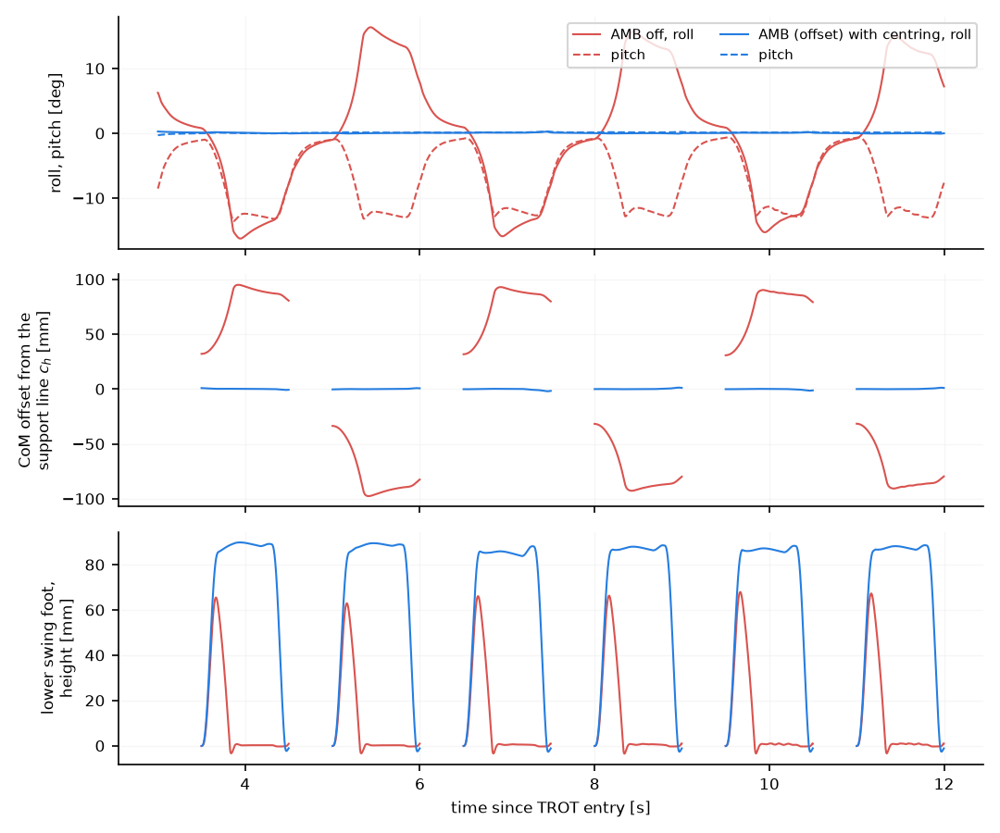

# Angular-momentum balancing inside the whole-body trot: static hold and trot in place

Generated 2026-11-27 16:59 from `reports/trot_amb/results.json`. Branch `amb-trot`. Simulated Go2, trot in place, whole-body path (`trot.wbc = true`). The controller's state input is simulator ground truth (attitude and position/velocity) on every run except the two marked filter runs. The attitude integral is on unless a row says otherwise.

## 1. Result

1. **AMB makes a slow trot in place possible, with one addition.** With two-foot phases of 0.75 to 2.0 s and a 0.5 s four-foot phase, every two-foot phase is a real two-foot stand and roll and pitch stay within 2.3 deg, in both realizations of AMB (Table 4). Without AMB the same gaits never stand on two feet: the body tips about 15 deg onto a swing foot in every phase, or falls.
2. **The addition is CoM centring in the four-foot phase.** The swing legs can only absorb a CoM that starts within about 3 mm of the support line (held from -3.1 to 2.7 mm, lost at 5.5 mm and at -6.0 mm; Table 2). On the trot's own footprint the CoM is 9.2 mm off each diagonal at the first lift-off. While all four feet are down, the body reference is therefore shifted until the CoM is over the next support line. Centring without AMB does not hold a phase; AMB without centring falls after 2.5 s.
3. **Both realizations work, and they are equivalent in quality.** The pass-through (thesis Eqs. 6.23, 6.26) needs the joint friction cancelled, as `MdlAMB` did; the reference offset does not.
4. **Limits.** It needs a four-foot phase of about 0.5 s (0.3 s and 0.2 s fall). A 0.1 s lateral push in the middle of a two-foot phase is survived up to 10 N / 10 N (offset, +y / -y) and 20 N / none (pass-through). With the attitude filter in the loop it falls after 7.2 s. Forward speed was not attempted.
5. **Two things had to change in the trot itself** before any of this could be measured: the swing has to leave the ground quickly (`swing_lift_time`), and AMB has to be back on the planned trajectory before the foot comes down (Section 3).

## 2. What was built

*Table 1. The pieces. All keys are in `[trot]`; the defaults leave the trot unchanged.*

| Piece | Where | What it does |
|---|---|---|
| Support pair as a parameter | `MdlAMB::geometry`, `robotMomentum`, `project` (`pair_t`) | The projection onto the support line for either diagonal. The second diagonal is ordered RL to FR: it is the mirror image of FL to RR, and reversing the line keeps every sign convention. Checked against the mirrored state in `test_trot_amb`. |
| `TrotAMB` | `TrotAMB.{hh,cc}`, called from `MdlTrot::_wbcTick` | The thesis law (`MdlAMB::ambLaw`, same template and gains) on the current stance pair in every two-foot phase, state reset at each phase. `amb`, `amb_mode`. |
| Mode `offset` | `TrotAMB::rotateReference` | The law's angular acceleration is integrated into a rotation of each planned swing-foot reference about its hip, axis parallel to the support line; returned to zero before the descent. |
| Mode `passthrough` | `MdlTrot::wbcSolve` (`amb_dir`, `amb_share`, `amb_acc`) | Thesis (6.23), (6.26): the swing task's error is removed along the tangential direction and the acceleration is a pure feedforward. Friction cancellation and joint PD off on that leg (6.28). |
| Swing lift time | `SwingTrajectory::sampleLifted`, `swing_lift_time` | The foot rises in a fixed time, holds, and comes down in the same time. |
| CoM centring | `MdlTrot::_wbcTick`, `amb_centre_tc` | In four-foot phases an integrator shifts the base position reference until the CoM is over the next support line. |

Settings of the runs below: `swing_lift_time = 0.2`, `wbc_touchdown_depth = 0.012` (Section 6), `amb_centre_tc = 0.3` where centring is on, law gains [950.0, 360.0, 41.0], template as `[amb]` (the centreline fit was not redone: it held), `amb_alpha_max = 0.9`, `amb_return = 0.15`.

Checks: `ctest` 100% tests passed, 0 tests failed out of 22 (22 with the new `test_trot_amb`; `test_trot_wbc` gained a pass-through case). With `amb = false` and the other new keys at their defaults, the default trot on both paths, a slow whole-body trot and the key-B `MdlAMB` balance log the same values tick for tick as before the work (compared on 2026-11-27 with the final binary).

## 3. Three findings on the way

1. **A long swing did not leave the ground.** The trot's clearance profile grows with the cube of the swing's progress: an 8 s swing is 0.7 mm up after 0.4 s. The foot scheduled to swing stayed on the ground, was loaded as the body began to tip (46 N for 70 ms measured) and kicked the body about the support line. The "two-foot phases" of the earlier baseline were three-foot phases: in Table 3 no phase of any gait without AMB counts as a two-foot stand.
2. **The CoM is not over the diagonals.** On the default footprint it is about 9 mm from each support line at the first lift-off, which is three times what the swing legs can absorb.
3. **A foot must not land with AMB's offset on it.** With the lift profile the descent starts before the touchdown; a foot that met the ground while still rotated by AMB landed 3 to 7 cm off its target. AMB now finishes its return before the descent begins.

## 4. Static hold on the trot's own footprint (step 1)

One two-foot phase of 8 s. The footprint is moved fore-aft (`trot.origin`) so the CoM starts at different distances from the support line; no centring.

*Table 2. Static hold against the CoM's starting offset from the support line. Held: neither swing foot came back to the ground and the body stayed within 10 deg.*

| Footprint origin x [mm] | CoM offset at lift-off [mm] | offset: held | offset: peak roll / pitch [deg] | offset: leg travel [deg] | pass-through: held | pass-through: peak roll / pitch [deg] | pass-through: leg travel [deg] |
|---|---|---|---|---|---|---|---|
| +0 | 9.2 | no | – | – | no | – | – |
| -5 | 5.5 | no | – | – | no | – | – |
| -9 | 2.7 | yes | 0.7 / 1.6 | 38 | yes | 0.7 / 1.1 | 36 |
| -13 | -0.2 | yes | 0.4 / 0.5 | 11 | yes | 0.3 / 0.2 | 8 |
| -17 | -3.1 | yes | – | 22 | yes | 0.4 / 0.5 | 26 |
| -21 | -6.0 | no | – | – | no | – | – |

The offset mode held the phase started at -3.1 mm and fell afterwards, at the stop. At the origin of -13 mm, AMB off tips onto a swing foot (17.1 / 19.0 deg, 0 of 1 held). The pass-through without friction cancellation falls after 6.4 s; with the cancellation it holds whether the swing joint PD is on (0.3 / 0.3 deg) or off (0.3 / 0.2 deg).

*Table 3. Both diagonals in one run on the default footprint, with centring: 8 s on one diagonal, 0.5 s on four feet, 8 s on the other.*

| Case | First diagonal | Outcome | Two-foot phases held | Peak roll / pitch [deg] | CoM offset at the lift-offs [mm] |
|---|---|---|---|---|---|
| centring only | FL-RR | no fall | 0 of 2 | 16.8 / 18.1 | 5.5, -9.9 |
| centring only | FR-RL | no fall | 0 of 2 | 16.8 / 18.1 | -5.5, 9.9 |
| offset | FL-RR | no fall | 2 of 2 | 1.0 / 1.0 | 5.5, 4.6 |
| offset | FR-RL | no fall | 2 of 2 | 1.0 / 1.0 | -5.5, -4.6 |
| passthrough | FL-RR | falls after 6.3 s | 0 of 1 | – | 5.5 |
| passthrough | FR-RL | falls after 6.7 s | 0 of 1 | – | -5.5 |

The first lift-off comes 0.5 s after TROT entry, when the centring has brought the CoM from 9 to 5.5 mm only. The offset mode absorbed that start here; the pass-through did not. In the gait runs below, with shorter phases, both get through the first phase.

## 5. Trot in place with long two-foot phases (step 2)

*Table 4. Four-foot phase 0.5 s. Nothing: AMB and centring off, same lift profile.*

| Two-foot phase [s] | Case | Outcome | Two-foot phases held | Peak roll / pitch [deg] | Roll / pitch rms [deg] | CoM offset rms [mm] | Leg travel [deg] |
|---|---|---|---|---|---|---|---|
| 0.75 | nothing | falls after 8.6 s | 0 of 7 | – | – | 84.0 | – |
| 0.75 | centring only | falls after 4.6 s | 0 of 4 | – | – | 76.8 | 7 |
| 0.75 | offset | no fall | 12 of 12 | 0.4 / 0.6 | 0.10 / 0.14 | 0.8 | 15 |
| 0.75 | passthrough | no fall | 12 of 12 | 0.6 / 0.5 | 0.12 / 0.10 | 0.7 | 16 |
| 1.00 | nothing | no fall | 0 of 10 | 16.4 / 15.6 | 9.37 / 8.91 | 76.6 | – |
| 1.00 | centring only | falls after 13.0 s | 0 of 9 | – | – | 72.1 | 7 |
| 1.00 | offset | no fall | 10 of 10 | 0.3 / 0.4 | 0.08 / 0.12 | 0.5 | 14 |
| 1.00 | passthrough | no fall | 10 of 10 | 0.5 / 0.4 | 0.12 / 0.11 | 0.6 | 14 |
| 1.50 | nothing | no fall | 0 of 8 | 14.5 / 15.7 | 8.50 / 10.61 | 77.4 | – |
| 1.50 | centring only | no fall | 0 of 8 | 17.2 / 17.9 | 9.32 / 11.24 | 67.7 | 10 |
| 1.50 | offset | no fall | 8 of 8 | 0.7 / 1.4 | 0.09 / 0.15 | 0.5 | 9 |
| 1.50 | passthrough | no fall | 8 of 8 | 0.9 / 1.6 | 0.11 / 0.17 | 0.5 | 11 |
| 2.00 | nothing | no fall | 0 of 8 | 14.4 / 16.9 | 8.73 / 11.37 | 78.2 | – |
| 2.00 | centring only | no fall | 0 of 8 | 16.7 / 18.0 | 9.53 / 12.63 | 69.3 | 12 |
| 2.00 | offset | no fall | 8 of 8 | 1.0 / 1.9 | 0.13 / 0.25 | 1.2 | 31 |
| 2.00 | passthrough | no fall | 8 of 8 | 1.3 / 2.3 | 0.21 / 0.32 | 1.3 | 42 |



*Figure 1. Two-foot phase 1.0 s, four-foot phase 0.5 s. Without AMB the body tips until a swing foot is back on the ground (height 0) in every phase. With AMB and centring the swing feet stay up and the CoM stays on the support line.*

*Table 5. Variants of the 1.0 s / 0.5 s gait, AMB in offset mode.*

| Variant | Outcome | Two-foot phases held | Peak roll / pitch [deg] | Roll / pitch rms [deg] |
|---|---|---|---|---|
| as Table 4 | no fall | 10 of 10 | 0.3 / 0.4 | 0.08 / 0.12 |
| no centring | falls after 2.5 s | 0 of 2 | – | – |
| four-foot phase 0.3 s | falls after 3.5 s | 1 of 3 | – | – |
| four-foot phase 0.2 s | falls after 2.8 s | 1 of 3 | – | – |
| attitude integral off | no fall | 10 of 10 | 0.3 / 0.4 | 0.07 / 0.08 |
| attitude integral off, two-foot 1.5 s | no fall | 8 of 8 | 0.7 / 1.4 | 0.08 / 0.13 |
| position/velocity filter in the loop | no fall | 10 of 10 | 0.9 / 0.8 | 0.25 / 0.21 |
| both filters in the loop | falls after 7.2 s | 3 of 5 | – | – |

The attitude integral does not disturb AMB: with it off the result is the same or slightly smoother. The position/velocity filter in the loop costs a factor of two to three in rms; the attitude filter's noise is not tolerated.

*Table 6. Lateral 0.1 s push at the base CoM in the middle of a two-foot phase (t = 11.304 s), in 10 N steps to the first fall.*

| Case | Largest push survived, +y [N] | Largest push survived, -y [N] | Note |
|---|---|---|---|
| nothing | 90 | 150 (sweep cap) | stands on three feet in every phase, pushed or not |
| offset | 10 | 10 | all phases held at the surviving force |
| passthrough | 20 | – |  |

A two-foot stand held by the swing legs has a small basin: 1 to 2 N s. The trot without AMB shrugs off far larger pushes because it is already leaning on a third foot.

## 6. Baseline without AMB, and the touchdown depth (step 0)

*Table 7. The trot as it was before this work (AMB off, default swing profile, 8 mm touchdown depth), attitude integral on.*

| Two-foot phase [s] | four-foot 0.0 s | four-foot 0.2 s | four-foot 0.5 s |
|---|---|---|---|
| 0.50 | no fall, peak 2.6 / 1.8 deg | no fall, peak 6.3 / 5.8 deg | no fall, peak 8.8 / 6.6 deg |
| 0.75 | falls after 2.9 s | falls after 7.2 s | falls after 6.5 s |
| 1.00 | falls after 12.6 s | falls after 13.9 s | no fall, peak 22.3 / 14.6 deg |
| 1.50 | falls after 9.8 s | no fall, peak 16.7 / 15.3 deg | no fall, peak 16.9 / 15.7 deg |
| 2.00 | no fall, peak 25.4 / 14.8 deg | no fall, peak 19.1 / 15.1 deg | no fall, peak 17.2 / 15.6 deg |

At least one column falls at two-foot phases of 0.75, 1.00, 1.50 s; the runs that do not fall survive by resting on a swing foot. No phase in this table is a two-foot stand. Touchdown depth on the 1.0 s / 0.5 s gait with AMB: 3 mm: falls after 15.0 s; 8 mm: no fall, rms 0.09 / 0.14 deg; 12 mm: no fall, rms 0.08 / 0.12 deg. 12 mm is used; the 3 mm run fell at the stop.

## 7. Departures from the thesis and from the plan

1. Mode `offset` replaces Eqs. (6.23) and (6.28): the tangential references are the integrated motion, not the measured one, and the joint PD stays on. Its PD share of the tangential acceleration was 0.11 m/s<sup>2</sup> rms against 2.45 m/s<sup>2</sup> of feedforward on the headline gait.
2. The second diagonal is ordered RL to FR, not RF to LH as in Sec. 6.3.1.
3. CoM centring and the swing lift time are not in the thesis. The centring has the role `MdlDiagonalStance` has before `MdlAMB`.
4. The template was not refitted for the trot posture: the centreline parameters held every case here.
5. The stop key is placed in a four-foot phase. A stop during a long two-foot phase can fall (seen at the 3 mm depth and after one static hold); the stop ramp takes AMB's authority away with the lift scale.

## 8. Open

1. Four-foot phases shorter than 0.5 s: the centring integrator (0.3 s) does not converge in time, and 0.1 s is unstable against the base position task.
2. The small push basin and the attitude-noise failure; both are the swing legs' authority.
3. Forward speeds (step 3): the body shift used by the centring is not what a moving trot wants; foot placement relative to the CoM is the natural replacement.
4. Two-foot phases of 0.5 s: with a 0.2 s lift and descent AMB has no window left (`amb_min_swing`).

## 9. Reproduce

```bash
cd /home/ege/legged/iros/project
cmake --build build -j 12 && cmake --install build && (cd build && ctest)
/home/ege/legged/iros/.venv/bin/python figs/trot_amb/run_experiments.py     # all runs, 15 min
cd bin && ./sim.sh -c "trot.wbc = true" -c "trot.amb = true" -c "trot.amb_centre_tc = 0.3" \
  -c "trot.swing_lift_time = 0.2" -c "trot.wbc_touchdown_depth = 0.012" \
  -c "trot.forward_velocity = 0.0" -c "trot.period = 3.0" -c "trot.duty = 0.6666667"   # S, T, D
```
