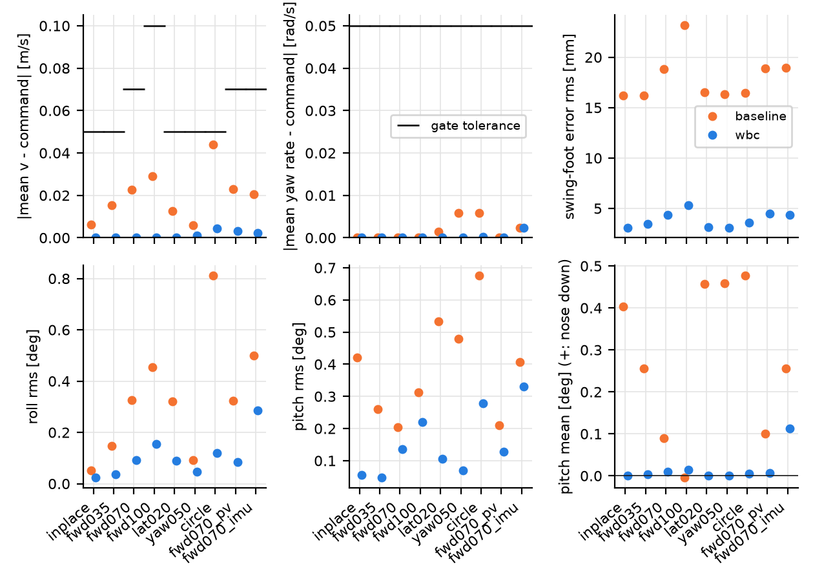
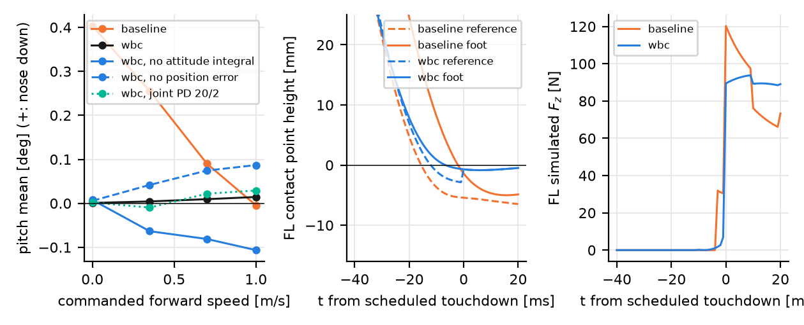
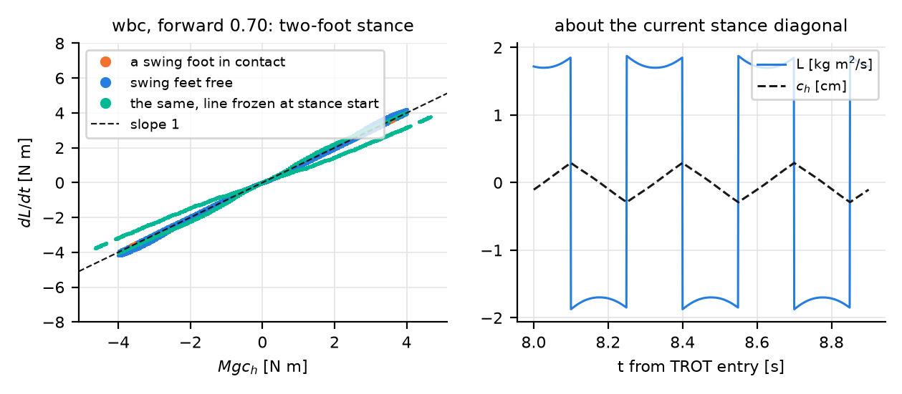
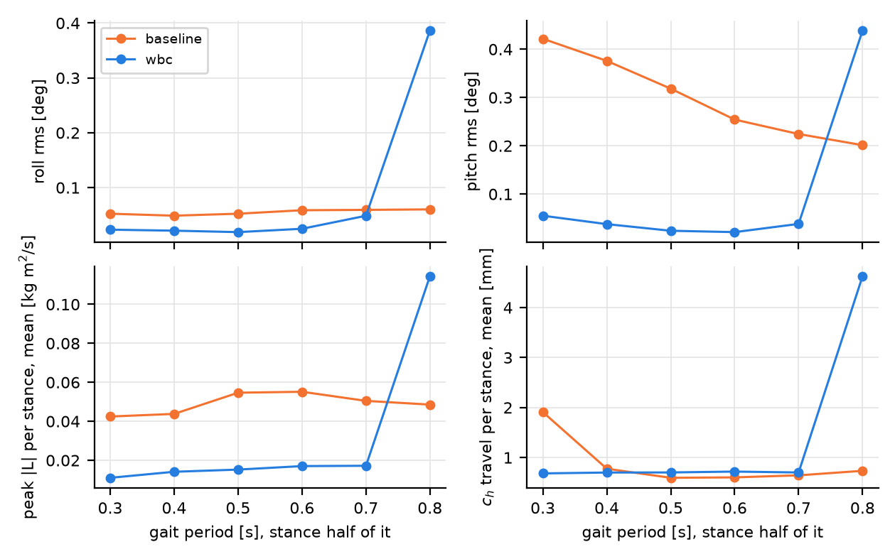

# Whole-body impulse-control trot on the Go2: verification

*Simulation only (MuJoCo, Unitree Go2). Results: `reports/trot_wbc/results.json`, written 2026-11-27 15:03 by `figs/trot_wbc/run_experiments.py` (189 simulator runs, 20 min); logs under `runs/trot_wbc/`. Every number below is read from results.json.*

## 1. What this is and the outcome

`[trot] wbc = true` replaces MdlTrot's per-leg commands (J<sup>T</sup>f on stance legs, a Cartesian PD on swing legs) by whole-body impulse control after Kim, Di Carlo, Katz, Bledt and Kim (2019). The convex MPC's first-step forces, the body reference and the swing samples become a task hierarchy and a QP that lets the floating base give way, and every joint gets the resulting torque plus a joint PD. The default stays `false`. Each run below exists for the unchanged per-leg trot ('baseline') and for the WBC. Outcome: the tests, old path, trots, tracking, health, duty and attitude gates pass. The WBC's velocity error is at or below the baseline's in 9 of 9 core runs and its pitch oscillation (sd) is smaller in 9. The controller is judged on the simulator's own state (attitude, position and velocity from ground truth), so that estimator error does not enter the comparison; two runs put the filters in the loop (Sec. 3.5). An integrator on the MPC's roll and pitch reference (`wbc_attitude_integral_gain`, as in Kim's released code, not in the paper) holds the mean attitude: the mean pitch is within 0.01 deg in every ground-truth core run, against up to 0.16 deg without it (Sec. 3.2). Nothing of angular-momentum balancing (AMB) is in the trot; Sec. 4 records, without a gate, the quantities a later AMB study needs.

*Table 1. Gates. Criterion, result and value as stored in results.json.*

| Gate | Criterion | Result | Value |
|---|---|---|---|
| tests | all ctest tests pass, test_trot_wbc among them: (i) four feet at rest keep consistent forces and get the static torques; (ii) diagonal stance holds the contact points, solved forces inside the pyramid and normal bounds; (iii) with the body off its reference the swing joint references and acceleration command are the body-frame ones; (iv) swing joints accelerate as the body-frame law asks, in a flight phase too, where the base falls freely | pass | 21/21 passed, test_trot_wbc passed |
| old path | wbc absent: the default trot run's log text-identical, sample for sample, to the pre-work baseline over the samples both hold (the new run logs every tick and is matched at the baseline's 10-tick stride from its first sample, because the log thread starts and stops on wall-clock-dependent ticks); AMB ablation (figs/amb_wbc, --only ablation) unchanged against the committed reports/amb_wbc/results.json | pass | 1346 of the baseline's 1346 samples identical; AMB ablation: 114 per-run values, 26 differ, gate pass before and pass now |
| trots | every core run, both modes: no fall, no module ERROR, stop completes to the sit | pass | all 18 runs clean |
| tracking | WBC mode: mean velocity within max(10 %, 0.05 m/s), yaw rate within max(10 %, 0.05 rad/s); roll rms, pitch rms, velocity error (and yaw-rate error where commanded) at most 1.5x the baseline's, or the cause of a miss measured | pass | all within |
| health | WBC mode, every core run: 0 QP failures, 0 fallback ticks (closing line and log), torque-saturated ticks below 1 % | pass | 0 QP failures, 0 fallback ticks over 143982 ticks (logged: 0 fallback, 0 nonzero QP status); 0 saturated ticks; tick mean 59.9-61.1 us, max 185.0 us against the 1000 us period |
| duty | duty 0.3 to 0.7 at the default period, in place and forward, both modes: no fall, no module ERROR, stop completes; WBC mode: 0 QP failures, 0 fallback ticks (below 0.5 the gait has a flight phase, which the whole-body path must solve) | pass | all 28 runs clean; 0 QP failures, 0 fallback ticks over 223972 WBC ticks |
| attitude | WBC mode, every ground-truth core and duty run: \|mean roll\| and \|mean pitch\| at most 0.05 deg over the steady window (the attitude integral) | pass | 21 runs: largest \|mean roll\| 0.007 deg, \|mean pitch\| 0.014 deg; largest MPC pitch reference 2.08 deg |

*Table 2. Core runs, baseline / WBC, steady window (simulator truth). |Δv|: mean body-frame velocity minus command; |Δω|: mean yaw rate minus command; ratios WBC ÷ baseline, bold above the 1.5x rule.*

| Run | \|Δv\| [m/s] (tolerance) | \|Δω\| [rad/s] | Roll rms [deg] | Ratio | Pitch rms [deg] | Ratio | Pitch mean [deg] (+ nose down) | Velocity error ratio |
|---|---|---|---|---|---|---|---|---|
| in place | 0.006 / 0.000 (0.05) | 0.000 / 0.000 | 0.05 / 0.02 | 0.44x | 0.42 / 0.06 | 0.13x | +0.40 / +0.00 | 0.00x |
| forward 0.35 | 0.015 / 0.000 (0.05) | 0.000 / 0.000 | 0.15 / 0.04 | 0.25x | 0.26 / 0.05 | 0.18x | +0.26 / +0.00 | 0.00x |
| forward 0.70 | 0.023 / 0.000 (0.07) | 0.000 / 0.000 | 0.33 / 0.09 | 0.28x | 0.20 / 0.14 | 0.66x | +0.09 / +0.01 | 0.01x |
| forward 1.00 | 0.029 / 0.000 (0.10) | 0.000 / 0.000 | 0.45 / 0.15 | 0.34x | 0.31 / 0.22 | 0.70x | -0.00 / +0.01 | 0.01x |
| lateral 0.20 | 0.013 / 0.000 (0.05) | 0.001 / 0.000 | 0.32 / 0.09 | 0.28x | 0.53 / 0.11 | 0.20x | +0.46 / +0.00 | 0.01x |
| yaw 0.5 rad/s | 0.006 / 0.001 (0.05) | 0.006 / 0.000 | 0.09 / 0.05 | 0.50x | 0.48 / 0.07 | 0.15x | +0.46 / +0.00 | 0.19x |
| circle 0.35 m/s, 0.5 rad/s | 0.044 / 0.004 (0.05) | 0.006 / 0.000 | 0.81 / 0.12 | 0.15x | 0.68 / 0.28 | 0.41x | +0.48 / +0.01 | 0.10x |
| forward 0.70, pos/vel filter | 0.023 / 0.003 (0.07) | 0.000 / 0.000 | 0.32 / 0.09 | 0.26x | 0.21 / 0.13 | 0.61x | +0.10 / +0.01 | 0.14x |
| forward 0.70, both filters | 0.020 / 0.002 (0.07) | 0.002 / 0.002 | 0.50 / 0.29 | 0.57x | 0.41 / 0.33 | 0.82x | +0.26 / +0.11 | 0.10x |

## 2. The formulation and what was built

Kim et al. split the controller in three. A convex MPC on a single rigid body plans the ground reactions over a horizon; only its first-step forces f<sub>MPC</sub> go down. A task hierarchy, rebuilt every tick from the scheduled contacts, stacks the contact constraint, body orientation, body position and one position task per swing foot by null-space projection: a kinematic stage (pseudo-inverse) gives joint references q<sub>des</sub>, q̇<sub>des</sub>, an acceleration stage (dynamically consistent inverse) gives q̈<sub>cmd</sub>. A QP then corrects the floating-base acceleration (δ<sub>fb</sub>, 6) and the forces (δ<sub>f</sub>) so that the six floating-base rows of the dynamics hold, with the friction pyramid on f<sub>MPC</sub> + δ<sub>f</sub>; weighting the base lightly (0.1) against the forces (1.0) lets the body give way and keeps the MPC's forces, the 'impulse' idea. Finally τ = A q̈ + b + g − J<sub>c</sub><sup>T</sup>f goes to every joint with a joint PD on q<sub>des</sub>, q̇<sub>des</sub>. A trot stance uses all 18 degrees of freedom (3 n<sub>c</sub> + 3 + 3 + 3 (4 − n<sub>c</sub>)), so no null space is left.

*Table 3. Where each piece lives. Only the per-leg command block of MdlTrot's TROT/STOPPING tick is replaced; gait clock, footstep law, swing quintic, body reference, MPC call and state machine are shared by both modes.*

| Piece | Here | Code |
|---|---|---|
| MPC → f<sub>MPC</sub> | MdlConvexMPC unchanged: horizon 15 × 10 ms, re-solved on every contact change; first-step world forces | `MdlTrot::_trotDuring` |
| State | R, ω from MdlOrientationEstimator; base position and velocity from MdlPosVelEstimator, moved from the CoM back to the base origin (in the runs here both modules hand out simulator truth, Sec. 3) | `MdlTrot::_wbcTick` |
| Model | floating-base Go2, 18 DoF: A, b + g, contact and foot Jacobians | `QuadrupedDynamics` (Go2 config) |
| Contacts | scheduled stance legs (no touchdown detection, as Kim); rolling contact points one foot radius below the foot centres | `MdlTrot::wbcSolve` |
| Tasks | body orientation (R<sub>z</sub>(desired yaw), yaw-rate command; 100/10), base position (MdlTrot's CoM reference less the CoM offset, commanded velocity; 100/10), one per swing foot (body-frame swing quintic; 100/10); zero reference acceleration on the body tasks | `MdlTrot::wbcSolve` |
| Hierarchy, QP | Kim Eq. (16)–(21), (25); weights 0.1 / 1.0; friction and normal bounds copied from [mpc] | `QuadrupedWBC` (qpOASES; changed only to solve flight, Sec. 3.7) |
| Joint command | τ + PD 30/3 on every leg; the request is clipped per joint to the Go2 limits; the closing line counts the clipped ticks | `MdlTrot::_wbcTick` → `MdlLegControl::setJointCommand` |

1. **Switch and keys.** `[trot] wbc` (default `false` in trot.toml and MdlTrot.hh): T trots as before until it is flipped. `wbc_kp_*` / `wbc_kd_*` (ori, pos, foot), `wbc_w_base`, `wbc_w_force`, `wbc_joint_kp` / `wbc_joint_kd`, `wbc_touchdown_depth`, `wbc_attitude_integral_gain` / `_input` / `_limit`, all read in init().
2. **Failure handling.** A tick without a solution (QP failure, unusable joint state) uses the per-leg commands; `command_failure_limit` (3) such ticks in a row is a module ERROR. A torque request beyond the limits is capped and nothing else: the abort after 20 saturated ticks in a row (`torque_saturation_limit`) was removed from both paths, because under a push it ended a trot that was not falling and the sit that followed could roll the robot over.
3. **Go2 only.** The floating-base model carries the Go2 inertias; for another `robot_model` init() warns and keeps the per-leg path.
4. **Log.** `MdlTrot_wbc` (45 doubles: MPC-desired and WBIC-solved force per leg, QP status, orientation and position task errors, swing errors p<sub>B,des</sub> − p<sub>B</sub>, fallback flag, tick time; layout at `_logWbc` in MdlTrot.hh). deactivate() prints tick mean / max, QP failures, fallback and saturated ticks.
5. **Test.** `test_trot_wbc` checks `MdlTrot::wbcSolve` on the Go2 model without the simulator: (i) four feet at rest keep statically consistent forces and get the static torques; (ii) diagonal stance at random states holds the contact points with forces inside the pyramid and normal bounds; (iii) with the body off its reference, the swing joint references and the swing acceleration command are the body-frame ones; (iv) swing joints accelerate as the body-frame law asks.

## 3. Results

Each run is one headless, non-real-time `bin/sim.sh` call with the Supervisor key script 0 s, 2.5 t, 19.3 d (stand, T, D): 15 s in MdlTrot's TROT state, then the normal stop to the sit. Logs at 1000 Hz (every control tick). Steady window: TROT entry + 2.0 s ramp-up + 1.0 s to the stop key at 19.3 s. Fall: base z below 0.16 m or |roll|, |pitch| above 45 deg from TROT entry to the end of centering (or to the ERROR tick). The controller's state input is simulator ground truth in every run, attitude and base position/velocity alike (`orientationestimator.use_ground_truth = true`, `posvelestimator.use_ground_truth = true`; the filters keep running in shadow), so no estimator error enters the feedback; only the two filter runs of Sec. 3.5 differ. The reported torso state, velocities, ground reactions, CoM and L are simulator truth as well; MPC, WBIC and swing quantities are MdlTrot's log ('ctrl'). Torque limits: 23.7 / 23.7 / 45.43 N m (abduction, hip, knee). Leg order of the simulated ground reactions is fixed by MdlSimDriver's lookup of the foot geoms by name (FL, FR, RL, RR); the desired and simulated F<sub>z</sub> of each leg correlate at 0.99 and across the two diagonals they anti-correlate, which checks the sign and the diagonal pairing (within a diagonal the two legs move together, so the correlation cannot tell them apart). The logged ground reactions are good to about 1 N: over the steady window their sum differs from what the CoM's momentum rate and gravity require by (+0.5, -0.0, -0.4) N baseline fwd070; (-0.1, -0.0, -0.0) N wbc fwd070; (+0.0, +0.0, -0.2) N baseline inplace; (+0.0, +0.0, -0.0) N wbc inplace.

### 3.1 Core runs

*Table 4. Velocity and drift, baseline / WBC. Lateral drift: displacement normal to the heading at the window start, less the commanded lateral travel; 'from heading': the part a change of heading carries (forward velocity off the initial heading); straight runs only.*

| Run | Mean v<sub>x</sub> [m/s] | Mean v<sub>y</sub> [m/s] | Mean ω [rad/s] | Lateral drift [m] | From heading [m] | Yaw change [deg] |
|---|---|---|---|---|---|---|
| in place | -0.006 / 0.000 | 0.000 / -0.000 | -0.000 / 0.000 | -0.000 / -0.000 | -0.000 / 0.000 | -0.07 / 0.00 |
| forward 0.35 | 0.335 / 0.350 | -0.000 / 0.000 | -0.000 / 0.000 | -0.004 / 0.001 | -0.000 / 0.001 | -0.06 / 0.01 |
| forward 0.70 | 0.677 / 0.700 | -0.000 / 0.000 | -0.000 / 0.000 | -0.007 / 0.001 | -0.001 / 0.001 | -0.05 / 0.01 |
| forward 1.00 | 0.971 / 1.000 | -0.001 / 0.000 | -0.000 / 0.000 | -0.012 / 0.003 | -0.004 / 0.003 | -0.05 / 0.02 |
| lateral 0.20 | -0.003 / 0.000 | 0.188 / 0.200 | 0.001 / -0.000 | -0.147 / -0.000 | -0.000 / 0.000 | 0.87 / -0.03 |
| yaw 0.5 rad/s | -0.006 / -0.000 | 0.002 / 0.001 | 0.494 / 0.500 | – / – | – / – | – / – |
| circle 0.35 m/s, 0.5 rad/s | 0.334 / 0.348 | 0.041 / 0.004 | 0.494 / 0.500 | – / – | – / – | – / – |
| forward 0.70, pos/vel filter | 0.677 / 0.703 | -0.003 / -0.001 | -0.000 / 0.000 | -0.037 / -0.004 | -0.001 / 0.002 | -0.05 / 0.02 |
| forward 0.70, both filters | 0.680 / 0.701 | 0.005 / 0.002 | -0.002 / -0.002 | -0.040 / -0.100 | -0.097 / -0.122 | -1.50 / -1.54 |

*Table 5. Attitude and height, baseline / WBC. Height target: MdlTrot's CoM reference less the CoM offset.*

| Run | Roll mean [deg] | Roll sd [deg] | Pitch mean [deg] | Pitch sd [deg] | Height − target [mm] | Height sd [mm] |
|---|---|---|---|---|---|---|
| in place | -0.00 / -0.00 | 0.05 / 0.02 | +0.40 / +0.00 | 0.12 / 0.06 | +3.5 / +0.3 | 0.51 / 0.56 |
| forward 0.35 | +0.00 / -0.00 | 0.15 / 0.04 | +0.26 / +0.00 | 0.05 / 0.05 | +4.2 / +0.1 | 0.55 / 0.61 |
| forward 0.70 | +0.00 / -0.00 | 0.33 / 0.09 | +0.09 / +0.01 | 0.18 / 0.14 | +4.5 / -0.1 | 0.63 / 0.68 |
| forward 1.00 | +0.00 / -0.00 | 0.45 / 0.15 | -0.00 / +0.01 | 0.31 / 0.22 | +4.8 / -0.3 | 0.74 / 0.74 |
| lateral 0.20 | +0.25 / -0.00 | 0.21 / 0.09 | +0.46 / +0.00 | 0.27 / 0.11 | +3.4 / +0.4 | 0.54 / 0.63 |
| yaw 0.5 rad/s | +0.04 / +0.00 | 0.08 / 0.05 | +0.46 / +0.00 | 0.13 / 0.07 | +3.5 / +0.4 | 0.55 / 0.61 |
| circle 0.35 m/s, 0.5 rad/s | -0.78 / -0.00 | 0.24 / 0.12 | +0.48 / +0.01 | 0.48 / 0.28 | +3.9 / +0.5 | 0.54 / 0.68 |
| forward 0.70, pos/vel filter | +0.01 / -0.00 | 0.32 / 0.09 | +0.10 / +0.01 | 0.19 / 0.13 | +4.6 / -0.7 | 0.63 / 0.66 |
| forward 0.70, both filters | -0.39 / -0.27 | 0.31 / 0.10 | +0.26 / +0.11 | 0.32 / 0.31 | +4.2 / -0.4 | 0.93 / 0.76 |

Both modes track every command; the WBC's mean velocity error stays at or below 0.004 m/s (baseline up to 0.044) and its yaw-rate error at or below 0.002 rad/s. The WBC holds the commanded base height (-0.7 to 0.5 mm from the target), while the baseline rides 3.4–4.8 mm above it. Its roll and pitch oscillate less (sd), and the attitude integral holds its mean roll and pitch at zero (Sec. 3.2). The two filter runs are in Sec. 3.5.



*Fig. 1. Core runs: velocity and yaw-rate error with the gate tolerance, swing-foot error, roll and pitch rms, pitch mean. Orange: baseline, blue: WBC.*

### 3.2 The pitch offset and the attitude integral

As Kim's paper has it, the controller holds a steady pitch that depends on the gait and the speed: +0.01 / -0.06 / -0.08 / -0.11 deg in place / 0.35 / 0.70 / 1.00 m/s, and up to -1.21 deg in a gait with a flight phase (Sec. 3.7). The common cause is structural: the MPC answers a tilt with a moment in proportion and nothing integrates the attitude error, so every steady moment the MPC's rigid-body model lacks leaves a steady tilt; the rest of this section and Sec. 3.7 measure two such moments. Kim's released controller meets this with an integrator on the MPC's roll and pitch reference (`rpy_int`, `rpy_comp` in ConvexMPCLocomotion.cpp). `wbc_attitude_integral_gain` (0.5; the reference is bounded at 0.05 rad) does the same here: at the end of each gait cycle that share of the cycle's mean tilt is moved into the MPC's reference, against the tilt, while the whole-body tasks keep the level reference. Theirs is continuous and scaled by speed; this one is not scaled, because the tilt exists in place too, and it steps once per cycle so that the tilt the gait repeats never enters and the correction slows with the cadence. Table 6: the mean pitch falls to within 0.01 deg on ground truth, the oscillation (sd) is unchanged or smaller, and the reference the MPC needs reaches 1.98 deg. With a filter in the loop the integral zeroes the estimated tilt, so the true one keeps the filter's bias. A continuous integrator at 2 /s, tried first, held the mean as well at the 0.3 s gait but rocked the body at 0.6 Hz from a 0.7 s period on (roll rms 0.44 deg against 0.05); a per-cycle gain of 1.0 does the same from 0.5 s on (check runs, 2026-11-27). A cycle's mean tilt counts only up to `wbc_attitude_integral_input` (0.01 rad): taken whole, the tilt of a push recovery ran the reference to its bound within a cycle, and a 155 N lateral push then failed where the trot without the integral recovers up to 160 N (Sec. 4.3).

*Table 6. The attitude integral, WBC runs: without / with. Mean and sd of the true pitch over the steady window, roll rms, and the MPC's mean pitch reference with the integral.*

| Run | Pitch mean [deg] | Pitch sd [deg] | Roll rms [deg] | MPC pitch reference [deg] |
|---|---|---|---|---|
| in place | +0.01 / +0.00 | 0.06 / 0.06 | 0.02 / 0.02 | -0.01 |
| forward 0.35 | -0.06 / +0.00 | 0.05 / 0.05 | 0.04 / 0.04 | +0.11 |
| forward 0.70 | -0.08 / +0.01 | 0.14 / 0.14 | 0.10 / 0.09 | +0.15 |
| forward 1.00 | -0.11 / +0.01 | 0.22 / 0.22 | 0.17 / 0.15 | +0.21 |
| lateral 0.20 | +0.02 / +0.00 | 0.11 / 0.11 | 0.10 / 0.09 | -0.04 |
| yaw 0.5 rad/s | +0.03 / +0.00 | 0.07 / 0.07 | 0.05 / 0.05 | -0.04 |
| circle 0.35 m/s, 0.5 rad/s | +0.16 / +0.01 | 0.35 / 0.28 | 0.64 / 0.12 | -0.09 |
| forward 0.70, pos/vel filter | -0.16 / +0.01 | 0.13 / 0.13 | 0.11 / 0.09 | +0.28 |
| forward 0.70, both filters | +0.15 / +0.11 | 0.41 / 0.31 | 0.49 / 0.29 | -0.06 |
| duty 0.40, 0.00 m/s | -0.22 / +0.00 | 0.12 / 0.12 | 0.08 / 0.07 | +0.36 |
| duty 0.30, 0.00 m/s | -0.72 / +0.01 | 0.25 / 0.25 | 0.24 / 0.25 | +1.24 |
| duty 0.40, 0.35 m/s | -0.48 / -0.01 | 0.13 / 0.11 | 0.15 / 0.13 | +0.77 |
| duty 0.30, 0.35 m/s | -1.21 / -0.00 | 0.21 / 0.17 | 0.27 / 0.19 | +1.98 |

**Mechanism at speed, measured without the integral.** The kinematic stage moves the base by the base-position task error with no gain, so every leg's q<sub>des</sub> absorbs that error, and the 30/3 joint PD turns it into a force at the feet outside the QP and outside the MPC's plan. The error (reference − position, along the heading) grows with speed: -0.2 / 5.6 / 8.7 / 11.3 mm in place / 0.35 / 0.70 / 1.00 m/s. Three runs isolate the path (Table 7). Holding the horizontal body reference on the measured position (`trot.position_reference_clamp = 1e-6`, diagnosis only) removes the error and turns the offset around: pitch mean +0.01 / +0.04 / +0.07 / +0.09 deg against +0.01 / -0.06 / -0.08 / -0.11 deg. With the position task's gains at zero (`trot.wbc_kp_pos = 0, trot.wbc_kd_pos = 0`) the offset stays (-0.08 deg at 0.70 m/s), so the task's acceleration is not the path; the joint PD on the shifted q<sub>des</sub> is. The baseline with the same clamp is identical to its core run: its MPC weights horizontal position 0 and has no other position feedback, so the clamp changes nothing else. Whether stance or swing legs carry most of the push is not separated; the clamp changes the swing error too.

**Where the error comes from.** On ground truth the body runs at the commanded speed (0.700 m/s at 0.70) and trails its position reference by a steady 9 mm; the MPC's net forward plan on the stance feet is -0.4 / -1.6 / -2.4 / -3.2 N (in place to 1.00 m/s). Why this lag settles where it does is not established (hypothesis: the MPC, which weights forward velocity 1 and horizontal position 0, plans a small braking force and the error settles where the PD's push balances it). With the position/velocity filter in the loop the error is larger (14 mm at 0.70 m/s) and so is the offset (-0.16 deg), because the filter's position advances 3.7 mm/s slower than its own velocity estimate (baseline run 3.6 mm/s): the position task holds the estimated position on the reference, and the body then runs at 0.7033 m/s (Sec. 3.5).

**Size and the baseline's own offset.** Moving the MPC's CoM belief forward (`mpc.com_offset_body x + 2 mm`, -0.30 N m about the true CoM, in place) measures the static pitch stiffness: 2.2 N m/deg in the baseline, 3.3 N m/deg with the WBC, so a few tenths of a N m the MPC does not model move the pitch by a tenth of a degree. The baseline has its own offset in place (+0.40 deg) that the WBC does not (+0.01 deg): its stance forces miss the plan by +1.86 N m about the CoM, and the stance legs' own gravity torque, which the per-leg τ = J<sup>T</sup>(−f) leaves out and the WBC's inverse dynamics carries, accounts for +0.82 N m of it (J<sup>−T</sup>g(q) at the contacts; that this sets the offset is a hypothesis). With speed the baseline's pitch mean falls towards zero (+0.40 / +0.26 / +0.09 / -0.00 deg), which is why its pitch rms is smallest at speed.

**A softer joint PD, rejected.** `trot.wbc_joint_kp = 20, trot.wbc_joint_kd = 2` pushes less per mm of error (pitch mean +0.02 / +0.03 deg at 0.70 / 1.00 m/s), but the swing error grows in 9 of 9 runs (Table 7) and pitch rms rises in in place; lateral 0.20; yaw 0.5 rad/s; circle 0.35 m/s, 0.5 rad/s; forward 0.70, both filters. It weakens the path instead of removing the error, so the plan's 30/3 stays.

*Table 7. Pitch-offset diagnosis, WBC runs with the attitude integral off: the core run, the same with the base position error held at zero ('no pos.'), and with joint PD 20 / 2 ('PD 20/2'). Logs in diagnosis/.*

| Run | Pitch mean [deg]: baseline / WBC / no pos. / PD 20/2 | Pitch rms ÷ baseline: WBC / no pos. / PD 20/2 | \|Δv\| [m/s]: WBC / no pos. / PD 20/2 | Swing rms [mm]: WBC / no pos. / PD 20/2 | Position error [mm]: WBC / PD 20/2 |
|---|---|---|---|---|---|
| in place | +0.40 / +0.01 / +0.01 / +0.00 | 0.13 / 0.13 / 0.16 | 0.000 / 0.000 / 0.000 | 3.1 / 3.1 / 4.3 | -0.2 / -0.5 |
| forward 0.35 | +0.26 / -0.06 / +0.04 / -0.01 | 0.30 / 0.24 / 0.17 | 0.000 / 0.004 / 0.000 | 3.5 / 3.4 / 4.9 | 5.6 / 6.4 |
| forward 0.70 | +0.09 / -0.08 / +0.07 / +0.02 | 0.78 / 0.78 / 0.66 | 0.000 / 0.006 / 0.000 | 4.3 / 4.2 / 6.2 | 8.7 / 9.9 |
| forward 1.00 | -0.00 / -0.11 / +0.09 / +0.03 | 0.79 / 0.78 / 0.71 | 0.000 / 0.009 / 0.000 | 5.3 / 5.1 / 7.6 | 11.3 / 13.2 |
| lateral 0.20 | +0.46 / +0.02 / +0.01 / +0.02 | 0.21 / 0.23 / 0.28 | 0.000 / 0.004 / 0.000 | 3.2 / 3.1 / 4.4 | -0.5 / -1.2 |
| yaw 0.5 rad/s | +0.46 / +0.03 / +0.02 / +0.04 | 0.16 / 0.16 / 0.19 | 0.001 / 0.002 / 0.001 | 3.1 / 3.1 / 4.3 | -0.7 / -1.2 |
| circle 0.35 m/s, 0.5 rad/s | +0.48 / +0.16 / +0.17 / +0.28 | 0.57 / 0.52 / 0.62 | 0.006 / 0.015 / 0.007 | 3.5 / 3.5 / 4.9 | -0.3 / -2.5 |
| forward 0.70, pos/vel filter | +0.10 / -0.16 / +0.09 / -0.07 | 0.98 / 0.80 / 0.68 | 0.003 / 0.008 / 0.003 | 4.4 / 4.2 / 6.3 | 14.0 / 16.9 |
| forward 0.70, both filters | +0.26 / +0.15 / +0.27 / +0.28 | 1.08 / 1.02 / 1.26 | 0.002 / 0.007 / 0.001 | 4.3 / 4.2 / 6.1 | 7.2 / 6.2 |



*Fig. 2. Left: pitch mean against forward speed for the baseline, the WBC (black), and the WBC without the attitude integral: as built, with no base position error and with joint PD 20 / 2. Middle and right: FL around its scheduled touchdown at 0.70 m/s, averaged over the steady window's touchdowns: swing reference and contact-point height (a loaded foot sinks a few mm into MuJoCo's soft contact), and simulated F<sub>z</sub>. The WBC foot lands when its reference passes through the ground (Sec. 3.4).*

### 3.3 Force tracking

*Table 8. Ground reaction over scheduled stance, rms per axis x / y / z [N], leg-samples pooled: MPC desired against simulated for both modes, and for the WBC desired against WBIC-solved and solved against simulated.*

| Run | Desired − simulated, baseline | Desired − simulated, WBC | Desired − solved, WBC | Solved − simulated, WBC |
|---|---|---|---|---|
| in place | 4.5/2.4/10.8 | 3.1/1.6/7.3 | 0.3/0.1/0.2 | 2.8/1.5/7.3 |
| forward 0.35 | 6.8/2.4/12.0 | 2.6/1.5/7.2 | 0.3/0.2/0.3 | 2.3/1.5/7.1 |
| forward 0.70 | 9.4/2.9/13.9 | 3.4/2.0/8.1 | 0.6/0.4/0.5 | 3.0/1.9/7.9 |
| forward 1.00 | 12.4/3.8/17.2 | 4.4/2.6/9.5 | 0.8/0.5/0.7 | 3.9/2.4/9.2 |
| lateral 0.20 | 4.6/4.1/11.5 | 3.0/2.7/6.8 | 0.4/1.1/0.6 | 2.6/2.0/6.6 |
| yaw 0.5 rad/s | 3.9/4.0/10.8 | 2.4/2.3/6.9 | 0.3/0.3/0.3 | 2.1/2.1/6.9 |
| circle 0.35 m/s, 0.5 rad/s | 5.3/5.3/12.9 | 4.2/4.1/9.7 | 0.9/0.9/0.8 | 3.5/3.4/9.8 |
| forward 0.70, pos/vel filter | 9.3/2.9/13.8 | 4.4/2.3/8.1 | 0.6/0.5/0.6 | 4.1/2.0/7.9 |
| forward 0.70, both filters | 9.1/2.9/13.6 | 4.6/3.1/8.8 | 0.6/0.8/0.7 | 4.2/2.6/8.7 |

The QP keeps the MPC's forces (desired − solved 0.3–1.1 N rms on the worst axis), as Kim's weighting intends. Most of what separates the simulated force from the plan arises after the QP: solved − simulated is nearly the whole desired − simulated difference. The joint PD (Sec. 3.2), the touchdown transient (Sec. 3.4) and MuJoCo's soft contact all enter there. The MPC's summed vertical force at 0.70 m/s is 127 / 150 N (baseline / WBC) against a weight of 149 N; why the baseline's plan is below the weight was not investigated.

### 3.4 Swing tracking, touchdown timing and torque

The WBC tracks the swing reference more closely than the per-leg Cartesian PD (18.9 / 4.4 mm rms at 0.70 m/s, baseline / WBC). The per-leg path's touchdown target is the nominal footprint's height. The stand sags about 10 mm under its joint PD, so the trot holds the body lower than that footprint assumes and the target lies 7–8 mm below the ground; the baseline's foot lags 6–7 mm behind its reference and touches 0–8 ms early. With the same target the WBC, which tracks closely, followed its reference into the ground: 12–15 mm deep, first contact 21–26 ms early at 1.31–1.48 m/s, braking 0.14–0.38 N s per touchdown (run before the fix). The WBC path therefore aims `wbc_touchdown_depth` (3 mm, Kim's value) below the height the foot lifted off from, in the body frame (Table 10). Its reference now ends 3.3–3.5 mm below the ground and the foot first touches 1–7 ms early at 0.03–0.18 m/s (baseline 0.91–1.12), with at most 6 N before the scheduled touchdown (baseline 22–35) and no braking (-0.00–0.01 N s per touchdown). Torque stays below the limits in every core run of both modes (peak |τ|/limit at most 0.71).

*Table 9. Swing and touchdown, baseline / WBC. Swing error p<sub>B,des</sub> − p<sub>B</sub> (ctrl, body frame). Loaded: simulated F<sub>z</sub> above 5 N. First contact: how long the foot has been in contact (above 0.5 N, unbroken) when its scheduled swing ends, mean over touchdowns. Peak |τ|/limit: the WBC's is WBIC torque plus joint PD, before the clip.*

| Run | Swing rms [mm] | Swing max [mm] | Swing samples loaded [%] | Stance samples unloaded [%] | First contact before schedule [ms] | Peak \|τ\|/limit | WBC tick mean / max [µs] |
|---|---|---|---|---|---|---|---|
| in place | 16.2 / 3.1 | 24.2 / 5.5 | 3.7 / 0.0 | 0.00 / 0.00 | 5.5 / 1.0 | 0.49 / 0.47 | 60.1 / 160 |
| forward 0.35 | 16.2 / 3.5 | 25.1 / 5.6 | 4.7 / 0.0 | 0.00 / 0.00 | 5.5 / 1.5 | 0.49 / 0.47 | 59.9 / 154 |
| forward 0.70 | 18.9 / 4.4 | 30.4 / 6.1 | 4.0 / 0.3 | 0.00 / 0.00 | 4.5 / 3.5 | 0.50 / 0.53 | 61.0 / 116 |
| forward 1.00 | 23.2 / 5.3 | 37.3 / 7.6 | 3.3 / 0.7 | 0.01 / 0.00 | 2.5 / 5.6 | 0.56 / 0.71 | 60.8 / 136 |
| lateral 0.20 | 16.5 / 3.2 | 25.3 / 5.7 | 4.2 / 0.0 | 0.01 / 0.00 | 5.0 / 0.8 | 0.49 / 0.47 | 60.7 / 185 |
| yaw 0.5 rad/s | 16.3 / 3.1 | 25.5 / 5.5 | 4.7 / 0.0 | 0.00 / 0.00 | 5.3 / 1.0 | 0.49 / 0.47 | 60.2 / 135 |
| circle 0.35 m/s, 0.5 rad/s | 16.4 / 3.6 | 27.1 / 6.3 | 5.1 / 1.8 | 0.16 / 0.36 | 5.0 / 2.4 | 0.49 / 0.47 | 61.1 / 115 |
| forward 0.70, pos/vel filter | 18.9 / 4.5 | 30.5 / 6.3 | 4.7 / 0.3 | 0.00 / 0.00 | 5.5 / 3.3 | 0.49 / 0.54 | 60.7 / 168 |
| forward 0.70, both filters | 18.9 / 4.3 | 31.8 / 6.7 | 5.4 / 0.5 | 0.00 / 0.00 | 6.1 / 3.2 | 0.47 / 0.56 | 61.0 / 150 |

*Table 10. Touchdown detail, means over the steady window's scheduled touchdowns (TD). Reference: the swing reference's contact-point height. Through ground and first contact: how long before the scheduled TD, front / rear legs. Swing feet F: mean forward force on the scheduled-swing feet (the logged sum is off by up to 0.5 N along x, Sec. 3).*

| Mode, run | Reference at TD [mm] | Through ground [ms] | First contact [ms] | Reference at contact [mm] | Foot v<sub>z</sub> [m/s] | Peak F<sub>z</sub> early / after [N] | Impulse [N s] | Swing feet F [N] |
|---|---|---|---|---|---|---|---|---|
| baseline, in place | -7.9 | 19 / 15 | 8 / 3 | -7.3 | -0.91 | 32 / 120 | -0.11 | -1.5 |
| baseline, forward 0.70 | -7.2 | 15 / 17 | 3 / 6 | -6.7 | -1.04 | 35 / 133 | -0.09 | -1.4 |
| baseline, forward 1.00 | -6.6 | 13 / 18 | 0 / 5 | -6.3 | -1.12 | 22 / 145 | -0.05 | -0.9 |
| wbc, in place | -3.4 | 13 / 13 | 1 / 1 | -3.4 | -0.03 | 1 / 96 | -0.00 | -0.0 |
| wbc, forward 0.70 | -3.5 | 12 / 14 | 5 / 2 | -3.3 | -0.09 | 4 / 98 | 0.00 | +0.0 |
| wbc, forward 1.00 | -3.3 | 10 / 15 | 7 / 4 | -2.7 | -0.18 | 6 / 98 | 0.01 | +0.1 |
| WBC no pos., forward 0.70 | -3.6 | 12 / 14 | 5 / 2 | -3.4 | -0.09 | 4 / 99 | 0.00 | +0.0 |

### 3.5 Filters in the loop

Every run above feeds the controller the simulator's state. Two more runs at 0.70 m/s put the filters in the loop: the position/velocity Kalman filter alone (`posvelestimator.use_ground_truth = false`), and that filter together with the Mahony attitude filter on the simulated noisy IMU (Table 11). With the position/velocity filter and no attitude integral the WBC's nose-up pitch grows from -0.08 to -0.16 deg (with the integral: +0.01 deg) and its mean speed from 0.700 to 0.703 m/s: the filter's position advances 3.7 mm/s slower than its own velocity estimate, the base-position task holds that position on the reference, so the body runs ahead of the command and the joint PD pushes on the shifted joint references (Sec. 3.2). The baseline, which has no position feedback, hardly changes. With both filters the two robots turn by -1.50 / -1.54 deg over the window (ground truth -0.05 / 0.01): the controller holds the estimated heading, so the same turn in both modes points to the attitude filter's yaw drift.

*Table 11. Forward 0.70 m/s with the controller's state from ground truth and from the filters, baseline / WBC (measured on simulator truth).*

| State input | Mean v<sub>x</sub> [m/s] | \|Δv\| [m/s] | Roll rms [deg] | Pitch mean [deg] | Pitch rms [deg] | Pitch rms ratio | Yaw change [deg] |
|---|---|---|---|---|---|---|---|
| ground truth | 0.677 / 0.700 | 0.023 / 0.000 | 0.33 / 0.09 | +0.09 / +0.01 | 0.20 / 0.14 | 0.66x | -0.05 / 0.01 |
| pos/vel filter, true attitude | 0.677 / 0.703 | 0.023 / 0.003 | 0.32 / 0.09 | +0.10 / +0.01 | 0.21 / 0.13 | 0.61x | -0.05 / 0.02 |
| both filters, noisy IMU | 0.680 / 0.701 | 0.020 / 0.002 | 0.50 / 0.29 | +0.26 / +0.11 | 0.41 / 0.33 | 0.82x | -1.50 / -1.54 |

### 3.6 Timing

Over the core runs the WBC ran 143982 ticks with 0 QP failures, 0 fallback ticks and 0 torque-saturated ticks (closing lines); the log shows no fallback flag and no nonzero QP status, and no run printed a warning. Tick time (model terms, tasks and QP): mean 59.9–61.1 µs, max 185 µs, against the 1 ms period; headless and not real time, so this is CPU cost, not a real-time guarantee.

### 3.7 Duty factor: overlap and flight

The gait clock takes any duty factor. At the default 0.3 s period a duty above 0.5 overlaps the two diagonals on four feet; below 0.5 no foot is scheduled down for (0.5 − duty) · period per half cycle, a flight phase. Kim's controller covers flight inside the same hierarchy and so does this one: with no contact all four feet are swing tasks (`QuadrupedWBC::MAX_TASKS` is 6), the QP has only the floating-base correction, so the base falls freely whatever the body tasks ask, and the legs keep following their swing references in the body frame. As first built the solver refused a problem without a contact, and the trot ended in a module ERROR at the first flight phase (found by Ege, 2026-11-27; fixed the same day). Table 12: every run completes, with 0 QP failures and 0 fallback ticks over 223972 WBC ticks. The robot leaves the ground for less than the schedule asks, because the feet lift off late and land early, and the WBC comes closer to the schedule than the baseline: at duty 0.30 and 0.35 m/s it is airborne 17 / 30 ms per half cycle (baseline / WBC) of the scheduled 60 ms. The WBC holds the commanded speed at every duty (0.349–0.350 m/s; baseline 0.328–0.335 m/s). Its base runs up to 12 mm below the commanded height. Without the attitude integral it carries a nose-up pitch that grows as the duty factor falls, to -1.21 deg at duty 0.30; with the integral the mean pitch at that duty is -0.00 deg (Table 6), for a pitch reference of +1.98 deg.

**Where that pitch comes from** (analysis of duty 0.35 logs without the integral and check runs of 2026-11-27, outside this script). The legs are 8.3 of the robot's 15.2 kg and all four knees bend the same way, so when the legs extend at push-off all four thighs turn together (2.2 rad/s) and carry pitch angular momentum. In place the robot leaves the ground with 0.11 kg m²/s nose-up about its CoM, of which the trunk holds 0.02. The MPC is a single rigid body fed the trunk's rate, so it sees almost none of it. In flight the legs stop extending and the trunk takes the momentum: its pitch rate goes from −4.5 to −13.8 deg/s with no foot on the ground (0.11 kg m²/s over the MPC's 0.488 kg m² is 13 deg/s). The rear feet then land first and the stance turns the trunk back, but not to zero before the next flight. Interventions at duty 0.35, pitch mean in place / at 0.35 m/s, from −0.37 / −0.88 deg: the MPC fed the whole-robot angular momentum over its inertia in place of the trunk rate (a temporary build) −0.02 / −0.64; the base-position error held at zero (Sec. 3.2's mechanism) – / −0.52; both – / −0.38. Not the cause: touchdown timing (a target 10 mm higher lands on time and doubles the pitch) and the MPC's 200 N force cap (the plan sits on it for 7 % of ticks; 400 N changes neither height nor pitch). About 0.4 deg at speed is not explained, nor is the height loss. Feeding the MPC the whole-robot momentum is not a fix by itself: at duty 0.5 and 0.35 m/s it moves the pitch from −0.06 to −0.30 deg. The attitude integral removes the mean whatever its source.

*Table 12. Duty factor at the 0.3 s period, baseline / WBC, ground-truth state. Scheduled phase: four-foot overlap or flight per half cycle. Airborne: mean time per half cycle with no foot in contact. Height: mean base height minus the commanded one. Saturated: share of samples with a torque request beyond the limit.*

| Duty | v<sub>x</sub> cmd [m/s] | Scheduled [ms] | Airborne [ms] | Mean v<sub>x</sub> [m/s] | Roll rms [deg] | Pitch mean [deg] | Pitch rms [deg] | Height [mm] | Sat. [%] |
|---|---|---|---|---|---|---|---|---|---|
| 0.70 | 0.00 | 60 four-foot | 0 / 0 | -0.006 / 0.000 | 0.15 / 0.08 | +0.76 / -0.00 | 0.78 / 0.11 | +4.5 / +0.7 | 0.0 / 0.0 |
| 0.60 | 0.00 | 30 four-foot | 0 / 0 | -0.006 / 0.000 | 0.08 / 0.02 | +0.55 / +0.00 | 0.57 / 0.06 | +3.8 / +0.3 | 0.0 / 0.0 |
| 0.50 | 0.00 | none | 0 / 0 | -0.006 / 0.000 | 0.05 / 0.02 | +0.40 / +0.00 | 0.42 / 0.06 | +3.5 / +0.3 | 0.0 / 0.0 |
| 0.45 | 0.00 | 15 flight | 0 / 0 | -0.007 / 0.000 | 0.04 / 0.04 | +0.41 / +0.00 | 0.42 / 0.06 | +1.4 / -1.6 | 0.0 / 0.0 |
| 0.40 | 0.00 | 30 flight | 0 / 9 | -0.008 / 0.000 | 0.08 / 0.07 | +0.38 / +0.00 | 0.40 / 0.12 | +0.6 / -3.4 | 0.0 / 0.0 |
| 0.35 | 0.00 | 45 flight | 7 / 20 | -0.009 / 0.000 | 0.07 / 0.13 | +0.55 / +0.00 | 0.56 / 0.12 | -3.9 / -9.7 | 0.1 / 0.1 |
| 0.30 | 0.00 | 60 flight | 23 / 35 | -0.007 / -0.001 | 0.15 / 0.25 | +0.60 / +0.01 | 0.64 / 0.25 | -2.0 / -10.6 | 5.0 / 3.5 |
| 0.70 | 0.35 | 60 four-foot | 0 / 4 | 0.330 / 0.350 | 0.05 / 0.05 | +0.48 / -0.00 | 0.49 / 0.10 | +5.7 / +0.4 | 0.0 / 4.0 |
| 0.60 | 0.35 | 30 four-foot | 0 / 0 | 0.332 / 0.350 | 0.11 / 0.08 | +0.22 / +0.00 | 0.24 / 0.08 | +4.6 / +0.1 | 0.0 / 0.0 |
| 0.50 | 0.35 | none | 0 / 0 | 0.335 / 0.350 | 0.15 / 0.04 | +0.26 / +0.00 | 0.26 / 0.05 | +4.2 / +0.1 | 0.0 / 0.0 |
| 0.45 | 0.35 | 15 flight | 0 / 0 | 0.332 / 0.350 | 0.19 / 0.06 | +0.02 / +0.00 | 0.04 / 0.05 | +1.9 / -2.0 | 0.0 / 0.0 |
| 0.40 | 0.35 | 30 flight | 0 / 6 | 0.332 / 0.350 | 0.25 / 0.13 | +0.06 / -0.01 | 0.17 / 0.11 | +1.1 / -3.8 | 0.0 / 0.0 |
| 0.35 | 0.35 | 45 flight | 3 / 16 | 0.328 / 0.350 | 0.20 / 0.12 | -0.04 / +0.00 | 0.06 / 0.10 | -3.8 / -10.5 | 5.7 / 0.1 |
| 0.30 | 0.35 | 60 flight | 17 / 30 | 0.330 / 0.349 | 0.16 / 0.19 | +0.05 / -0.00 | 0.10 / 0.17 | -1.9 / -12.1 | 5.9 / 3.0 |

## 4. Baselines for the AMB study (no gate)

L is the whole-robot angular momentum about the line through the two scheduled stance feet's ground contact points (the foot sphere's lowest point), c<sub>h</sub> the CoM's horizontal offset from that line (positive to the robot's left). With point feet fixed on the line the ground forces have no moment about it, so dL/dt = M g c<sub>h</sub>: the stance forces change L only by moving the CoM off the line, and the next touchdown replaces the line. These are the quantities an AMB term would regulate.

### 4.1 Support line in a normal trot

*Table 13. Per complete two-foot stance phase in the steady window, mean / max over the phases: peak |L|, peak |c<sub>h</sub>|, how far c<sub>h</sub> moves within the stance, how far the stance contact points roll; and the check dL/dt against M g c<sub>h</sub> (slope, correlation) on the samples whose swing feet carry no force, about the instantaneous line and, in brackets, the line frozen at stance start.*

| Mode, run | Phases | Peak \|L\| [kg m²/s] | Peak \|c<sub>h</sub>\| [mm] | c<sub>h</sub> travel [mm] | Contact travel [mm] | dL/dt check |
|---|---|---|---|---|---|---|
| baseline, in place | 78 | 0.042 / 0.043 | 2.9 / 2.9 | 1.9 / 1.9 | 2.4 / 2.4 | 1.02, 0.997 (0.58, 0.984) |
| baseline, forward 0.70 | 78 | 1.816 / 1.820 | 31.0 / 31.4 | 53.0 / 53.2 | 10.0 / 10.2 | 1.09, 0.988 (0.96, 0.979) |
| wbc, in place | 78 | 0.011 / 0.011 | 1.3 / 1.3 | 0.7 / 0.7 | 0.1 / 0.2 | 1.00, 0.993 (1.01, 0.990) |
| wbc, forward 0.70 | 78 | 1.875 / 1.878 | 29.0 / 29.1 | 57.8 / 58.0 | 7.7 / 7.8 | 1.02, 0.999 (0.90, 0.988) |

In place, L about the diagonal stays near 0.011–0.042 kg m²/s and the CoM within 1.3–2.9 mm of the line. At 0.70 m/s peak |L| is 1.82–1.87 kg m²/s and c<sub>h</sub> sweeps 53–58 mm across the line within each stance. The body moves forward over a diagonal that is oblique to the motion, so L about the line contains the moment of the forward momentum about it, and it is this large in a steady trot that does not fall. A controller that regulates L about the stance diagonal would therefore have to separate this gait-borne part at speed; in place it would work on a small quantity. dL/dt follows M g c<sub>h</sub> with a slope above 1 at speed because the rolling feet move the contact points (7.7–10.0 mm per stance); about the line frozen at stance start the slope is 0.90–0.96. Peak |L| depends on where the contact point is taken: about the line through MuJoCo's own contact positions (midway through the penetration) it is -0.5 % (baseline); -0.2 % (wbc) at 0.70 m/s, while c<sub>h</sub> does not change.



*Fig. 3. WBC, forward 0.70 m/s. Left: dL/dt against M g c<sub>h</sub> on two-foot stance. Right: L and c<sub>h</sub> about the current stance diagonal; L changes sign with the diagonal because the line's direction does.*

### 4.2 Cadence: prolonged diagonal support

In place, gait period 0.3 to 0.8 s at duty 0.5 (diagonal stance 0.15 to 0.40 s), each mode up to its first failure. Baseline: no period up to 0.8 s fails (no fall, no module ERROR, no saturated torque sample). WBC: no period up to 0.8 s fails (no fall, no module ERROR, no saturated torque sample). The failure boundary therefore lies beyond the sweep and was not searched. With longer stance both modes rock more about the diagonal: at 0.8 s peak |L| per stance is 0.049 / 0.114 kg m²/s and roll rms 0.06 / 0.39 deg (baseline / WBC), against 0.042 / 0.011 kg m²/s and 0.05 / 0.02 deg at 0.3 s. For a controller that regulates L about the stance diagonal, a slower cadence both lengthens the time it has per diagonal and enlarges the quantity it would regulate.

*Table 14. Cadence sweep, in place: roll / pitch rms [deg]; per stance mean peak |L| [kg m²/s] / peak |c<sub>h</sub>| [mm] / c<sub>h</sub> travel [mm]; peak |τ|/limit.*

| Period [s] | Baseline attitude | Baseline support line | Baseline τ | WBC attitude | WBC support line | WBC τ |
|---|---|---|---|---|---|---|
| 0.3 | 0.05 / 0.42 | 0.042 / 2.9 / 1.9 | 0.49 | 0.02 / 0.06 | 0.011 / 1.3 / 0.7 | 0.47 |
| 0.4 | 0.05 / 0.38 | 0.044 / 1.6 / 0.8 | 0.40 | 0.02 / 0.04 | 0.014 / 1.1 / 0.7 | 0.48 |
| 0.5 | 0.05 / 0.32 | 0.055 / 0.9 / 0.6 | 0.39 | 0.02 / 0.02 | 0.015 / 1.0 / 0.7 | 0.50 |
| 0.6 | 0.06 / 0.25 | 0.055 / 0.6 / 0.6 | 0.38 | 0.02 / 0.02 | 0.017 / 0.9 / 0.7 | 0.53 |
| 0.7 | 0.06 / 0.22 | 0.050 / 0.5 / 0.6 | 0.37 | 0.05 / 0.04 | 0.017 / 0.8 / 0.7 | 0.55 |
| 0.8 | 0.06 / 0.20 | 0.049 / 0.5 / 0.7 | 0.37 | 0.39 / 0.44 | 0.114 / 4.6 / 4.6 | 0.61 |



*Fig. 4. Cadence sweep: attitude rms and support-line quantities against the gait period. Orange: baseline, blue: WBC.*

### 4.3 Lateral pushes

In-place trot, one 0.1 s pulse at the base body's CoM along world ±y (the robot's left / right; the heading stays near zero in place), 27 gait cycles after TROT entry: at the FL–RR touchdown (12.403 s) or half a stance later (12.478 s). 20 N steps to the first failure, then 5 N steps up from the last success. A torque request beyond the limits is capped and the trot goes on (recovered pulses with a peak roll below 20 deg ask for up to 4.1 times the limit; in 4 recovered WBC pulses near the boundary, peak roll 27–45 deg, the uncapped request reaches hundreds of times the limit), so the first failure is a fall. These brackets are the balance boundary the AMB study needs. The WBC's boundary lies above the baseline's in 4 of 4 cases (Table 15).

*Table 15. Pushes: largest recovered / first failing pulse and how it failed.*

| Direction, phase | Baseline | WBC |
|---|---|---|
| +y, touchdown | 160 / 165 N, fall 0.99 s after the pulse | 185 / 190 N, fall 0.67 s after the pulse |
| +y, midstance | 155 / 160 N, fall 0.92 s after the pulse | 200 / 205 N, fall 4.30 s after the pulse |
| −y, touchdown | 140 / 145 N, fall 0.80 s after the pulse | 180 / 185 N, fall 0.60 s after the pulse |
| −y, midstance | 160 / 165 N, fall 0.75 s after the pulse | 185 / 190 N, fall 1.08 s after the pulse |

## 5. Departures from Kim et al.

1. **Footholds.** Not re-planned in world frame every tick: MdlTrot's body-frame footstep law and swing quintic stay, so both modes share them.
2. **Swing task frame.** Kim's swing task tracks a world-frame foot target. Here the kinematic stage carries the body-frame sample on the *desired* body and the acceleration stage commands the absolute acceleration of the body-frame sample with the body moving as the two body tasks command, so the swing joints see the leg-relative error the footstep law was tuned for. The plan said 'on the measured body'; on the measured body the joint PD, stiffer than the swing task, would track the body's own error with the swing leg.
3. **Joint PD.** 30/3 N m/rad on every leg, stance and swing (Kim's structure: one set of gains for both). Kim uses 3/0.3 on the 9 kg Mini Cheetah; 30/3 is the thesis' Go2 stance value, and the thesis gives swing joints none. On a lifted Go2 leg this PD is stiffer than the swing task, so it sets swing tracking, and on stance legs it pushes toward the shifted q<sub>des</sub> (Sec. 3.2).
4. **Rate.** The WBC runs on every 1 ms control tick (15998 ticks per run, one per ms of TROT and STOPPING); Kim runs it at 500 Hz.
5. **MPC.** Horizon 15 × 10 ms, re-solved on every contact change (Kim: about 10 × 26 ms at about 40 Hz); its moment arms use the foot centres, the WBC uses the contact points one foot radius lower.
6. **Not carried over.** No stance-foot Cartesian damping and no knee barrier (extras in Cheetah-Software's code, not in the paper).
7. **Attitude integral.** Not in the paper; Cheetah-Software has it on the MPC's roll and pitch reference, continuous, scaled by the body speed and switched off for pronking. Here it steps once per gait cycle on the cycle's mean tilt (gain 0.5, with an input limit against wind-up under a push), at any speed and in every gait, on the whole-body path only (Sec. 3.2).
8. **Robustness additions.** Go2-only guard; a tick without a solution falls back to the per-leg commands, with an ERROR after `command_failure_limit` in a row; the torque request is clipped to the Go2 limits. Kim has none of these.
9. **Logging.** The WBIC feedforward torque is not logged by itself: `MdlTrot_torquereq` is WBIC torque plus joint PD before the clip, so the WBC's peak |τ|/limit in Table 9 is that sum.

## 6. Open issues and limits

1. **The pitch offset is removed in the mean, not at its source** (attitude integral, Ege, 2026-11-27). The moments behind it are still there and the MPC's pitch reference carries them: +0.15 / +0.21 deg at 0.70 / 1.00 m/s, +1.98 deg at duty 0.30. The integral acts on the estimated attitude, so an attitude filter's bias stays in the true pitch (Sec. 3.5). Untested sources: horizontal position weight in the MPC (Cheetah-Software's MPC has one), or a position/velocity filter whose position agrees with its velocity.
2. **Hypotheses left open:** why a position lag remains on ground truth; stance against swing legs in the PD's push; the per-leg path's left-out leg gravity as the cause of the baseline's in-place offset; the MPC's summed vertical force below the weight; the baseline's side slip in the both-filters run.
3. **Touchdown depth at slow cadence.** The 3 mm of `wbc_touchdown_depth` suit the 0.3 s gait. With a long swing the body moves further before the foot arrives and 3 mm is too shallow: in place at a 0.8 s period the WBC's roll / pitch rms is 0.30 / 0.32 deg with 3 mm and 0.07 / 0.10 deg with 8 mm; at 1.0 s it is 1.40 / 1.24 deg against 0.22 / 0.19 deg (check runs on ground truth, 2026-11-26, outside this script). A slow-cadence study has to set this depth first, or the comparison measures it.
4. **Flight phases** (Sec. 3.7) run, but below duty 0.5 the WBC rides up to 12 mm low and the robot is airborne for at most about half the scheduled time. Of the pitch the attitude integral removes there, leg angular momentum the MPC does not see and the base-position error explain a little over half at speed; the rest, the height loss and the late lift-off are not explained.
5. **The push limit is not a clean boundary.** The sweep steps 20 N to the first failure and then 5 N, so it can step over an isolated failure: in check runs of 2026-11-27 (push to the left at FL-RR touchdown) the WBC recovered at 160, 180 and 185 N and fell at 170 and 190 N, with and without the attitude integral.
6. **Cadence boundary** not reached up to 0.8 s; a longer sweep would find where prolonged diagonal support fails.
7. **What the tests do not cover:** no check of the body tasks' error signs; the fallback and its ERROR never ran in simulation (0 fallback ticks).
8. **Limits.** Simulation only (MuJoCo, rolling sphere feet, soft contact); the state feedback is ground truth, with two filter-in-the-loop runs per mode at 0.70 m/s only; tick times are headless, not real time; logged ground reactions are good to about 1 N.
9. **AMB untouched.** figs/amb_wbc's ablation, re-run, gives the same verdict (pass → pass); 88 of 114 per-run values are equal; the others belong to joint_off, wbc_off, wbc_on only, whose 500 Hz logs started on the other tick parity than the reference runs', so their sampled peaks and event times move by one tick.

## 7. Reproduction

From the repository root. One simulator at a time: the script refuses to start while a `simulation` process runs, and serialises its runs on `runs/.simlock`, shared with figs/amb_wbc.

```bash
cd /home/ege/legged/iros/project
cmake --build build -j 12 && cmake --install build && (cd build && ctest --output-on-failure)
/home/ege/legged/iros/.venv/bin/python figs/trot_wbc/run_experiments.py        # all + report
/home/ege/legged/iros/.venv/bin/python figs/trot_wbc/run_experiments.py --only push   # a subset
/home/ege/legged/iros/.venv/bin/python figs/trot_wbc/run_experiments.py --out /tmp/x  # elsewhere
/home/ege/legged/iros/.venv/bin/python figs/trot_wbc/build_report.py           # report only
cd bin && ./sim.sh -c "trot.wbc = true"           # interactive: S stand, T trot, D stop
```

Experiments: tests, oldpath, amb_ablation, core, diagnosis (needs core's logs), duty, cadence, push. Logs go to `runs/trot_wbc/<experiment>/<mode>_<run>.mat` and `.log`; the old-path baseline is kept gzipped in `reports/trot_wbc/oldpath_baseline/`, since runs/ is not tracked. The harness shares figs/amb_wbc's lock, fall thresholds, foot radius, torque limits and MuJoCo model, with its own runner and loader (amb_wbc's hard-code the balance script). A key script instead of `supervisor.autorun_trot_duration` gives every run the same gait datum. The baseline logs the MPC forces and swing references in place of `MdlTrot_wbc` (a log line holds 127 doubles).
